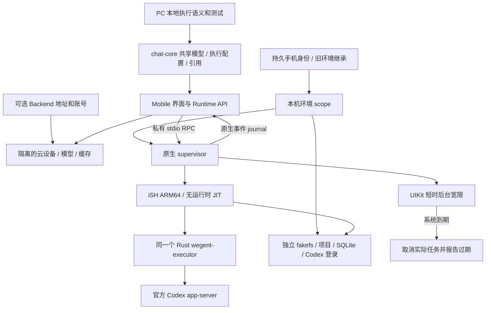

# 手机本地执行器

手机本地执行复用 PC Wework 的本地执行器、Codex app-server 和 Runtime RPC。
手机不注册一个虚拟云设备，也不把本地任务转交远端机器。当前嵌入实现面向
ARM64 iPhone；Android 需要独立的原生执行后端，不能将 iOS 验证结果当作 Android 支持证据。
模型请求仍由 Codex 按用户选择的 provider 和模型配置发出。

## 本机优先与可选后端

App 启动即进入现有任务列表，不以 Backend 登录作为入口条件。包含原生组件时自动准备
本机执行；可在“设置 → 本机执行”查看状态和重试。未登录 Backend 时隐藏“全部 / 这台手机”
设备筛选，新会话默认在手机上执行。已有会话保持原来的执行设备，新聊天页面保持现有布局。

“设置 → 模型与账号”提供官方 OpenAI 浏览器登录、显式设备码登录和自定义 Responses 模型。
自定义模型的 API Base URL、模型 ID、API Key 保存在本机安全存储；运行时配置和真实工具调用
连接测试复用 PC 实现，仅支持 Responses 协议。不会读取桌面 Codex 登录文件。

“设置 → 登录 Wegent”中配置 Backend 地址并完成现有授权后，才启用后端模型和授权云设备，
同时显示设备筛选。后端模型也可在手机执行；模型服务的位置与执行设备分开。

本机可用状态直接来自当前手机环境的原生 supervisor，独立于 Backend 设备请求；云端响应
和缓存恢复不能覆盖最新的本机状态。停止本机后，新建会话不能继续选择该设备。
设备合并和响应排序参照 PC `hybridServices.ts` 与 `useWorkbenchDataRefresh.ts`。

## 数据和进程所有权



- PC 对照入口是 `wework/electron/src/runtime/managed-executor-runtime.ts`、
  `runtime-supervisor.ts` 及 `runtime-supervisor.process-group.test.ts`。
  设备、工作区、任务和请求参数继续使用现有 executor 协议。
- 模型选择和执行权限来自 `packages/chat-core/src/local-runtime-model.ts`、
  `local-runtime-execution.ts`；编辑器引用来自 `runtime-composer-references.ts`。
- 手机文件系统、executor 数据目录、Codex 登录和本机模型属于持久手机身份。
  Backend 登录、退出或换账号不会切换本机根目录或停止本机任务。浏览器和设备码登录使用官方 app-server 协议，完成通知需要同时匹配
  登录 ID 和进程 generation；旧进程的登录结果不能覆盖新进程状态。
- transcript 持久化由 executor 负责。原生事件 journal 只补偿 JS 暂停期间的通知，
  不替代任务历史，也不能跨本机环境回放。
- 升级时只继承原环境，不移动、删除或合并旧根；未确定身份且发现多个旧环境时，在
  “设置 → 本机执行”显式选择。原生发现接口只读合法根目录元数据，不读取认证和聊天内容。
- 云端 HTTP、Socket.IO、设备缓存和文件预览按 Backend 地址与用户隔离。账号变化撤销旧请求、
  连接和远端文件缓存，保留本机预览与阅读位置。缓存恢复完成前不写入该 scope，防止空状态覆盖离线数据。

## 锁屏与前台恢复

锁屏会暂停 App 的周期性内存采样。guest 恢复分配时，如果样本已超过 2 秒，内存准入会
同步查询宿主的真实内存状态，再应用原有的压力、余量和滞回规则。定时器尚未恢复不代表
内存不足；宿主查询失败、无效读数、真实内存压力和超出总额度的申请仍会拒绝分配。
同步查询不能打印内核日志或获取 guest 锁，因为调用方可能已经持有内存或 syslog 锁。

iOS 挂起期间可能回收 TCP 监听端点。真机记录显示 `accept` 连续返回宿主 `EAGAIN`，
请求管道没有积压但所有 RPC 都超时；使用相同 executor 的宿主故障注入进一步确认，
监听端点同时报告 `POLLHUP` 时，Tokio 的永久关闭就绪状态会让 accept future 空转，
阻塞同一服务的请求处理。仅注入 `EAGAIN` 或 `ECONNABORTED` 不能复现完整停滞。

真机的就绪事件还依赖查询掩码：同一个失效监听器只查询 `POLLIN` 时返回 0，查询
`POLLIN | POLLOUT | POLLPRI` 时返回 `POLLHUP`。因此恢复判断和 guest 就绪返回必须
处理同一次完整采样，不能先以窄掩码检查、再独立查询并返回另一组事件。accept 检查同样
使用完整掩码。重建成功后丢弃旧端点的事件，由更新后的 reactor 等待新端点连接。

嵌入层为 TCP 监听端点启用恢复：在宿主关闭事件进入 guest reactor 或执行 accept 前，
按成功记录的地址、实际端口、backlog、socket 选项与文件标志重建监听端点，保留 guest
打开文件身份和宿主 fd 编号。描述符 generation 变化使每个 poll/epoll 后端重新注册，
清理旧边沿状态；已触发的 ONESHOT 仍等待 guest 显式 rearm。guest 主动成功 shutdown
的监听端点不恢复，恢复失败保留真实错误，不无限重试。这一平台适配不改变 PC 的 RPC、
任务身份或事件协议，也不重启整个执行环境。

`regress_listener_recovery.c` 使用宿主故障注入覆盖 IPv4/IPv6、连续两次回收、多个 poll、
dup 注册、ONESHOT、端口/选项/标志保留、恢复后实际连接，以及失败可见性。此测试与真实
executor/HTTP 恢复探针属于宿主验证，不能替代 iPhone 锁屏与流式输出验收。

恢复等待队列按一次阻塞调用注册线程，返回后无条件注销，不能按 poll 集合中的 socket
数量引用计数。其他线程可以在等待期间通过 epoll_ctl 或 close 改变集合；分别遍历等待前后
的集合会漏注销，线程释放后留下失效节点，使监听器恢复循环持锁并阻塞所有 RPC。
`regress_poll_waiters.c` 在真实宿主等待边界同步两条线程，覆盖添加、删除和替换监听集合，
确保等待返回及线程释放前队列已清理；未修复的内核在此回归上确定性失败。

运行环境不得根据空闲时长结束 guest 进程。Codex app-server 可以长期等待 stdin；锁屏也会使单调时钟继续前进而 guest 没有活动。旧 iSH 的 poll 超时分支会在 60 秒无活动后调用 `do_exit_group(0)`，且仍持有 poll 锁，导致最后一个线程在文件描述符清理时永久等待已退出线程的锁。已删除此空闲退出策略，保留显式退出和信号处理。`regress_idle_poll.c` 将真实 guest 的进度时间置为 120 秒前，验证有界等待后进程存活、后续事件交付及显式关闭；旧库确定性失败，新库通过。

历史读取失败与成功读取空历史保持区分。失败仍只更新侧栏头像的重试标记，保留已有消息；
首次读取未成功时不显示新会话引导或“暂无消息”。只有成功读取空历史才显示空状态。

App 回到前台时，先等待尚在进行的原生停止过程，再确保原本请求运行的本机环境已启动，
最后恢复事件日志和活动会话 transcript。此流程不重发用户消息，也不刷新项目或会话列表。
主动停止会撤销运行意图；切换环境或卸载旧 JS 实例会取消等待中的启动，不能让旧环境复活。
启动或停止失败保留明确错误，不伪造“已就绪”。恢复启动屏障对照 PC 的
`wework/src/desktop/localExecutor.ts` 和 `wework/src/api/local/localServices.runtimeReadiness.test.ts`。

运行状态不代表请求通道健康。原生层在前台/网络变化与请求超时时记录管道未读字节数、
guest `accept` 调用与失败计数、最近的宿主 errno 和 guest PID，以及监听器恢复成功/失败计数和恢复 errno；诊断只读取计数和字节数，
不消费管道、不记录请求或响应内容。锁屏恢复仍须通过真机请求和增量输出验证，不能仅凭
状态为 `running` 或 TCP 能连接就判定恢复成功。

## 停止和显式切换本机环境

退出 Wegent 只撤销云连接。下列进程排空流程仅用于停止本机运行时，或在“设置 → 本机执行”
明确确认切换保留的本机环境；后端账号变化不触发此流程。

```mermaid
sequenceDiagram
    participant UI as Mobile
    participant N as Native supervisor
    participant G as Guest threads
    participant F as Mounted fakefs
    UI->>N: 停止当前本机环境
    N->>G: 关闭 IPC / guest SIGTERM
    opt 仍有活线程
        N->>G: guest SIGKILL
    end
    G->>G: 每个线程自己释放 mm / files / fs
    G-->>N: 最后线程退出，leader 可 wait
    N->>N: native count = 0；join；reap
    alt 全部清理完成
        N->>F: 卸载旧环境，挂载所选环境
    else 超时或清理失败
        N-->>UI: 明确失败，保留旧环境边界
    end
```



不能把“主进程退出”当作“所有子进程和宿主线程都结束”。兼容补丁删除了上游
`do_exit_group` 的超时强制移除活线程、延迟释放和伪造退出逻辑。活线程继续留在进程组；
只有最后一个线程完成自己的资源释放后，leader 才能成为可回收 zombie。
线程退出前清除 TLS `current`，避免父进程回收 task 后，pthread cleanup 再访问它。

原生入口在创建 pthread 前计数，创建失败回滚计数，在最外层 cleanup 最后减计数。
未归零时禁止切换挂载。停止超时必须可见，不能改写成成功，也不能调用宿主 `_exit()`
或用宿主信号杀掉整个 App。启动、解压、登录和停止错误只使本机能力不可用，远端功能仍应可打开。

## 执行权限边界

本机模式的文件范围由 App 沙箱和当前本机环境挂载决定。它不提供完整 Linux 内核的
namespace、seccomp 或 Landlock 隔离。

挂载表由原生宿主管理。guest 的 `mount` / `umount` 一律返回 `EPERM`，防止通过
`real` 文件系统挂载宿主路径，或留下跨环境的共享挂载；宿主的 fakefs、proc 和 devpts
初始化不受影响。明确指向手机的附件在环境未就绪或不匹配时必须失败，不能改走 Backend 上传。

同一本机环境中的任务不具有工作区级安全隔离。完整访问能够读取该环境其他项目和
Codex 认证文件；API Key 的原始配置保存在 Keychain，但执行时仍需交给 guest 中的运行时。
因此不能将不可信仓库脚本当作受限沙盒任务运行。模拟器与 App 共用宿主进程，原生崩溃或
极端内存压力仍可能终止整个 App；内存监控不等于进程级故障隔离，也不提供磁盘或 CPU 配额。

固定版本的官方 Codex `0.167.0` 可在此环境中运行；其受限 Linux sandbox 不能工作：

- `readOnly` 和 `workspaceWrite` 命令返回失败，不能自动转换成更高权限。
- 官方附带的 bubblewrap `--version` 可以运行；最小隔离命令
  `bwrap --ro-bind / / --unshare-user --unshare-pid -- /bin/true` 实测失败于
  `prctl(PR_SET_NO_NEW_PRIVS)`，返回 `EINVAL`。
- 固定 iSH 源码没有对应的完整 namespace / seccomp 实现，`clone` 的允许标志也不包含
  namespace 创建标志。将这些调用伪实现为成功会造成错误的安全保证。
- 命令执行验证使用显式 `dangerFullAccess`。产品必须让用户明确选择与此能力相符的权限，
  不能声称只读或工作区隔离已经生效。

上游依据：
[Linux PR_SET_PDEATHSIG](https://man7.org/linux/man-pages/man2/PR_SET_PDEATHSIG.2const.html)、
[PR_GET_PDEATHSIG](https://man7.org/linux/man-pages/man2/PR_GET_PDEATHSIG.2const.html)、
[固定 iSH 源码](https://github.com/OpenMinis/ish-arm64/tree/0fd17a135e78b7a0cf08a4f5831217bbb76ed22f)。

## 固定源码与构建

`wework-mobile/modules/wework-local-runtime/native/ish-source-lock.json` 锁定上游 revision、
补丁、许可证、探针 Alpine 镜像及 Codex npm 包的 SHA-256。源码准备脚本校验这些输入，
对已有目录核对完整已应用补丁，拒绝混用其他 revision 或本地修改。

```bash
uv run --no-project python \
  wework-mobile/modules/wework-local-runtime/scripts/prepare-ish-source.py \
  --output /external/ish-source

node wework-mobile/scripts/build-local-executor.mjs \
  --repo "$PWD" --output /external/executor-cache

uv run --no-project python wework-mobile/scripts/build-local-runtime-ios.py \
  --source /external/ish-source \
  --rootfs /external/clean-rootfs.tar.gz \
  --rootfs-sha256 VERIFIED_ROOTFS_SHA256 \
  --executor /external/executor-cache/wegent-executor \
  --output /external/ios-runtime --link-module
```

executor 工具链固定为 Rust `1.94.1`、Zig `0.15.2`、cargo-zigbuild `0.23.0`、
OpenSSL `3.5.9`；使用 `--openssl-archive` 可提供已下载的归档，仍需通过脚本的哈希校验。
iSH 使用 `guest_arch=arm64`、`engine=asbestos`、`jit=true`、`jit_emit=false`。
其中 `jit=true` 选择带 AOT 支持的引擎，`jit_emit=false` 禁止生成运行时可执行代码。

生产 rootfs 是显式传入并校验哈希的独立制品，包含 Alpine、bash、git、CA 证书和
官方 Codex 完整资源目录；构建脚本再加入本次 Rust executor。不能从开发者的活跃 rootfs
直接复制 `meta.db`：fakefs 的 inode 映射与宿主文件关联，移动后可能损坏软链接。
使用上游 `fakefsify` / `unfakefsify` 导入导出，并在独立目录验证。交付归档的 `/root`
和 `/tmp` 必须为空，不包含探针、日志、账号或会话文件。

大文件、工具链缓存、静态库、rootfs、日志和设备安装制品放在仓库外。模块 `vendor`
只是本机构建生成的链接，不能提交。

## 针对性验证

`native/tests` 提供 22 项 guest C 断言：父线程退出通知、fork/exec/身份切换语义、
阻塞管道读写退出、快慢读路径的 `EINTR` / `SA_RESTART`、保留 zombie 与活 worker 的
`/proc/<pid>/stat`。额外宿主探针故意阻塞 native worker 超过上游旧超时，验证进程不能被
提前 wait/reap；worker 真正退出后，计数才归零并允许回收。
宿主探针还验证已构造并加载程序、但 native thread 尚未启动的 child 能完整回滚，
释放描述符、注销 PID，并继续创建下一 child。

```bash
uv run --no-project python \
  wework-mobile/modules/wework-local-runtime/scripts/test-ish-runtime.py \
  --ish /external/ish-source/build-host/ish \
  --fakefsify /external/ish-source/build-host/tools/fakefsify \
  --rootfs-archive /external/alpine-minirootfs-3.21.0-aarch64.tar.gz \
  --output /external/probe-results \
  --native-source /external/ish-source
```

每次使用新输出目录，避免覆盖账号文件系统；结果写入 `results.json`。宿主探针要求
Apple ARM64；不传 `--native-source` 时只运行 guest 断言。脚本同时校验 guest 自己的
退出码和断言数量，因为上游 CLI 的 PID 1 halt 路径可能把 guest 失败转换成宿主退出码 0。

macOS ARM64 上已验证无 JIT iSH、上述针对性探针、真实 Rust executor IPC、官方 Codex
initialize、命令执行、文件写入、Git 操作、流式输出、取消及关闭。

2026-11-14 的 iPhone iOS 27.3 独立原生 harness 已验证真实 executor 的 health、经 executor
调用 Codex `config/read`、停止后重启，以及直接启动官方 Codex 后的 initialize、文件写入、
Git 暂存/diff 和真实 `command/exec/outputDelta`。该 harness 使用相同原生运行时和 rootfs；
直接 Codex 探针仅在外部测试副本中切换程序入口，不扩展产品 executor 的 RPC 白名单。
随后使用实际 UIKit 宽限实现的探针，已在后台完成系统到期回调、真实 Codex 命令取消
（exit 137、后续文件未写入），以及停止/重启健康检查。独立前台探针持续 45.088 秒，
严格记录 `backgroundTransitions=0`、exit 0，真实文件写入和 Git 操作正常，未被误取消。
上述结果不等于产品任务到模型的完整链路：真机模型推理、
产品任务流式、产品取消全流程和持续后台尚未验证通过，Android 也未验证。
默认不运行 E2E 或 AI verify。

现有 CI 的 `core:native-lifecycle` 套件增加了 `mobile-local-payload.scenario.mjs`，
加载真实共享模型和执行配置 builder，通过真实 executor 与 Codex 执行两轮创建/发送，
验证同一 thread、消息 ID 和状态；只模拟模型 SSE。该新增场景已做语法、lint、模块加载
和 CI 归类检查，未在本次开发中执行 E2E，不能视为真机覆盖。


JS → 原生桥接的数字必须按 JavaScript number 校验和转换。Expo SDK 57 的非类型化字典使用 Swift `Double`；禁止对 `afterSequence`、`timeoutMs` 使用 `as? Int ?? 默认值`。这会将非零回放游标变为 0，事件超过 256 条后重复读取第一页，使后续实时事件滞留在恢复缓冲区。仅缺省参数使用默认值；非整数、非有限数、负游标和无法表示的超时须显式拒绝。原生回归覆盖多页回放、前台恢复游标及超时参数。

本机会话首次读取独立于 Backend 连接和设备发现。下拉刷新只读取所选设备的会话列表；全部设备视图并发读取当前可见设备，云端断开时仍读取本机。设备发现使用独立的“刷新设备列表”操作，不串联模型、历史或执行器重启。晚到的磁盘缓存只能从合并后的权威设备快照发布列表，不能覆盖已返回的新本机数据。读取失败仍只通过侧边栏头像重试标记呈现，不增加自动刷新。

启动诊断只在「设置 → 诊断 → 诊断日志」开启时，从 executor stderr 提取白名单中的固定阶段代码（模型目录、Codex 启动、会话列表），按运行 generation 记录到系统日志。解析器每行最多保留 128 字节，丢弃全部字段和未知日志，不保存原始 stderr、认证信息或消息正文。关闭后继续排空 stderr，避免管道反压，但不解析阶段。阶段记录不改变请求、重试或运行环境生命周期。

### 诊断、磁盘和性能

诊断日志默认关闭，使用 iOS / Android 原生开关并持久化偏好；修改失败保留原设置。开关控制 App 排版、连接和原生运行层诊断，以及 iSH 向宿主输出的内核日志。内核仍保留有界的 1 MiB 内存环形缓冲，内存安全采样不受开关影响。Codex 自身及系统可能保留错误日志，开关不承诺禁止所有第三方写盘。

事件回放只使用内存，最多 2048 条、序列化数据总量不超过 8 MiB；淘汰最早事件，超大事件仍实时交付但不缓存。缺失范围明确返回 `truncated`，由既有 transcript 恢复流程处理。此限制不是整个进程的堆内存上限。完整会话仍由 executor 保存，不再写第二份 `events.jsonl`，排版诊断也不定时重写文件。

本机启动时删除旧版生成的诊断文件；所有 guest 进程退出之后、启动新进程之前，仅通过 guest fakefs API 回收 `ProcessCatalog` 生成的 UUID-v4 模型目录文件。目录或符号链接不删除，自定义目录、账号和会话保留。清理失败记录诊断但不阻止打开 App。项目、安装依赖、聊天记录和第三方缓存仍会随使用增长；本地 Codex 的运算、内存安全检查及事件传输仍消耗资源。

## iOS 后台和分发

当前实现支持前台执行，并使用 UIKit `UIApplication.beginBackgroundTask` 申请切到后台后的
短时宽限。它不依赖 `BGContinuedProcessingTask`、固定百分比或输出字节数。系统决定是否
给予时间以及何时到期，不能承诺固定秒数、锁屏持续运行或后台完成任意长度任务。
宽限到期必须取消实际任务并报告 `expired`；已经完成的内容由 executor transcript 保留。
前台任务不能因一个人为后台时限被提前取消。Lease 继续按运行 generation 和 task revision
匹配，旧轮释放和旧状态查询不能取消新轮任务。

选择短时宽限的依据来自已淘汰的 Continued Processing 探针。该 API 要求及时、可衡量的
真实工作进度。有限工作量可以用真实总量和已完成项更新 `Progress`，但未知总量的模型
输出字节只说明收到数据，不构成其所需的完成进度。禁止虚构总量、百分比或无意义保活。

旧探针将 `totalUnitCount` 设为 `-1`、持续累加实际输出字节。iOS 27.3 上后台约 20 秒
后收到 expiration，尽管期间每秒都有真实输出。系统 `dasd` 日志明确记录
`Task has not reported progress within expected cadence, marking stalled`，并由
`Activity Progress Policy` 暂停任务；系统记录的 fraction 为 0。
`NSProgress` 对负总量的定义是 indeterminate，`fractionCompleted` 始终为 0，因此这个旧方案
不能支持未知长度 Codex 任务持续在后台运行。20 秒只是该次观测，不是 UIKit 宽限或系统的固定配额；
其他过期事件仍需结合系统日志归因。回到前台后恢复输出，也不能算后台持续成功。

原生事件 journal 解决 JS 暂停后的通知回放，不授予后台执行权。产品必须如实呈现后台
不可保证和任务过期状态，不能用宿主测试或有限工作量对照替代真实模型任务的真机验证。

Apple 依据：
[UIKit 后台宽限](<https://developer.apple.com/documentation/uikit/uiapplication/beginbackgroundtask(withname:expirationhandler:)>)、
[BGContinuedProcessingTask](https://developer.apple.com/documentation/backgroundtasks/bgcontinuedprocessingtask)、
[长任务执行指南](https://developer.apple.com/documentation/backgroundtasks/performing-long-running-tasks-on-ios-and-ipados)、
[Progress.isIndeterminate](https://developer.apple.com/documentation/foundation/progress/isindeterminate)、
[WWDC25 session 227](https://developer.apple.com/videos/play/wwdc2025/227/)、
[Apple DTS 关于未知总量工作的讨论](https://developer.apple.com/forums/thread/840384)。
其中 DTS 讨论说明该 API 主要适配固定工作量；不能采用虚构进度建议来规避系统要求。

模块保留 iSH 原始 `LICENSE.md`、`LICENSE.IOS` 和 GPLv3 全文。iSH 的 App Store 附加条款
只处理与商店服务条款的冲突，不免除 GPL 的源码和许可证提供义务。发布时必须同时提供
匹配上游 revision、兼容补丁和构建步骤；Wegent 代码的许可证不会替代这些上游条款。
