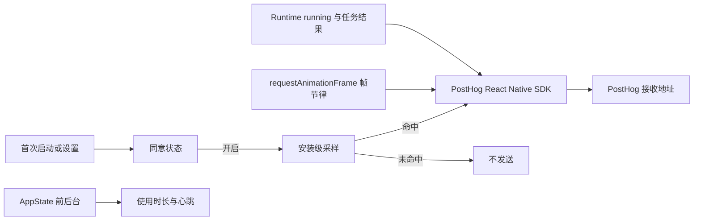
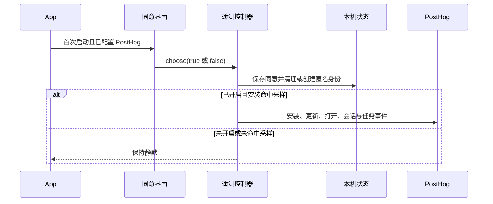

# Wework Mobile 遥测

Wework Mobile 使用 PostHog React Native SDK 采集匿名产品与稳定性指标。采集默认关闭，首次启动必须由用户明确选择是否共享。用户可在 **设置 → 隐私 → 帮助改进 WeWork** 中随时开启或关闭。

## 架构

同意、安装标识和前台会话标记保存在应用文档目录的 `wework-telemetry-state.json`。状态更新串行写入，写入失败只影响遥测，不会阻止应用启动或其他功能。

## 构建期配置

`wework-mobile/app.config.ts` 在打包时读取环境变量并写入 Expo `extra.weworkTelemetry`。运行期只读取已经打包进应用的配置，不读取用户输入的后端地址或账号信息。

| 变量                           | 默认值                       | 作用                                           |
| ------------------------------ | ---------------------------- | ---------------------------------------------- |
| `WEWORK_POSTHOG_HOST`          | `https://us.i.posthog.com`   | PostHog 接收地址，与 PC Wework 同名            |
| `WEWORK_POSTHOG_KEY`           | 空                           | PostHog 项目 Key。为空时不显示同意界面且不采集 |
| `WEWORK_TELEMETRY_SAMPLE_RATE` | `1`                          | 安装级采样率，范围 `0` 到 `1`                  |
| `WEWORK_TELEMETRY_ENVIRONMENT` | 根据发布渠道推导             | 有界环境标签                                   |
| `WEWORK_RELEASE_CHANNEL`       | EAS profile 或 `development` | 发布渠道标签                                   |
| `WEWORK_TELEMETRY_SOURCE`      | `wework-mobile`              | 数据来源标签                                   |

本地 Expo 构建也可使用对应的 `EXPO_PUBLIC_WEWORK_*` 变量。显式 `WEWORK_*` 优先。非法采样率会使 Expo 配置加载失败，避免因拼写错误改变采集范围。

采样按匿名安装标识稳定分桶。同一安装命中后，本次安装的会话、卡顿和任务事件会保持一致。未命中的安装不发送任何事件。装机人数需要按 `telemetry_sample_rate` 加权估算，因此需要精确装机量时应将生产采样率保持为 `1`。

## 指标

| 事件                                                   | 主要属性                                      | 用途                                             |
| ------------------------------------------------------ | --------------------------------------------- | ------------------------------------------------ |
| `mobile_app_installed`                                 | `since_install_ms`                            | 新增装机                                         |
| `mobile_app_updated`                                   | `from_version`、`to_version`                  | 版本升级                                         |
| `mobile_app_opened`                                    | `launch_count`、`since_install_ms`            | 启动次数、活跃安装、留存分群                     |
| `mobile_foreground_started`、`mobile_foreground_ended` | `duration_ms`                                 | 前台使用时长                                     |
| `mobile_session_abnormal_end`                          | `duration_ms`                                 | 上次前台会话未正常结束时恢复，作为崩溃或强杀信号 |
| `mobile_frame_health`                                  | `jank_rate`、`max_stall_ms`、掉帧与长卡顿计数 | 卡顿率与流畅度                                   |
| `mobile_startup_completed`                             | `duration_ms`                                 | JS 启动到首次界面挂载耗时                        |
| `mobile_screen_viewed`                                 | `screen`                                      | 页面使用分布                                     |
| `mobile_task_started`、`mobile_task_completed`         | 执行目标、耗时、结果、重试间隔                | 任务漏斗、成功率与延迟                           |

每 30 秒写入一次前台心跳。应用被系统终止时没有结束事件，下次启动用最后一次心跳恢复近似使用时长。卡顿指标按 60 Hz 目标节律统计 `requestAnimationFrame` 回调间隔，连续 100 毫秒以上没有回调记为卡顿，500 毫秒以上单独计数。该口径覆盖 JS 与原生调度停顿，但不能单独拆分 GPU 渲染或原生 UI 线程内部耗时。

## 隐私边界

- 不设置账号 ID、用户名、邮箱、任务 ID、设备 ID、项目或文件路径。
- 不上报聊天、提示词、模型回复、代码、终端内容或凭据。
- PostHog 关闭自动页面、应用生命周期、异常、Session Replay、Survey 和功能开关采集。
- `before_send` 只允许本文事件及其有界属性，未知事件直接丢弃。
- 所有事件禁用 GeoIP，并使用 `person_profiles: never`。
- 关闭共享时停止 SDK、清理未发送队列、重置分析身份并删除本机匿名安装标识。

PostHog 项目仍应在服务端关闭 autocapture 与 Session Replay，并对 IP 做匿名化，作为客户端边界的纵深防御。
