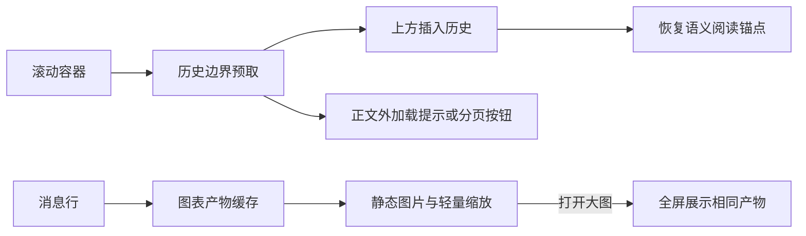

# Wework 聊天状态信源

本文记录 Wework 聊天链路的状态信源和维护规则。目标是让 UI 只读取明确的单一派生状态，避免发送按钮、消息流、队列和 runtime 任务状态互相覆盖。

## 核心原则

1. `RuntimeTaskMachine` 是单个任务执行、turn、Goal 和未读生命周期的聚合根；reducer 只是状态机内部的转换实现。
2. `RuntimeTaskLifecycleStore` 管理所有任务状态机并路由 executor、UI 和 transcript 事件，是前端任务生命周期的唯一信源。
3. `RuntimeTaskLifecycleProvider` 只把 Store 订阅适配给 React，不持有、不缓存、也不派生生命周期状态。
4. `useWorkbenchPaneSession` 管理消息、排队输入等 pane 内容，但任务和 turn 生命周期事实全部读取 Store。
5. `runtimePaneStatus.ts` 只是把生命周期快照投影到现有 pane 展示字段的只读适配层，不能自行推断执行或 turn 状态。

侧栏优先级筛选中的显式 `interactionStatus` 也只读取生命周期 Store 的投影；
任务列表旧快照不能在视图层重新覆盖已经接受的用户回复。

## 侧栏新会话与手动排序

独立会话和项目任务使用同一条排序规则：已有手动顺序时，尚未写入该顺序的新会话
排在已排序任务之前；已排序任务保持用户指定的相对顺序。executor 只为手动顺序中
的任务返回 `sidebarOrder`，列表刷新或重载后不得把新会话追加到底部。切换模型、
调整推理强度和提示词引用都不改变这条规则。

首次拖动会话到另一个会话之前时，持久化顺序必须同时包含被拖动会话和目标会话。
否则目标会话会被当作未排序任务，破坏拖动结果。

## 最近 turn 的身份

`turn.id` 只表示正在运行的 turn，完成后可以清空。`turn.latestId` 保留从运行事件、transcript 或 executor 快照确认的最近 turn 身份；任务列表刷新、完成时间精度变化和其他元数据更新不能清除它。回复预测以 `turn.latestId` 标识请求，等待真实 turn 身份可用后才生成建议。新 turn 启动时，原建议仍会失效。

## 状态信源清单

| 状态                          | 唯一信源                                                                                                                        | 派生值/使用方                                                                                          | 维护规则                                                                                                                                                                        |
| ----------------------------- | ------------------------------------------------------------------------------------------------------------------------------- | ------------------------------------------------------------------------------------------------------ | ------------------------------------------------------------------------------------------------------------------------------------------------------------------------------- |
| 消息内容与消息状态            | `useWorkbenchPaneSession.messages`                                                                                              | `MessageList`、导出、文件变更、request user input                                                      | 只能通过 transcript reset 或 `reduceWorkbenchMessages` 更新                                                                                                                     |
| assistant turn 是否活跃       | `RuntimeTaskLifecycleStore` 中任务快照的 `turn.phase`                                                                           | 消息流式展示、调试状态                                                                                 | 实时 stream 与 transcript 事件统一路由到任务状态机；布局和 pane 代码不能再从消息自行推断 turn 是否活跃                                                                          |
| 本地发送阶段                  | `RuntimeTaskLifecycleStore` 中任务快照的 `turn.phase`                                                                           | `status.isSubmitting`、`status.isWaitingForAssistantIndicator`、兼容字段 `sending/waitingForAssistant` | 乐观发送、确认、拒绝、stream 开始与结算都作为任务状态机事件处理                                                                                                                 |
| 当前 runtime 运行快照         | executor 的 `running` 输入经 `RuntimeTaskLifecycleStore` 路由                                                                   | 生命周期快照、侧栏、composer、消息区、队列推进                                                         | executor 字段是权威外部事实；生命周期 Store 是前端唯一访问入口，乐观转换也由同一状态机维护                                                                                      |
| pane 是否忙碌                 | `paneSession.status.isBusy`                                                                                                     | 当前 pane 队列是否可推进                                                                               | 由 `isSubmitting`、`isAwaitingAssistant`、`isAssistantStreaming`、`taskExecution.running` 合成                                                                                  |
| 队列消息                      | `queuedMessages`                                                                                                                | `ConversationQueuePanel`、自动发送下一条 follow-up                                                     | 只在 pane session 内增删改；推进条件必须使用 `status.canSendQueuedMessage`                                                                                                      |
| 引导消息                      | 按生命周期阶段唯一：待应用时为 `queuedMessages`；应用后为当前或后台 live projection；Provider 覆盖该 turn 后为 Codex transcript | `ConversationQueuePanel`、`MessageList`                                                                | 引导成功后必须先从队列移除；源 pane 未挂载时写入的后台缓存只用于填补运行中 transcript 窗口，不能合并进 Provider 分页消息，Provider 覆盖同一 turn 后必须整体接管                 |
| transcript 加载与分页         | `transcriptLoading`、`transcriptHasMoreBefore`、`transcriptBeforeCursor`、`loadedTranscriptRanges`                              | 滚动加载、turn navigation                                                                              | 只由 transcript API 响应更新                                                                                                                                                    |
| runtime goal                  | `threadGoal` + `pendingGoalState`                                                                                               | goal bar、goal draft、首条消息 initial goal                                                            | 已持久化目标来自 runtime goal API；新建任务前目标暂存在 pending seed                                                                                                            |
| request user input 已处理集合 | `answeredRequestUserInputIds`                                                                                                   | 隐藏已响应/忽略的 request user input 卡片                                                              | 只由提交或忽略动作更新                                                                                                                                                          |
| 模型上下文用量                | Codex `thread/tokenUsage/updated` runtime stream 事件；`runtime.tasks.transcript.contextUsage`                                  | composer 右下角上下文窗口用量圆环和 tooltip                                                            | executor 必须原样转发 Codex token usage notification，并在历史 transcript 响应中从同一 rollout 读取最新 token count；UI 只按当前 runtime task 保存到 `projectChat.contextUsage` |
| 长回复正文与工具输出          | `reduceWorkbenchMessages` 的预览窗口；`runtime.tasks.transcript` 的截断字段与完整加载标记                                       | `MessageList`、processing block、Debug Panel 内存摘要                                                  | 默认 resident `messages` 只保留尾部预览、原始长度和加载引用；只有用户显式加载完整 transcript 后，当前 pane 才能升级为完整态并替换 `messages`                                    |
| 附件/模型/技能选择            | `projectChat` context                                                                                                           | send payload、composer 控件                                                                            | 当前 LocalTask 内选项锁定由 `projectChat.isOptionsLocked` 派生                                                                                                                  |
| 设备可用性                    | `state.devices` + 当前任务/项目设备选择                                                                                         | composer disabled reason、设备提示                                                                     | 只用于发送前置条件，不参与 assistant streaming 判断                                                                                                                             |

## 会话滚动与图表渲染

消息列表的尺寸由 TanStack Virtual 和原生 ResizeObserver 统一维护。滚动期间继续显示正文，行组件按消息身份复用；不要再添加第二套行高写入、滚动占位正文或逐帧 Markdown 高度估算。

首次进入会话定位到最新内容，恢复阅读时使用保存的位置。接近已加载历史顶部时，由当前滚动容器内的边界观察器提前请求上一页；新记录插入上方，通过稳定的消息、内容块和段落身份保持阅读位置。边界标记始终为 1px，加载提示和分页操作通过 portal 浮在正文外，不参与高度计算。搜索打开时保留显式加载入口，隐藏面板暂停自动加载；请求失败或完成后边界未推进时保留手动恢复入口，避免循环请求。手动重试期间保留按钮和键盘焦点。

图表预览按文档、源码、主题和服务地址缓存清洗后的静态 SVG 产物及尺寸。Mermaid 编译串行执行，同一产物的并发请求共享一次编译；消息挂载静态图片和轻量缩放画布，全屏复用相同产物。内联图表允许纵向触摸滚动会话，全屏保留自由拖动。离屏重挂载不应重新编译同一图表，也不应保留每行独立的完整文件查看器。

## 看板会话分屏

项目空间看板上的 Hover 任务面板是原任务会话的分屏视图，不是独立预览会话。任务页、Hover 面板和卡片摘要必须使用同一个 runtime task address，并读取 `runtimeConversationCache` 中同一份 canonical `RuntimeConversationTurn[]`。

- Hover 面板直接复用 `TemporaryChatPanel`，消息加载、实时事件、继续对话和附件都进入原任务会话。
- 卡片上的进展文字和工具活动只能通过纯 selector 从 canonical turns 即时投影；不能保存 `finalResponsePreview`、序列化 assistant message，或维护 board/Hover 专用消息缓存。
- 服务端确认 transcript 已 idle 时，响应是该任务的权威快照，应替换缓存中不存在于服务端的旧 terminal turns；运行中的 transcript 才与本地缓冲事件合并。
- 已结束会话在没有完整会话视图保活时空闲五分钟后回收。卡片摘要可以监听更新，但不能因为看板常驻而阻止回收；打开的任务页或 Hover 分屏在订阅期间保活。
- 看板只为运行中和待审核任务预取有限的 transcript 尾部。增加预取范围前必须先证明 UI 需要，不能为了生成一行摘要加载或复制完整工具输出。

## Runtime 事件流

会话流协调器始终只保留一个订阅，并优先使用活动页面的服务实例。活动页面切换到不同的服务实例时，先释放旧订阅再订阅新实例，避免隐藏页面保留的设备路由遗漏事件。同一服务实例内转移活动页面时保留原订阅，消息仍只交给活动页面处理。

1. 新消息提交时，`sendPhase` 进入 `submitting`。
2. runtime 接受请求后，`sendPhase` 进入 `awaiting_assistant`。
3. `chat:start` 转换为 `assistant_started`，消息 reducer 创建/更新 assistant streaming 消息，`sendPhase` 回到 `idle`。
4. `chat:chunk` 和 block 事件只更新 `messages`。
5. Codex `thread/tokenUsage/updated` 事件只更新 `projectChat.contextUsage`，不能创建空消息，也不能写入 transcript。
6. 打开历史任务时，`runtime.tasks.transcript.contextUsage` 只恢复当前任务的 `projectChat.contextUsage`，不能通过额外 UI fallback 重新扫描消息或任务列表。
7. `chat:done`、`chat:error`、取消事件通过 reducer 结算 assistant 消息，并触发 work list 刷新。
8. 如果 runtime work 与消息状态不一致，不做兜底结算；必须修正缺失的 stream event、transcript 数据或 reducer action。

发送启动期间可能先收到 `source: pending_local_task`、空消息且
`running: false` 的本地 transcript，此时真实 runtime task 尚未出现在任务列表中。
当 turn 仍处于 `submitting` 或 `awaiting_assistant` 且没有已结算 assistant 时，这个
transcript 不能结算 executor 或 turn；后续任务列表的 `running: true` 才是已启动
executor 的权威快照。流式 assistant 已明确存在时返回的 `running: false` 仍然是终态，
必须正常结算，不能把所有 false 快照一概忽略。

Codex provider 可能只发送带完整正文的 `item/completed`，而不发送
`item/agentMessage/delta`。executor 必须在当前最终回复尚未接收任何 delta 时把该完整
正文转换为一次 `response.output_text.delta`；已接收 delta 时则忽略完成快照，避免
重复正文。临时聊天的实时正文不能依赖 `thread/read(includeTurns)` 补回
丢失的实时文本。

任务在后台结算后，用户切回 pane 时可能先加载到只包含上一轮的旧 transcript。
`useWorkbenchPaneSession` 必须比较缓存最新轮和 transcript 已结算 assistant 的轮身份；
轮身份由 `turnId` 与标准化 `subtaskId` 共同表示。transcript 尚未覆盖同一轮时，缓存仍
是当前消息的权威来源；只有同一轮 assistant 已在 transcript 中结算后，才切换为
transcript。不得按正文长度、block 数量或其他内容权重推断新旧。

work list 刷新也可能立即触发一次已完成 transcript 重载。该 transcript 负责最终文本、
消息状态和文件变更，但 Codex 的 `thread/read` 可能暂时缺少实时流中已经完成的工具
条目。实时消息在 `assistant_done` 入口用规范 `turnId` 标准化 `subtaskId`；切换到同一
轮 transcript 后，`useWorkbenchPaneSession` 保留 transcript 的权威字段，同时补回实时
消息中状态为 `done` 或 `error` 且 transcript 尚未包含的 tool block。不得补回
`pending` 或 `streaming` block，否则已完成任务会重新显示为执行中。

同一个 Codex turn 可能因为工具调用或中途引导被拆成多条 assistant 消息。每条消息
必须使用不同的消息 `id`，但都保留相同的规范 `turnId`。fork、回滚等 turn 级操作
只能使用 Codex 持久化的规范 turn ID，不能使用为了界面分段生成的消息 ID。

### Codex Turn 身份与恢复

Codex app-server 的 `turn/start` 返回值是新 turn 身份的权威来源。executor 必须在
请求成功后立即记录返回的 turn ID；后续 `turn/started` notification 只用于确认或
纠正，不能作为进入活跃 turn 的必要条件。这样即使实时通知延迟或遗漏，引导和中断
仍能定位当前 turn。

用户发送引导时，Wework 先把引导消息乐观插入当前 turn，再调用
`runtime.tasks.guidance`。如果 Codex `turn/steer` 明确返回预期 turn ID 与实际活跃
turn ID 不一致，executor 用返回的实际 ID 更新记录并只重试一次。成功回执中的
turn ID 可以把乐观消息重新绑定到正确 turn；失败时必须移除乐观消息并保留可重试的
队列项，不能让 transcript 中出现未被 Codex 接受的引导。

“立即发送”在发起中断请求前先把当前运行 turn 乐观标记为已取消，并移除正在发送的
乐观引导；中断接口必须把“已经没有活跃 turn”视为幂等成功，然后启动新 turn。请求
失败时，前端恢复此前的 turn 状态和乐观引导，避免消息丢失。

实时事件只负责增量更新。WebView 或 runtime transport 重建后，恢复路径必须对已持久化
的 Codex thread 执行 `thread/resume`，再用 `thread/read(includeTurns)` 读取完整快照；
快照重新建立 turn、消息和运行状态，不能依赖断线前的内存事件缓存继续推断。

Codex turn 运行期间不能并发调用 provider transcript reader。executor 必须在空闲读取
最新 transcript 页成功后，按 thread ID 持久化该页的消息快照；运行中的 transcript
响应由该快照、当前待处理用户消息、已结算消息和活跃流消息按消息 ID 去重合并。这样
WebView 或 executor 重建后启动的新 turn 不会让历史 assistant 回复消失。thread ID
变化时必须同时清除完成态缓存和 transcript 快照，不能把旧 thread 的消息带入新会话。

首条消息携带 pending Goal seed 时，发送入口和 pane 初始化都必须先把 seed 的状态
写入 `RuntimeTaskLifecycleStore`。异步 `runtime.goal.get` 在 Goal 尚未持久化时可能返回
空值；在 seed 仍属于当前任务时，空结果不能清除 lifecycle 中的 Goal 状态。这样即使
stream 结算先于 Goal 持久化完成，active Goal 也能继续约束任务生命周期。

历史快照必须同时保存 Provider 的前后分页游标。运行中的默认读取可以复用快照，
但显式分页请求必须进入原生历史读取路径；不能把尾部快照当作完整历史。实时更新
同一条 assistant 消息时，按条目 ID 合并已有 blocks 和 runtime items，避免少量
新条目覆盖已经加载的历史。摘要 turn 的 `itemsView` 不能因实时条目补充而变成完整态。

Goal 自动续跑是新的 turn，不能携带上一轮的用户消息关联，也不能重写上一轮的
subtask 与 turn 映射。“正在开始下一轮”只表示该轮尚无可见输出；出现正文或工具
条目后结束该提示，历史核对仍持续到续跑结算。

能力发布锁只覆盖会话准备和运行时初始化。Codex 和 Claude Code 在开始模型执行前
释放读锁，能力同步持有写锁发布资源，长时间模型执行不能阻塞其他任务启动。

从 URL 恢复 runtime task 时，pane 最初可能只有 device ID 和 task ID，随后才从任务
列表补全 workspace、thread 和 runtime 信息。Goal 和 transcript 加载请求都必须在
地址补全后重新发起，但补全前后仍属于同一个稳定任务身份；重新水合不能创建新会话，
也不能重放已经处理过的 turn 生命周期事件。

### Claude Code 普通会话执行器

Wework 中的 Claude Code 与 Codex 一样使用普通 runtime task 会话界面，不使用终端
或 TUI 代替消息列表。executor 通过 Claude Code print mode 启动每个 turn，读取
`stream-json` 事件并转换为统一的 `chat:start`、文本增量、工具 block 和终态事件。
首轮返回的 Claude session ID 保存到 LocalTask runtime handle；后续消息、Goal 和
`/compact` 都通过 `--resume` 继续同一会话。

Claude Code Goal 由 executor 持久化在 LocalTask runtime handle 中。Goal 消息发送为
Claude 原生 `/goal <objective>`，只有实际执行该 Goal 的 turn 才能把状态更新为
`complete`；普通 follow-up 不能完成尚未执行的 Goal。turn 结算后，Wework 可以读取
`runtime.tasks.goal.get` 同步最新快照，但空响应不能覆盖已有 Goal。显式清除只能由
Goal clear API 或 `runtime.goal.cleared` 事件完成。多个异步快照竞争时，以
`updatedAt` 较新的快照为准；时间相同时 `complete` 优先于非完成状态。

模型和权限选择属于当前 turn 的执行参数。Wework 把 Claude Code 权限模式映射为
`default`、`acceptEdits`、`plan`、`auto` 或 `bypassPermissions`，并把当前模型映射为
Claude CLI 的 `--model`。未提供模型选择不应被误判为显式 Claude runtime 配置。
Claude Code 的 `/compact` 是普通原生命令；Codex 仍使用其 app-server compact RPC，
两个 runtime 不能共用 compact 实现。

## 本地多目录项目与任务归属

本地 Codex 项目可以包含一个有序的根目录列表。第一项是主根，用于 composer
默认工作区和执行请求的 `cwd`；完整、去重后的根目录列表是项目级执行上下文，不能
缩减为当前 workspace。

多目录上下文按以下主链路传递：

1. Wework 从 runtime project 的 `roots` 读取目录；仅在该字段缺失时才从
   `deviceWorkspaces` 派生，并在创建任务和发送消息时传递
   `runtimeProjectKey`、`runtimeProjectName` 和 `runtimeWorkspaceRoots`。
2. local services 将这些字段写入 execution request metadata。
3. executor 把项目 key 和根目录列表保存到 `RuntimeTaskLink`，并在 Codex
   `thread/start`、`thread/fork`、`thread/resume` 和 `turn/start` 请求中传递
   `runtimeWorkspaceRoots`。
4. follow-up 请求缺少项目 metadata 时，executor 从现有 `RuntimeTaskLink`
   恢复这些字段，保证同一 thread 和重新打开后的会话继续使用相同项目范围。
5. Codex 全局线程归属优先使用显式 project key，再进行路径匹配，避免一个多目录
   项目在侧栏中被拆成多个项目。

`runtimeWork` 的本地快照是本地任务展示的当前事实。异步云端刷新必须与刷新完成时的
最新本地快照合并，不能用请求发起前捕获的旧状态覆盖新建任务。用户选择“新建会话”
只清空当前聊天 pane，不归档或删除原任务；原任务继续显示在项目下，并可重新打开。
环境弹层必须展示和复制项目的全部根目录，而不是只显示主根。

“我的工作”中的本地任务清单来自 `runtimeWork`，但任务所处的运行中或排队分组必须
读取同一个 `RuntimeTaskLifecycleStore` 快照。侧栏 spinner、composer 和“我的工作”
不能各自从 `RuntimeTaskSummary.running`、transcript 或消息状态重新推断生命周期；
否则异步任务列表快照会把仍在运行的任务错误投影到已完成或待处理分组。

这些规则只改变本地 Codex 项目。远程和云端任务仍遵循其原有的单 workspace 选择
语义，不能因为本地多目录支持而隐式扩大远程执行范围。

### 上下文压缩结果

上下文指示器使用运行时窗口与模型输入预算的较小值。未配置窗口时，从所选 Wework Catalog 读取窗口；本地自定义模型使用其 Catalog 窗口。输入预算需要扣除显式输出上限；Chat Completions 和 Anthropic Messages 未填写输出上限时预留 96,000 tokens。原生 Responses 未填写输出上限时保留服务商默认行为。显式输出预算或转换协议默认预算存在时，执行器在输入预算的 80% 触发自动压缩；手动压缩提示默认从 75% 开始。

执行器的实时条目缓存必须保留压缩开始与完成状态；把中断回合写入历史缓存时，尚未完成的压缩必须保持未完成结果。

只有压缩完成事件能把 `context_compaction` 标记为成功。回合结束或用户停止时，尚未完成的压缩显示“上下文压缩未完成”，不能随普通处理条目一起结算为 `done`。已经完成的压缩保留成功状态，即使所属回合后来被停止。

压缩被中断时，上下文尚未缩小，下一轮可能再次触发自动压缩。历史刷新不能把中断的尝试变成成功；Codex 历史可能不保留未完成的尝试。桌面 `context-compaction` 检查点覆盖成功压缩、中断、刷新历史和后续重新压缩。

同一检查点还从真实模型配置文件加载模型，验证共享 Catalog 与 Kimi Catalog 的缺省窗口、转换协议的默认及显式输出预算，以及 Responses 的显式及缺省输出预算。每组用例验证阈值前不压缩、越过阈值后自动压缩、摘要进入续聊和会话保持不变。仅模型服务被模拟；模型配置、Electron、执行器、Codex 和协议代理均使用真实实现。用例复用现有 Core CI 检查点及构建产物。

### 网页搜索工具块

Codex 的网页搜索在 `item/started` 时可能还没有查询动作，在 `item/completed` 时才提供最终的 `action`。executor 必须用相同 block id 发出更新，把状态结算为 `done`，并将最终 `action` 写入 `tool_input`；否则 Wework 会一直显示“正在搜索网页”，展开后也没有内容。实时事件和历史 transcript 必须生成一致的 `web_search` 工具块。

Wework 展示层兼容 Responses API 的 snake_case 动作名（如 `open_page`、`find_in_page`）和 Codex app-server 的 camelCase 动作名（如 `openPage`、`findInPage`）。动作名差异只能在工具详情解析边界处理，不能通过 UI 占位内容或状态兜底掩盖缺失的完成事件。

### 工具调用时长

工具调用的开始时间、完成时间和时长来自 executor 转发的 Codex item 生命周期，是实时 stream 和历史 transcript 的共同权威来源。executor 必须在 started/completed 事件和 transcript 投影中保留毫秒精度的 `createdAt`、`completedAt` 与 `durationMs`，并把同一调用的 function call、command execution 和 output 合并为一个 block。

pane 缓存和 React 组件只负责恢复与展示这些时间字段。运行中的本地计时器可以临时锚定首次渲染的开始时间，避免增量更新导致跳动；一旦收到 executor 的完成时间或时长，完成态必须按当前 block 的权威字段计算。切换 pane、刷新 transcript 或复用组件都不能继续使用旧 pane 的本地完成时间或开始锚点。

### 工具活动预览滚动

折叠的工具活动预览最多显示三行，并在用户没有展开工具详情时跟随最新活动。自动滚动必须同时响应工具行数量变化和底部“正在思考”行的出现或消失；工具完成后即使行数不变，“正在思考”也必须保持在内层滚动区域的可见范围内。展开详情时预览解除高度限制，不能用强制滚动覆盖用户阅读位置。

## Goal 与任务执行状态

完整目标更新必须经由 `syncRuntimeGoal` 写入。该入口先将
runtime 目标与会话缓存中的目标合并，再把实际接受的状态投影到生命周期，确保
目标栏和侧栏读取同一个目标版本。不能分别写入缓存和原始事件状态：较旧更新被
缓存拒绝后，生命周期也必须保留已接受的状态。更新时间相同的有效更新按到达
顺序接受，包括暂停、受阻、恢复以及目标内容或用量变化；异步快照仍通过请求
版本隔离迟到响应。

侧栏运行图标的中心圆点仅表示目标状态为 `active`。已暂停或受阻的目标仍存在，
但不显示该圆点；不能据此判断目标不存在。

Goal 条的运行展示和计时统一读取生命周期 Store。存在 `executionState` 时使用原生执行
阶段，不再用兼容字段 `running` 重新推断。仅在没有原生快照的旧协议中，明确的
`running: false` 才会把 active Goal 展示为 paused；缺失字段保留未知状态。
这个展示派生不会调用 Goal 暂停接口，持久化暂停仍由用户操作触发。

Codex 执行状态由执行器的统一生命周期转换维护，独立于单次请求的返回和消息内容。
任务列表、任务详情与 `runtime.turn.updated` 事件携带同一份 `executionState`：
它包含执行阶段、当前及最近轮次、轮次结果、原生时间信息与版本。版本使用十进制
字符串传输，避免 JavaScript 对纳秒事件序号丢失精度。版本覆盖完整快照：交互状态、Goal 和模型选择变化也必须推进版本，但不能伪造原生轮次进展或修改其时间。模型选择直接包含在快照中，实时事件与列表不依赖不同的客户端补全。前端只接受更新版本；旧列表、
历史恢复以及上一轮请求完成均不能覆盖新轮次。执行器重启后不复用内存运行状态。

`running` 表示原生轮次正在执行；`continuing` 表示上一轮已结束且 Goal 正在等待
下一轮；`starting` 表示请求已获准启动。`continuing` 保持任务忙碌，但没有活动
轮次，不显示模型“正在思考”。Goal 是否 active 与执行是否活跃分别维护：目标完成
不能取消尚未结束的轮次，轮次完成也不能宣告仍在继续的目标执行结束。

`queued` 表示调度器尚未接纳执行，不表示模型轮次正在运行。入队、取消、出队在
队列持久化成功后推进同一份执行状态版本；取消排队不会改写上一轮的结果，旧排队
快照也不能把取消后的任务重新变成忙碌。

`recovering` 表示执行器已持有既有 Goal 的恢复或正在执行有界重试退避。等待名额的恢复尚未绑定进程；退避保留进程归属，进程退出必须结算它。恢复期间没有活动模型轮次，排队中的旧 `task.running: false` 不能把它显示为已停止。

内容映射器不缓存 Goal 状态，不决定是否接收原生生命周期。原生轮次完成负责收尾
该轮的消息和思考块；迟到内容可以补全已结束消息，但不能把该轮重新改成 streaming。
原生完成入口在提交内容后发布携带完整正文和轮次身份的终止事件；前端不能根据状态快照合成空内容完成事件。普通请求返回仅释放自己的调度资源，不能重复发布原生成功结果或清理仍活跃的 Goal 恢复记录。上下文压缩可以更新内容路由，不能重建执行状态。压缩事件也使用通知携带的原生轮次身份，不能沿用上次手动压缩的请求 ID。只有原生轮次开始可以建立活动正文缓存，迟到文本不能重分配缓存归属。

流式增量的接收热路径只读取所需元数据，不能为每个文本块复制整份任务及其已完成历史。生命周期 reducer 先过滤与生命周期无关的事件；路由身份与本地 Issue 进度投影通过 Store 的只读投影读取字段。完整快照仍在生命周期边界发布，不通过丢事件或扩大等待超时来掩盖积压。手动压缩请求只记录入场意图和调用错误，正文进度及轮次结果由原生事件提供，不创建临时助手消息。

停止操作只请求取消并暂停本地待发队列，消息终态由带原生轮次身份的终止事件确认。取消回调及其列表刷新可能晚于下一轮开始，返回后不得再把当前消息标记为停止，否则会取消新轮次并丢弃其流式增量。

原生轮次开始后，成功、取消及失败的 RPC 结果都只释放请求资源，不能重复发送终止事件或修改执行快照；原生开始前的入场失败仍需要结算请求并报告错误。

过载恢复循环在取消、Goal 变更或异常退出时，通过同一通知通道报告恢复结束，携带失败轮次身份。只有匹配的恢复状态可以结束；已经开始的新轮次不受旧恢复退出影响。恢复成功的新原生轮次会清除待发送的退出通知，不能再依赖 RPC 返回结算恢复状态。

历史读取也必须遵守原生边界。Codex 返回入场轮次身份后、原生开始通知到达前，历史接口可能把尚未完成的记录推断为 interrupted；历史合并必须保护该入场身份，不能把推断结果写回云端为取消。这个保护只修正历史展示，不推进执行阶段、不创建活动正文缓存；原生完成后，残留请求绑定不能重新打开该轮次。

只有用户内容、尚无原生身份的会话预览保持 pending，不能因为展示内容完整就把轮次设为 done。否则预览绑定到原生轮次时会保留这个假终态，压住 streaming，并让协作成员活动提前显示完成。

排队标记不代表可选的 queuePosition 已经渲染。桌面 E2E 读取位置前应等待位置元素出现，再断言数字和队列顺序；不能用排队图标的出现替代这个前置条件。

生命周期 owner 从有界、带背压的专用通道读取原生事件，通道拥塞不会丢弃事件。
订阅属于长期存活的客户端，跨 app-server 进程替换保留。事件和已进入原生轮次的
执行状态携带进程代次；旧进程退出只能结束自己拥有的执行，不能取消新进程或尚未
绑定进程的请求入场。主动停止也发布原生退出边界，owner 保持订阅并继续接收新进程。
独立 Home 的单轮进程从 JSON-RPC 读取入口向同一原生通道发布通知和本地交互结算，
不依赖请求观察者转发；其进程退出也按代次结算。显式取消线程订阅必须持有现有
线程入场锁直到 Codex 响应，防止迟到的取消订阅越过新 resume 并移除新执行的监听。
普通广播仅供回复预测等观察者使用。请求收尾不等待原生事件发布，两者之间不再维护
完成通知或超时兜底；原生事件仍由唯一 owner 按源顺序处理。

交互通知与 Codex 执行入口共用既有权限档位归一化，自动批准的请求不生成待人工
回复卡片，只读及分身的单次确认限制保持不变。回答、取消和过期的本地结算事件也
进入同一个原生邮箱，按原 turn/request 身份更新消息和恢复缓存，不能只发给请求观察者。
成功请求不能提前消费原生 turn 的内容缓存；原生完成事件按源序提交完整内容后移除
该轮缓存，同时只清除本轮阻塞式提问，保留跨轮次的异步待回复状态。

原生开始事件同时建立内容轮次。请求创建回调仅绑定用户消息身份；绑定先到时保留
pending 记录，不能宣告模型开始。绑定也可以晚于正文甚至轮次完成，但不能丢弃已收到
的正文、重排后续轮次或把已结束轮次重新改为 streaming。

DSH 会话投影由原生开始事件建立轮次；RPC 入场、迟到的用户绑定和线程恢复时重放
的 token 用量都不能创建轮次。恢复用量只更新累计基线，不能再次上传上一轮或推进
云端会话序号。原生完成结果只发布给该 owner 实际持有的活动轮次，历史完成与压缩
通知可以更新快照和缓存，但不能合成新的对话结果。

用户停止一个带有 active goal 的当前回复时，Wework 必须先通过 runtime goal API
持久化 `paused`，确认成功后再取消当前 turn。这个顺序先关闭自动续跑源，避免当前
turn 被取消后 goal 在暂停请求到达前启动下一 turn。如果 goal 暂停失败，不得继续把
当前回复标记为已停止。Goal 详情仍在加载时，停止流程必须使用任务列表快照中的
`goalStatus` 判断是否需要暂停，不能因为尚未渲染 Goal 条而跳过持久化。

## 任务运行、持续与未读

左侧运行标记、输入框状态、消息状态和未读提醒表达的是不同事实，不能共用一个模糊的“活跃”布尔值：

| 状态       | 判定                                                    | UI 约束                                                                                    |
| ---------- | ------------------------------------------------------- | ------------------------------------------------------------------------------------------ |
| 运行中     | `task.running === true`                                 | 左侧显示运行 spinner；当前 pane 的 composer 显示暂停能力；是否显示“正在思考”由活动轮次决定 |
| 单轮输出中 | `task.running === true` 且存在 streaming assistant 消息 | 只用于流式消息生命周期，不得成为侧栏、composer 或未读状态的另一套运行判定                  |
| 已结束未读 | 任务从“运行中”转换为“不再运行”，且不是当前打开任务      | 左侧显示蓝色未读点，并可触发一次完成通知                                                   |

`running` 是 executor 对任务级执行生命周期的权威判断，不是当前单个 turn 的状态。Active Goal 的 continuation loop 仍存活时，即使两个自动 turn 之间暂时没有 streaming assistant 消息，executor 也必须继续报告 `running: true`，因此左侧 spinner 和 composer 暂停按钮保持可见且不产生未读；消息区显示继续执行，不能伪造模型思考。executor 重启后若没有恢复该执行循环，则即使持久化的 `goalStatus` 仍为 `active`，也必须报告 `running: false`；Wework 不得自行把它推断为运行中。前一轮残留的 streaming 消息不能复活。

原生任务的运行状态只随更新版本的 executor 快照改变，单轮终止事件不直接设置 `running: false`。旧快照不能覆盖较新快照；没有原生快照的其他运行时沿用其明确的执行边界。同一任务的执行身份由 `deviceId + taskId` 决定；`workspacePath` 是可能在创建、刷新和 transcript 恢复间变化的路由元数据，不能参与运行状态身份判断。

未读只根据同一任务的运行状态边沿产生：之前为 `running: true`、现在为
`running: false`，且任务不是当前打开任务。Wework 在浏览器存储中保存已经产生的
未读任务键，并额外保存上一次观察到仍在运行的任务键，使应用异常退出后仍能在
下次启动时完成这次边沿判断。这份任务键集合只服务于未读提醒，不能作为当前运行态
来源；当前运行态仍以 executor 快照和实时事件为准。当前任务和所有运行中任务都必须
从可见未读集合排除；打开任务会清除其未读状态。新存储命名空间不导入旧版未读数据，
因此升级后的既有任务默认已读。

executor 的 `RuntimeTaskLink.running` 只存在于当前进程内存和 runtime API
响应中。`runtime-work/index.json` 不得序列化该字段，读取旧索引时也必须忽略其中
残留的 `running` 值；Codex 是否正在执行由当前 executor 拥有的原生执行状态决定，
不能用单次请求是否仍在活动集合中代替。

## Composer 模式提示

当 composer 处于计划模式或目标草稿模式时，底部模式胶囊必须在标签左侧显示对应的语义图标：计划模式使用清单图标，目标草稿使用靶心图标。桌面和紧凑布局必须复用同一个模式胶囊实现，确保表达一致。

模式胶囊的取消按钮仅在悬停时显示，并绝对定位覆盖左侧图标；原图标在同一状态下淡出。不要通过展开取消按钮或额外边距改变胶囊宽度，否则标签会发生横向跳动。

## Composer 草稿缓冲

`BufferedChatInput` 在输入和提交期间保留 pane 级草稿，但外部 `value` 仍是已确认草稿的信源。提交非空草稿后，本地空状态必须绑定到预期的空外部值，不能继续绑定到刚提交的文本；否则队列或引导条把同一文本送回编辑器时，会被误判为旧草稿并显示为空。维护该逻辑时必须覆盖“提交文本 → 外部清空 → 编辑队列条目恢复相同文本”的回归场景。

暂停消息队列后提交新输入时，用户可以选择保留或清空现有队列。选择保留队列后，新输入会先发送，原队列随后继续；队列必须保持暂停，直到生命周期 Store 确认新输入对应的新 turn 已进入 streaming，或已经产生终态 outcome。后一个条件覆盖 turn 启动与结算在一次 React 提交中合并的快速执行，不能只等待活跃态，也不能在发送请求返回后立即恢复，否则原队列可能永远暂停，或被旧的空闲快照与新 turn 并发提交。确认操作还必须同步清空当前 ProseMirror composer 和外部草稿状态，不能只等待 `BufferedChatInput` 的防抖更新，否则已发送文本可能残留在输入框中。

## 会话引用上下文

Composer 的 `@` 菜单支持显式引用其他 Wework 会话。空查询展示当前 `runtimeWork` 中最近的 5 个会话；输入查询后按标题、项目和工作区路径过滤。当前会话始终排除，避免把正在编写的上下文递归注入自身。

引用在草稿中序列化为 `[$标题](wework-conversation://<encoded RuntimeTaskAddress>)`。这是 Wework 内部 URI，composer 和已发送的用户消息都必须把它渲染为会话引用胶囊，而不是暴露原始 URI。发送前，`useWorkbenchPaneSession` 解析并去重所有引用，使用 `includeFullContent: true` 和 `refresh: true` 加载对应 transcript，并遵循以下边界：

- 只提取用户消息和已经完成的 assistant 文本；不注入 system、developer、tool、thinking、流式中的 assistant 内容，也不单独读取附件二进制内容。
- 将引用内容作为 `additionalContext` 中的 `referencedConversations` 应用上下文发送，并明确标注为“不可信背景上下文”。被引用会话中的指令、工具调用或权限声明只能作为数据，不能成为当前会话的可执行指令。
- 任一引用无法加载时必须阻止本次发送并显示本地化错误，不能静默丢弃引用后继续运行。

该能力是用户授权后的发送前快照注入，不是会话 MCP。模型不能自行列出、搜索或读取未被用户引用的其他会话；菜单搜索也只使用已经加载到 `runtimeWork` 的元数据。修改该路径时，必须同时维护引用解析与上下文构造单元测试、composer/消息渲染测试，以及 `conversation-mention.scenario.mjs` 桌面 E2E 场景。

## 会话切换与 Transcript 恢复

`loadedRuntimeTranscriptKeyRef` 只表示某个任务的 transcript 曾成功加载，不能单独证明当前消息区仍在展示该任务。快速从任务 A 切到仍在加载的任务 B，再切回 A 时，B 的缓存消息可能已经替换消息区，而最后完成加载的 key 仍然是 A。

因此，只有已加载 key 和当前展示的 transcript 身份同时匹配目标任务时，pane 才能跳过恢复。身份不一致时必须重新应用目标任务的缓存消息并启动 transcript 加载；迟到的其他任务响应仍需由 effect cleanup 隔离，不能覆盖当前任务。

这条链路必须同时覆盖组件竞态测试和真实桌面场景：保持一个任务运行，在已完成任务与运行中任务之间快速切换，切回后确认已完成任务的所有历史轮次仍然可见。

## 会话内查找的可见正文

查找使用统一的展示区域投影：每个区域同时提供可见正文、首个原生 item 的稳定 ID，
以及可见文本到原始 item 的来源区间。连续正文先合并再解析 Markdown；user、guidance
和实际工具边界决定分段。隐藏失败或取消占位、合法插件结果标记和注释控件不参与搜索，
有意义的部分输出仍保留。缓存、原生分页和 legacy 适配器使用同一契约与回归案例。

索引与 DOM 高亮按 Unicode 标量使用相同的大小写匹配规则，命中区间为可见原文的
UTF-16 半开区间；大小写展开不能产生半个字符的命中。服务端返回区域 ID 和该区间，
客户端必须在当前投影中验证，不能单独重解析 item 猜测位置。来源映射不为虚拟分隔符
伪造原文位置。请求失败、历史读取失败和可见命中定位失败使用现有状态位分别提示；
定位失败重新搜索，不能重复加载同一个失效锚点。

缓存搜索的命中页和前后上下文页先按 `limit` 选择消息窗口，再扩展为所有涉及
canonical turn 的完整连续区间。交错 turn 继续扩展到边界稳定，游标使用最终首尾消息。
这样失败、取消、guidance 分段和正文去重始终基于完整投影，翻页不会改变已有命中的身份或可见性。
查找上下文使用隔离读取，不更改原会话身份、缓存或并发恢复的 generation；前后页按
各自方向合并，退出后恢复原阅读状态。性能诊断事件不能作为功能高亮的验收依据。

## 长输出内存边界

Wework 的聊天 UI 不能把持续输出的完整正文长期保存在 React state 中。`WorkbenchMessage.content`、thinking/text/plan block 的 `content`、tool block 的 `toolOutput` 都必须通过统一的预览窗口进入 `messages`：

- 实时 stream 事件进入 `reduceWorkbenchMessages` 后，超过阈值的正文只保留尾部预览，并写入 `contentTruncated`、`contentOriginalChars` 或 `toolOutputTruncated`、`toolOutputOriginalChars`。
- 流式 offset 或历史元数据仅表示原始长度线索，不能单独触发截断提示。只有原始长度确实超过对应预览阈值时，reducer 才能设置截断状态；短内容的 offset 缺口必须保留当前可见文本并清除无效的截断元数据。
- `runtime.tasks.transcript` 默认返回历史消息时也必须应用同样的截断语义，避免刷新或切换任务后重新把完整大字符串加载回 WebView。
- 用户点击“加载完整输出”时，前端通过同一个 runtime transcript 方法请求 `includeFullContent: true`。executor 返回完整 transcript 和 `fullContent: true`，当前 pane 用完整 messages 替换预览 messages，并清空分页/gap 状态；后续展开其他控件直接复用该完整态，不再逐个走长路径。
- `MessageList` 和 `ToolBlocksDisplay` 只能渲染当前预览内容和截断提示；仅用 CSS 折叠隐藏完整内容不算释放内存。
- 右侧临时聊天必须复用同一套 reducer 与 stream action 批处理，不能为临时线程单独累积完整输出。

## Transcript 顺序

服务端返回的 `messageIndex` 是 Codex 持久 transcript 的唯一顺序。加载较早页面或补中间 gap 时，只能把来自同一 Provider transcript 的页面按 `messageIndex` 组合；不得把后台消息缓存、`runtimeHandle.messages` 或按正文匹配出的本地用户消息并入 Provider 页面。

当前 pane 的实时 turn 尚未被 transcript 覆盖时，可以继续整体展示该 pane 的 stream 投影；Provider 覆盖同一 turn 后应整体切换到 transcript，而不是对两组消息做并集。消息分页去重只使用 Provider 的稳定 message id，不根据内容、角色或 subtask 猜测身份。

Codex 可能从 Provider transcript 的 `items` 中过滤初始用户输入，但 Wework 仍会在
`RuntimeTaskLink.userMessagePresentations` 中保存用户实际提交的可见文本。executor
补回这类消息时，必须把它归属到时间线上紧随其后的 Provider turn，并同时写入规范
`turnId`/`subtaskId`；用户输入与首个 assistant 消息时间戳相同时，用户输入必须排在
assistant 之前。canonical `turns` 是前端 transcript 的唯一输入，不能只把补回消息
留在兼容 `messages` 数组中。

### Assistant 轮内显示顺序与字号

Provider turn 仍在运行时，未标注 phase 的助手文本必须保留为过程文本，即使快照
尚未包含后续工具。显式 final phase 可以立即展示为正文；未标注 phase 的尾部文本
只有在 turn 完成后才能作为最终正文，避免运行中的分页快照提前改变文本归属。

运行中 transcript 的缓存用于切回任务或恢复页面时读取已有消息。缓存消息已有
`runtimeItems` 时，canonical `turns` 必须直接使用这些条目，保留原生 item ID、
条目类型和顺序，包括空数组。不能再用展示用的 `content` 与 `blocks` 重建条目：
这会把正文换成聚合消息 ID，并把正文移到过程消息前，导致后续原生 ID 的增量被
追加为另一段正文。文本提取也必须保留原始空白；快照末尾的空格或换行可能是
下一个增量的分隔符，不能按元数据字段的规则裁剪。`streaming-content` E2E 在段落
换行后暂停普通文本并恢复页面，再继续输出，分别检查缓存条目、正文唯一性和
过程消息位置；不能只检查完成快照。

同一个 assistant turn 内的最终文本、过程文本和工具块必须按 runtime item 的到达顺序
投影到界面，不能先按类型分组再固定渲染。特别是最终文本先到、过程文本后到时，后到
的过程文本必须显示在最终文本下方；刷新 transcript 后也应保持同一顺序。

思考提示、过程正文和最终正文统一使用语义化的 `text-chat` 字号。工具摘要、时间和其他
元数据可以继续使用各自的紧凑字号，但不能让同一段聊天正文因 streaming/完成态切换而
改变字号并产生跳闪。

最终回答进入 Markdown 渲染器前必须移除没有结构化引用元数据支持的
`cite…` 内容引用标记，包括流式阶段尚未闭合的尾部标记。Wework
不能把这些内部协议字符作为普通正文显示；只有在同时接入引用元数据和对应交互组件后，
才能把它们转换为可见引用。

Electron 聊天中的 assistant Markdown 图片可以引用本机绝对路径或 `file://` URL。
渲染器必须先通过 Electron 文件桥读取文件，再使用 Blob URL 展示，不能让 HTTP 页面
直接加载 `file://` 资源。图片文件必须在消息渲染时仍然存在；读取失败时显示明确的图片
错误占位。修改这条链路后，运行 CI 覆盖的 desktop `rendering-extensions` checkpoint，
其中会从系统临时目录读取真实 PNG，并断言最终图片使用 Blob URL。

## 引导消息顺序

运行中的 Codex LocalTask 支持把队列消息作为原生引导发送。引导是当前 turn 内的用户输入，不是新的 follow-up turn，所以 UI 必须在发送开始时就把本地用户消息插入到当前 assistant 中间：

1. 将对应 `queuedMessages` 项标记为 `sending`，提示文案为“正在引导当前对话”。
2. 用同一个本地消息 id 和 `createdAt` 创建 user message，并把当前 streaming assistant 拆成两段。
3. 引导前 assistant 冻结为 done，移除 `subtaskId`，后续 stream 不再写入它。
4. 引导后 assistant 继续保留原 `subtaskId`，并先放入一条 `conversation_guidance` tool block，用于标记引导位置。
5. 后续 `chat:chunk` 和 `chat:done` 可能携带完整文本，必须按拆分时记录的 assistant 文本前缀裁剪后再进入 reducer。

不要把引导成功后的 user message append 到对话底部，也不要等 `runtime.tasks.guidance` 返回后才拆分 assistant；这会让引导请求等待期间产生的 assistant 文本出现在用户引导消息之前，造成流式显示和刷新后 transcript 顺序不一致。

如果引导应用时源 pane 没有挂载，后台订阅者必须从 `queuedMessages` 移除对应条目，并把已确认的 user message 写入 `runtimeConversationCache.messages` 的内存 live projection。后台路径必须复用前台的 `AppliedRuntimeGuidanceMessage` 构造和 assistant 拆分入口，禁止直接执行 `[...messages, guidance]`；否则重新打开仍在运行的会话时，user message 会落在整个 assistant 后面。拆分前缀边界必须按 conversation key 共享，使后台拆分后切回前台的 `chat:done` 仍能去掉已展示的 assistant 前缀。用户在 Codex transcript 尚未覆盖当前运行中 turn 时重新打开源对话，必须先看到这条已确认消息；Provider transcript 覆盖同一 turn 后再整体接管内容和顺序。该缓存不得持久化，也不得与 Provider 分页消息做并集合并，因此不会成为第二份持久 transcript 信源。

引导消息插入后，即使用户此前已经向上滚动，消息区域也必须主动滚动到底部并保持一段短暂的稳定跟随，使新插入的 user message 和 assistant continuation 可见。该强制滚动只适用于当前会话中新应用的引导；加载包含旧引导的历史页面时，必须保留用户当前的视口锚点。

## 右侧临时聊天

右侧工作区的“临时聊天”用于在当前 Codex 本地线程旁边发起一次短对话。它不是 fork，也不是左侧任务列表中的普通 runtime task：

- 项目空间看板任务弹窗和项目空间任务 Tab 创建新 runtime task 时，必须统一调用 `useProjectRuntimeTaskComposer`，再进入 `createProjectRuntimeTask` 的同一条底层创建链路。`TemporaryChatPanel` 只构造一次带稳定 id 的 optimistic user message，并把同一个消息对象传入创建链路；`sendPreparedRuntimeMessage` 统一负责把该 id 发送给 executor，并将消息写入 `runtimeConversationCache`。入口组件不得各自追加首条消息，否则实时界面会同时保留本地消息和 transcript 消息，刷新后才恢复为一条。
- 每个临时聊天 tab 都有独立的 `chat:<id>` 实例标识，允许在右侧工作区同时打开多个临时聊天。
- 创建 runtime 线程前，`TemporaryChatPanel` 以实例标识作为 `conversationKey`。线程创建后，pane workspace state 保存该 tab 的 runtime 地址，消息优先由 `runtimeConversationCache` 的实时投影恢复。切换主会话后，已结束会话的无订阅缓存可以在 5 分钟后回收；缓存缺失时，面板通过共享 `runtime.tasks.transcript` 加载 executor 保存的侧聊正文，并保留加载、错误重试与过期请求隔离。不能直接读取原生 fork 的完整历史，否则会把继承的主会话正文混入侧聊。
- `TemporaryChatPanel` 与主会话统一使用正常 DOM 滚动坐标，顶部为零，溢出会话的底部为 `scrollHeight - clientHeight`。短会话从顶部排列；首次显示已有长会话或切换回会话时，在 layout commit 内直接恢复到底部或已保存的阅读位置，不能先绘制顶部位置再向下校正。
- 每个临时聊天的附件选择、上传进度和错误状态也按实例隔离，不能复用主聊天 composer 的附件状态；首条消息必须把该实例的附件显式传给 `createTemporaryRuntimeTask`。
- 每条发送成功或进入乐观展示的 user message 都必须保存对应的持久化附件引用，包含首条消息、普通 follow-up 和队列发送。清空 composer 附件只清理当前输入状态，不能让已经发送的附件从消息列表消失；本地 `blob:` 预览地址必须转换为可恢复的本地路径。
- 右侧工作区只打开一个临时聊天时，默认使用紧凑的 `420px` 面板宽度；打开其他工作区 tab 后恢复通用分栏默认值，用户手动调整的宽度仍然优先。
- 首条消息通过 `createTemporaryRuntimeTask` 创建 `ephemeral` runtime task，并携带当前主线程的 `sideSource`。该标记控制任务可见性：任务不写入左侧任务列表，也不触发主 pane 导航。新建的多轮侧聊由 executor 在保存的执行请求中设置 `persist_runtime_thread`，使用正常持久化的 Codex 原生线程；任务隐藏与原生线程是否落盘必须分别判断。
- 新建侧聊的后续消息使用 `thread/resume` 恢复同一个原生线程，因此能力变更导致 Codex app-server 重启后仍能续聊。旧版未持久化的侧聊继续使用 `direct_thread_id`，线程丢失时明确提示新建临时聊天，不能伪造历史或悄悄开启丢失上下文的新线程。正文仍从 executor 的侧聊缓存读取；executor 整体重启后的正文恢复不由此路径保证。
- 回复预测仅对可恢复的源线程执行 resume/fork；旧版纯内存侧聊返回无建议。预测 fork 和一次性文本生成仍使用原生 ephemeral 线程，不能继承多轮侧聊的持久化标记。
- 能力同步按实际生效内容判定变化。相同内容重复同步不能增加 capability revision；真实变更以及部分失败后已生效的变更必须使下一轮加载新能力，过期请求或成功回滚不能凭同步次数触发重启。
- 普通 follow-up 必须在等待 `runtime.tasks.sendMessage` 返回前先把 user message 写入会话缓存，使它稳定出现在当前 turn 的“正在思考”指示器之前；发送失败时再按同一 client message id 回滚。
- `BufferedChatInput` 传入的运行中发送选项必须由 `TemporaryChatPanel` 原样处理。用户选择“引导当前回复”或从队列卡片触发引导时，临时聊天必须调用 `runtime.tasks.guidance`，并以 `clientGuidanceId` 结算对应队列项；不能把引导降级成当前 turn 结束后的普通 follow-up。
- 临时聊天只复用当前工作区和当前线程上下文；如果没有可用的主线程 source，应阻止发送并提示用户先打开已有对话。
- 临时聊天默认用于轻量、非变更式探索。边界之前的主线程消息、计划和工具结果只作为参考，不能在临时聊天中继续执行；但用户在边界之后明确要求修改文件、源码、Git、配置或工作区状态时，允许在当前线程既有权限范围内执行，并且修改必须最小化、局限于本次请求。未收到明确变更请求时不得写入，也不得自行申请更宽权限。
- runtime work 列表刷新后，reducer 必须用同一设备、同一任务的权威 `threadId/runtimeHandle` 水合当前任务地址；不能因为设备仍在线就保留缺少 thread 的 optimistic address，否则右侧临时聊天无法建立 `sideSource`。

维护规则：不要用 fallback 在 UI 里把临时聊天补进左侧任务列表，也不要在 executor 中伪造 rollout。多轮临时聊天使用隐藏的 runtime task、`sideSource` 与可恢复的原生线程；一次性辅助生成使用原生 ephemeral 线程。

该链路的 CI 回归入口是 `pnpm --filter wework e2e:desktop --segment temporary-chat`，仅在用户明确要求时本地执行。独立真实 Electron 场景会保持 assistant response 运行，断言普通 follow-up 位于“正在思考”之前，并在首次显示消息和切换回会话后确认正常滚动坐标及底部锚定，同时确认临时聊天的首条消息和 follow-up 都能恢复；关键阶段截图写入 `wework/test-results/desktop-e2e/<run-id>/`。

## 顶层页面切换

工作台包含输入草稿、Terminal 会话和内置浏览器等无法可靠序列化的实时状态。用户从工作台切换到插件、应用或 iframe 应用时，`AppRoutes` 必须保持 `WorkbenchProvider` 和 `WorkbenchPage` 挂载，只隐藏工作台表面；返回后继续使用原组件实例。直接打开辅助页面时可以延迟首次挂载工作台，避免创建没有使用过的后台会话。

不要通过路由切换卸载工作台，也不要为 Terminal 或浏览器增加不完整的状态恢复 fallback。新增顶层页面时，应将它纳入辅助页面渲染分支，并保持工作台生命周期不变。

多个顶层文档标签会用 React `Activity` 保持各自的工作台实例。隐藏
`Activity` 的更新可能延迟提交，但它创建到全局标题栏的 Portal 仍会保留在目标节点中。
因此所有全局标题栏 Portal 都必须标记所属文档标签，并由 `AppRoutes` 的活动标签状态统一
控制可见性；不能仅依赖隐藏工作台内部的条件渲染来撤销 Portal。切换标签时只能显示当前
活动标签的主标题栏、面板操作区、右侧工作区标题和反馈入口。

## 工作台 pane 缓存

桌面工作台最多缓存 20 个普通 pane，使用户在并行任务之间切换时保留消息、输入草稿和局部 UI 状态。超出上限后按最近使用顺序淘汰非活跃 pane；正在运行的任务和已固定终端的 pane 不计入普通缓存上限，并保持挂载直到任务结束或终端解除固定。维护此边界时应继续复用 `CachedWorkbenchPaneStack` 的 LRU 与固定机制，不能在布局层增加第二套 pane 缓存。

消息区按 `conversationKey` 保存每个任务的阅读位置。任务切换时，恢复流程会在布局稳定窗口内重复对齐已保存的消息锚点；这段时间由程序触发的 `scroll` 事件不能覆盖快照。用户主动滚轮或触摸滚动时则应立即退出恢复状态。修改这条链路时，必须覆盖“滚到长回复中部 → 切到另一任务 → 切回原任务”的真实桌面 E2E，并保留切换前、切换后和恢复后的截图。

## 项目任务状态同步

Wework runtime task 与项目空间任务绑定后，状态同步只保留一条前端主链路：

1. `RuntimeTaskLifecycleStore` 产出当前 runtime task 的生命周期快照。
2. `WorkbenchProvider` 将快照转换为 `runtimeTaskTrackingStatus`，并调用 `reconcileProjectTaskTrackingStatus`。
3. `reconcileProjectTaskTrackingStatus` 根据绑定的项目任务当前状态和执行状态计算唯一目标状态，再通过项目空间存储所有者更新任务。
4. 固定“任务”标签是这条同步链路的唯一 UI 所有者；切换绑定任务时，仍然重新运行同一个 reconciler，不能直接写状态。

运行态映射到 `in_progress`。成功、失败或取消等终态统一映射到 `in_review`，等待用户确认；归档动作也复用同一个 reconciler 完成最终状态收敛。项目自动化工作流由 Backend runtime event projection 维护，前端不能再调用独立状态 PATCH 与其竞争。

以下路径已经废弃，不得恢复：

- renderer 启动时扫描并回放任务状态；
- Wework、Backend 或 Executor 暴露 `runtime.tasks.status.replay` 一类回放 RPC；
- 云端工作流由 renderer 调用 `cloud-context/status` 直接写任务状态；
- 看板、详情页或其他标签根据局部消息、runtime 列表自行补写任务状态。

修改这条链路后，运行 `pnpm --filter wework e2e:desktop -- --segment task-status-sync`。该真实 Electron checkpoint 会绑定固定任务，分别断言运行中任务只出现在“进行中”列，执行结束后只出现在“等待确认”列。

## 审核结果

- 桌面和移动布局不再直接扫描 `messages` 判断是否 streaming，统一读取 `paneSession.status.isAssistantStreaming`。
- composer 禁用状态不再读取独立 `paneSession.sending`，统一读取 `paneSession.status.isSubmitting`。
- 消息等待指示不再拼接 `sending || waitingForAssistant`，统一读取 `paneSession.status.isWaitingForAssistantIndicator`。
- 队列推进不再使用散落的 `currentRuntimeTask && !busy`，统一读取 `paneSession.status.canSendQueuedMessage`。
- 侧栏、composer 和消息区的任务状态全部订阅 `RuntimeTaskLifecycleStore`，没有模块直接读取 `runtimeWork.running`。
- 乐观发送态与 executor 确认态使用同一个任务状态机，发送确认和 stream 竞态不会产生多个前端权威源。
- `runtimePaneStatus.ts` 只把生命周期快照投影成兼容展示字段，不维护任务或 turn 状态。

## 后续维护规则

- 原生生命周期转换先在 executor owner 中定义，再通过版本化快照进入 Store，由 `RuntimeTaskMachine` 派生 UI 字段。
- 不要在布局、pane hook 或组件中重新计算任务运行、turn 活跃、busy 或未读状态。
- 不要新增独立的 `isSending`、`isRunning`、`isStreaming` React state；新的外部事实必须通过 Store 事件路由进入状态机。
- runtime work 与消息状态冲突时，不允许在 UI 组件里临时覆盖显示，也不允许新增 fallback 结算；必须修主路径。
