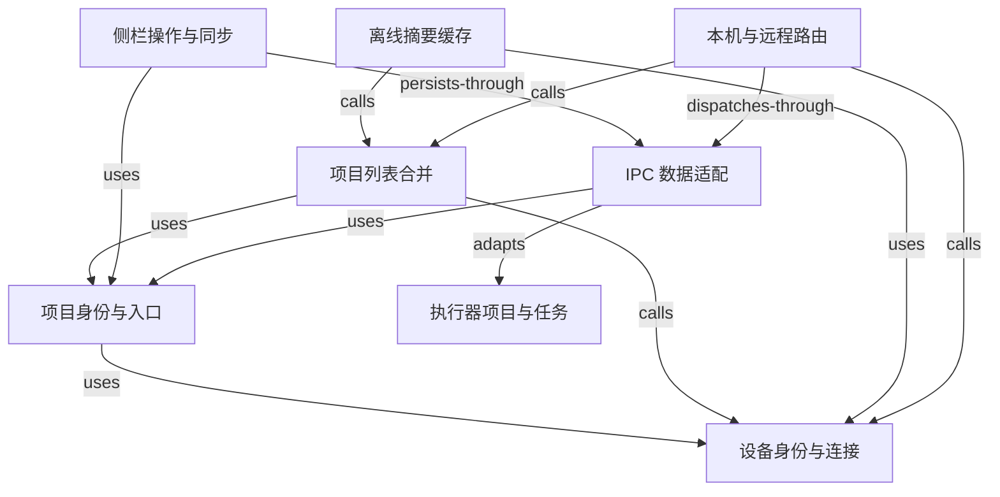

# Codex 左侧栏状态一致性

Wework 桌面端复用 Codex App 的侧栏状态语义。项目和实时任务内容由 Codex app-server 提供，侧栏元数据由设备对应 `CODEX_HOME` 下的 `.codex-global-state.json` 提供。远程设备在线时，Wework 还会在本机保存任务列表摘要，用于设备离线后的启动恢复。

## 悬浮详情的生命周期

侧栏项目和任务详情由鼠标悬停控制。鼠标离开行与浮层后关闭详情；浮层内按钮保留焦点不能延长显示时间。`HoverCard.interactive` 只允许操作浮层内容，需要焦点控制显示的调用方必须显式启用 `openOnFocus`。项目置顶状态与浮层是否保持显示无关。

桌面 `running-sidebar-state` 检查点覆盖从项目行进入详情、按下浮层按钮后移出并松开、详情关闭、重新打开和 Escape 关闭。该场景保留按钮焦点，验证关闭不会被后续鼠标移动取消。

跨元素移动使用 `pointerLeave` 的 `target` 参数，在同一 renderer 回合内发出离开与进入事件，避免控制协议的命令间隔超过实际关闭延迟。保留生产环境的 120ms 关闭延迟，不通过延长等待或重试掩盖问题。

## 状态所有权

| 数据                     | 唯一来源                               | 说明                                                                      |
| ------------------------ | -------------------------------------- | ------------------------------------------------------------------------- |
| 项目名称、根目录和类型   | Codex global state                     | 支持传统目录项目、`local-projects` 多目录项目和 `remote-projects`         |
| 项目顺序、置顶和外观     | Codex global state                     | 使用 `project-order`、`pinned-project-ids`、`project-appearances`         |
| 任务标题、时间和运行状态 | Codex app-server + Wework 远程摘要缓存 | Wework 不缓存任务正文；离线缓存中的运行状态始终为停止                     |
| 任务归属、顺序和置顶     | Codex global state                     | 使用 assignment、workspace hint、项目内 thread order 和 pinned thread IDs |
| 展开状态和滚动偏好       | Wework localStorage                    | 仅保存不影响 Codex 的纯 UI 偏好                                           |

项目的 UI 标识通常由“状态所属设备 + project key”计算。能够解析目标的远程入口使用目标项目的设备与 key，以保持同步前后的 UI 标识；已有入口在合并中保留自己的 UI 标识。数据合并采用下文的项目身份规则，不比较 UI 数字 ID。

任务的 UI 标识由“状态所属设备 + task ID”组成。实时列表刷新只按这个标识合并任务；标题、工作区路径和运行时类型都不是身份字段。不同任务可以具有相同标题，例如连续发送两个只有附件且没有文本的任务，因此前端和 Executor 都不能用这些展示字段推断任务重复。

项目内尚未进入手动顺序的新任务排在已有手动排序任务之前；多个未排序任务按最近活动时间排列。已有手动顺序的任务继续按 `sidebarOrder` 稳定显示。这样，乐观创建阶段尚未获得 `sidebarOrder` 的新任务会立即出现在项目顶部，Executor 返回持久化顺序后不会落到列表底部。

项目列表同样不能依赖某一次本地、云端或缓存请求的数组顺序。Executor 按 `project-order` 生成 `projectSidebarOrder`，Wework 将其保存在项目摘要和离线缓存中，并在合并多个 runtime work 来源后重新按该字段排序。没有持久化顺序的项目保持合并时的相对顺序；已排序项目不会因任务活跃时间、请求完成先后或设备重连而移动。

## 用户询问与执行状态

任务的 `interactionStatus` 由执行器持久化，独立于回合和执行是否结束。
阻塞式询问使用 `waitingForUserInput`；Codex 的 `request_user_input_async`
使用 `awaitingUserReply`，模型可以继续工作，回答作为下一条用户消息发送。
两种状态都显示侧栏铃铛，但异步待回复本身不会阻止发送消息。

异步问题在执行正常结束、切换任务和重新加载任务列表后仍保留提醒。
执行器接受下一次消息或运行中指导后清除提醒；执行失败或取消也会清除。
不能仅因为回合完成或问题工具调用完成，就把问题视为已回答。

桌面 `priority-filter` 检查点包含异步问题的铃铛回归：等待模型结束，
确认当前任务和后台任务仍显示铃铛，再提交回答并确认提醒消失。

## 项目模型

Executor 将以下三类数据合并为统一项目列表：

1. `electron-saved-workspace-roots` 与 `electron-workspace-root-labels` 表示传统单目录项目。
2. `local-projects` 与 `project-writable-roots` 表示新版本地多目录项目。
3. `remote-projects` 表示远程主机上的项目。

任务归组依次采用：`projectless-thread-ids` 排除、`thread-project-assignments` 显式归属、`thread-workspace-root-hints` 提示、最长项目根路径匹配。显式信息始终优先于路径推断。

## 全设备项目编辑

本机、云设备和远程设备的项目菜单以及会话内项目入口使用同一个编辑器。可以修改项目名称、添加或移除源文件夹、设置主目录，以及配置项目指令、默认模型、快捷短语和插件。默认项目空间继续由实验功能开关控制。

源文件夹全部属于项目的执行设备，至少保留一个文件夹；列表第一项是新会话使用的主目录。本机使用原生文件夹选择器，云设备和远程设备通过设备目录选择器浏览目标设备，不能把桌面电脑上的路径保存成远程目录。Executor 保存前验证目录存在且确实是文件夹。

项目的执行设备身份与本机侧栏状态身份分别保存。编辑请求携带执行设备及其真实项目 key，完整配置写入目标设备的 `CODEX_HOME`；本机的远程项目描述保留完整目录和设置投影，用于刷新和离线查看。项目按稳定身份合并，切换主目录不会创建第二个项目，也不会重置侧栏顺序、置顶或外观。插件读取和安装同样指向项目执行设备，缓存按设备隔离。

修改后的目录和 AI 设置只用于新建会话。已有会话继续使用创建时保存的工作目录、可写目录和项目执行设置；用户仍可通过会话内的模型等控件主动修改本轮配置。移除项目源文件夹不会删除对应文件。

设备离线时可以打开编辑器查看已有配置，但不能保存或安装插件。保存失败时保留编辑内容；目标设备已保存而本机索引同步失败时，界面明确提示同步错误。

本机侧栏同步使用当前本地 IPC 执行器返回的设备标识和运行时实例身份。生成同步清单和提交同步使用同一份身份；云端的历史注册或同名设备地址不会改变本机状态的保存位置。执行器重连时重新校验当前身份；运行时实例变化后，旧的排队同步失效，新的同步重新读取当前身份和完整项目清单。远程项目所属设备仍严格校验身份；无法确定归属时不会发送不完整清单。

所属设备的保存响应和新读取结果通过校验后，客户端按执行器身份更新项目设置；设备的不同路由地址不会阻止更新。即使随后本机侧栏同步失败，新对话仍使用已确认的项目默认模型和快捷短语，现有会话保持原配置。

### 旧设备按功能兼容

注册与心跳的 `runtime_features.projectEditing` 分别声明 `multiRoots`、`aiSettings`、`defaultProjectSpace` 和 `plugins`。显式布尔值优先，`false`、缺失或格式错误的显式字段均不授权写入。未声明能力的旧设备只采用已经验证的版本契约：Executor 1.8.5 支持名称和多目录，1.8.6 以及已验证发布镜像版本 2.0.21 还支持 AI 设置、快捷短语和默认项目空间；其他版本（包括无法识别和未来版本）只通过原有重命名操作改名。

项目插件选择保存在 AI 配置对象内，因此修改选择需要同时支持 AI 设置写入和插件 RPC；单独支持插件 RPC 时市场只读。插件不能从版本号推断。未声明插件能力时，客户端向拥有者运行时发送只读 `plugin/installed` 查询，使用 `runtime.codex.app_server.request`。只有该运行时方法明确不支持时显示升级提示；鉴权、断连、超时和插件服务错误继续显示真实错误。能力和市场缓存随设备、运行时实例、版本或在线状态变化失效。已保存的插件和其他配置保持可读，未支持的控件禁用，插件查询不阻塞其他设置保存。

保存时省略未支持的字段，使用拥有者设备返回的响应和该设备的实时项目列表核对名称、目录顺序及设置。字段丢失或值不匹配不会关闭草稿，也不会以空值覆盖本机投影。

### 显式、安全地升级旧 Docker 设备

升级由设备维护者主动执行，不自动迁移、合并或覆盖 Codex home。

1. 在旧容器仍存在时确认实际 Codex home、Executor home、工作区目录、持久化卷和挂载。旧镜像可能未设置 `CODEX_HOME`，此时必须确认 Codex 默认 home；不能只备份新版本预期的路径。
2. 停止新的任务写入，并在销毁旧容器前把实际 `.codex-global-state.json`、待写 oplog、Codex 配置/会话/插件及 Executor 持久化身份与工作区备份到独立存储。检查备份包含项目、根目录和 AI 设置；记录原 `device_id`、`runtime_instance_id`、卷映射、用户/home、权限和镜像版本。备份可能包含凭据，应按私密数据保管。
3. 保留原设备 ID、运行时持久化身份、卷与 home 挂载，准备替换容器。先确认新版本的规范持久化 `CODEX_HOME`，再把备份恢复到该路径，最后启动替换容器。目标 home 已有内容时先单独备份并由维护者明确选择保留哪一份；不能静默合并或覆盖两份 home。
4. 验证设备身份未变化，拥有者运行时中的项目名称、根目录顺序、默认空间、AI 设置和插件选择都与备份一致，再确认新能力已上报。保留旧备份作为回滚依据；运行时升级成功不能代替数据验证。

## 执行器身份、项目和本机入口

- `deviceId` 是执行请求使用的设备地址。设备别名统一由 `workbench-device.ts` 解析；有持久化 `runtime_instance_id` 时用它比较执行器身份，连接地址仍使用可路由的 `device_id`。双方均缺少 Runtime 身份时，仅对同一注册记录（相同记录 ID 和规范设备 ID）去重，不能凭共享别名推断为同一执行器；有身份的记录不会与缺少身份的记录合并，不同 Runtime 同时声明同一别名时明确报错。
- 本机身份来自 `executor.describe` 的必填 `runtime_instance_id`。只有与本机 Runtime 身份相同的 APP 云端注册记录才能加入本地 IPC 路由；共享 `app_device_id` 的其他安装不属于本机。描述缺少或包含无效 Runtime 身份时，按 IPC 协议错误处理。
- 连接健康状态与安装身份分开处理。短暂 IPC 断连只将已验证的执行器标记为离线，保留其身份，使 APP 地址的回滚和终端清理仍使用本地路由；重新连接时更新身份。无效的协议描述会撤销缓存身份。
- `remoteHostId` 是保存在 Codex 远程项目入口中的主机引用。读取和写回时保留原值，通过身份解析器参与比较，不在列表合并中改写为另一种地址。
- `stateDeviceId` 指定收藏、排序和入口元数据的保存设备。它与运行任务的设备可以不同，不能据此重定向任务。

Executor 项目按“所属执行器 + project key”识别，目录按“所属执行器 + 规范化路径”识别。UI 的数字 ID 不能作为项目合并依据。Backend 的真实项目 ID 仍使用其独立的全局命名空间。

Wework 保存的 `wegent-remote:<host>:<projectKey>` 入口显式引用目标项目。合并时先建立实际项目索引，再解析入口，与输入先后无关。入口提供名称、收藏、排序和外观，实际项目提供目录和任务。两个不同项目可以共享同一目录，不能因此合并。仅有目录信息的传统项目或外部入口，只能关联到同设备、同目录下唯一的项目；有多个候选时保留独立记录，不猜测归属。显式引用的目标缺失时，不改绑到同路径的其他项目。

Executor 输出列表也必须保留项目 key 和远程主机边界。任务按已有 `group_project_key` 归组；没有显式归属的独立会话保留自己的目录分组，即使目录位于代码项目内部，其他任务才采用唯一的最长本地根目录。远程入口不能认领本机同路径任务。工作区类型属于元数据，不参与目录身份判定。

项目同步的移除记录按“设备 + 项目 key”隔离；无法解析目标的外部入口按“状态设备 + 入口 key”隔离。删除或重新打开一个项目不能影响其他设备或同目录中的其他项目。不得按显示名隐藏远程入口，也不得只按路径屏蔽同步。

此模型不增加公共 API 字段、数据库迁移或新的设备编号。旧远程入口通过原有格式解析，无法解析的外部主机保持原样。

下图展示设备身份、项目入口、列表合并与同步之间的职责和调用关系。

## 写入与并发

Wework 只发送语义操作，例如“把项目 A 放到 B 前”“置顶 thread T”，不从前端整份覆盖 JSON。Executor 在每次操作时读取最新状态并计算数组。

Codex App 未运行时，Executor 在同目录写临时文件、刷盘后原子替换 global state。Codex App 运行时，操作先进入 JSONL oplog；读取时将磁盘状态和待写操作叠加，因此 UI 立即可见。Codex 退出后，Executor 把操作合并到最新磁盘状态。所有写入都保留 Wework 不认识的字段。

本地项目由本地 Executor 修改本机 `CODEX_HOME`；设备在线时，远程项目由目标设备的 Executor 修改该设备的 `CODEX_HOME`。Backend 不持久化这部分状态。

Wework 向本地 Executor 同步远程项目描述时，每个非空批次对其中出现的远程主机具有权威性：Executor 会更新批次中的项目，并删除这些主机下已不在批次中的旧项目，同时清理对应的顺序、置顶、外观和任务归属元数据。批次中未出现的其他主机保持不变；空批次也不会清空远程项目，避免本地视图暂时不可用时误删离线设备状态。

## 远程任务离线恢复

云端或远程设备的任务列表同步成功后，Wework 按当前用户在本机 `localStorage` 保存字段白名单内的摘要，包括任务 ID、标题、更新时间、工作区路径、仓库和分支提示以及侧栏排序信息。项目投影还保存执行设备身份、完整源文件夹、默认项目空间及 AI 设置，供离线查看。默认模型只保存名称、类型和会话选项；缓存不包含设备或模型凭据、完整模型接口配置、会话正文、工具调用、运行句柄或父子任务树，完整会话详情仍只存在于远程设备。

启动时，缓存摘要作为过期数据与本地 Codex 项目描述合并。远程设备不可用时，项目、上次记录的 IP 和任务摘要仍会显示，状态点为灰色；任务行不能打开，也不能置顶、重命名、订阅通知或归档。设备重新在线后，实时列表恢复为权威数据，并更新或清理缓存。设备发现或任务列表同步失败时保留旧摘要，避免暂时的网络错误清空侧栏。

“远程设备不可用”和“用户主动断开云连接”是两个不同状态。只要 Wework 仍保持云连接，离线设备对应的远程项目继续按上述规则显示。用户主动断开云连接时，Wework 暂时从侧栏隐藏远程项目、远程任务和远程聊天，但不会删除本地摘要缓存或 Codex global state 中的 `remote-projects`。重新连接后，侧栏先从缓存恢复原远程项目，再由实时设备和任务列表更新；本地项目始终不受影响。

用户在设备离线时移除云端或远程项目，操作只作用于当前 Wework 实例：Wework 删除本机 Codex global state 中对应的 `remote-projects` 描述和本地摘要缓存，不联系离线设备，也不删除目标设备上的项目状态或工作区文件。因此项目在设备持续离线期间不会因刷新或重启 Wework 恢复；设备重新上线并再次上报同一工作区后，项目可以重新出现。

## 交互边界

- “云端工作”显示“可用”时，点击整行会打开独立的云端工作页面；行尾设置按钮仍打开“连接”设置。
- 点击项目只展开或收起任务，不改变中间内容区。
- 点击任务或新建项目任务才改变主内容。
- 项目、置顶项目、置顶任务和项目内任务支持语义化拖拽排序。
- 任务只允许在同一项目内排序，不提供跨项目放置目标，也不通过拖拽修改 `thread-project-assignments`。
- 项目和任务的省略号菜单与右键菜单使用同一动作集合。
