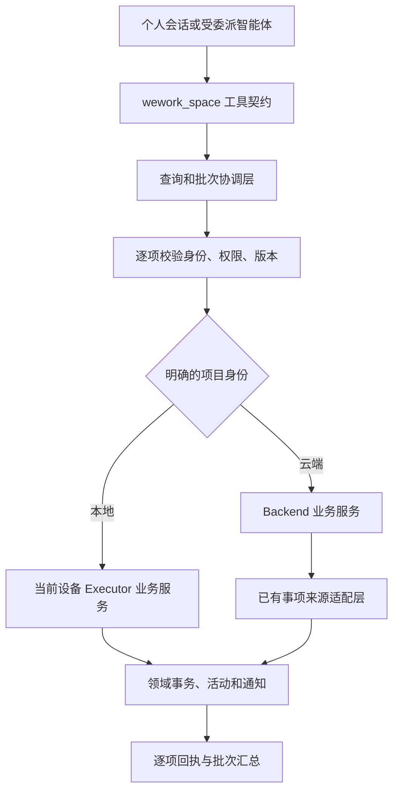
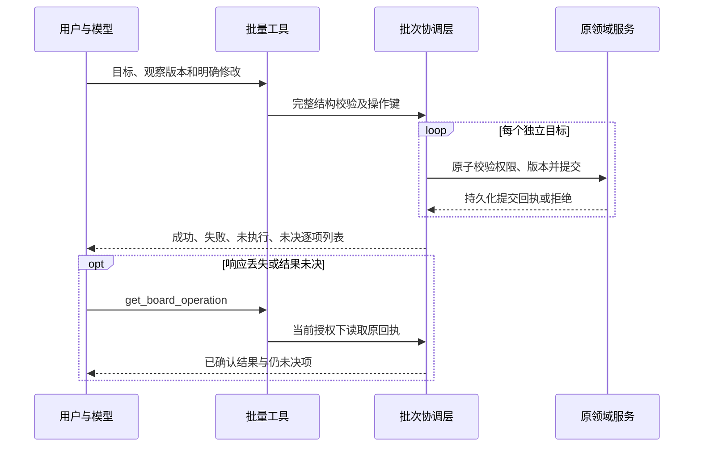
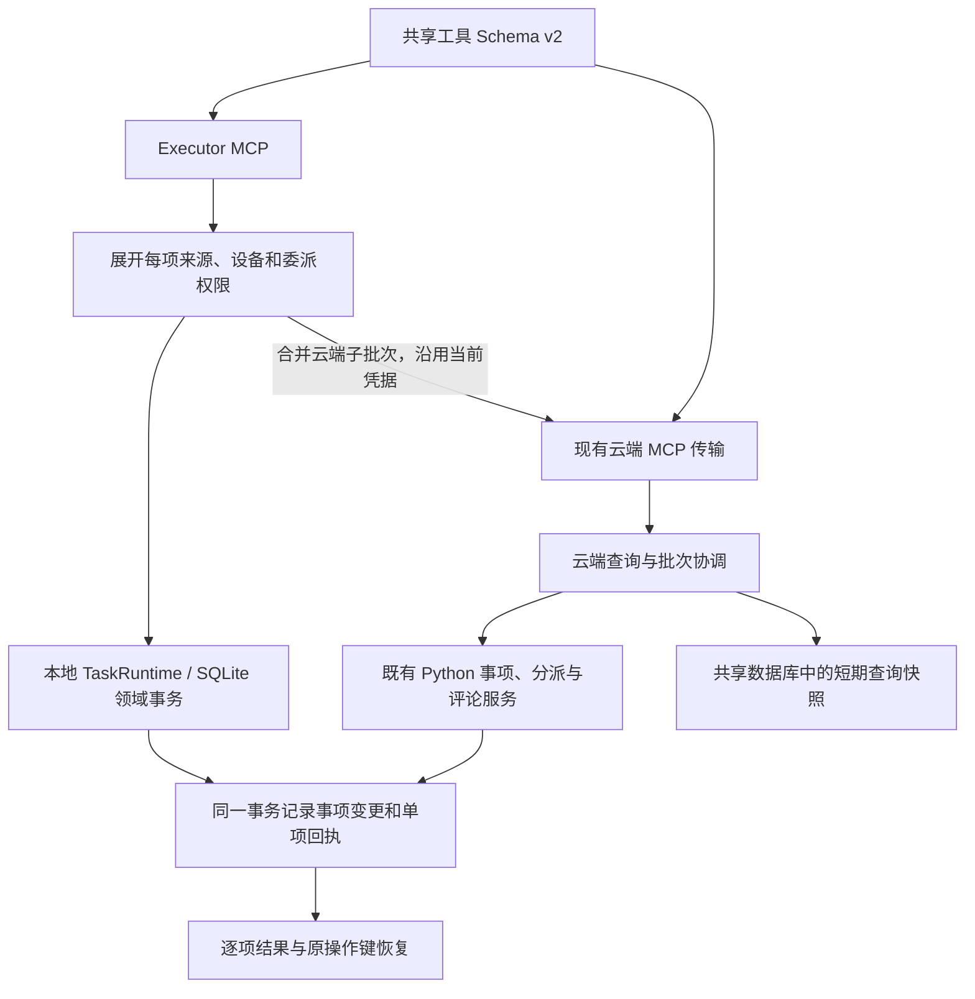

# Wework 协作批量工具设计

状态：A+B+C+D 全范围实现。协议版本：2。日期：2026-11-16。

实现覆盖本地 Executor 与云端 MCP；本次开发没有修改真实事项状态。共享 Schema 是字段与输入限制的唯一来源。
[English](../../../en/wework/developer-guide/wework-collaboration-batch-tools-design.md)

## 1. 目标与实际问题

目标是让“找出某人全部需求 → 阅读完成证据 → 人工选择 → 批量修改 → 核验结果”成为完整、可追溯的协作工具流程。

需求背景是一次跨多个项目核查上百条事项的操作。历史对话中的数量和完成判断只作为场景输入，不作为本设计已重新核验的业务事实。

| 代码事实                                  | 影响                           | 设计要求                     |
| ----------------------------------------- | ------------------------------ | ---------------------------- |
| 搜索最多返回 200 条，没有续页位置         | 截断结果可能被当作全部需求     | 查询必须分页，并声明完整性   |
| 搜索有创建人筛选，没有负责人筛选          | “某人负责”和“某人创建”容易混淆 | 两种身份独立筛选             |
| 桌面本地、桌面云端、云端 MCP 各有搜索处理 | 支持的筛选条件存在差异         | 共用契约和一致性用例         |
| 详情、评论、修改、分派只有单项入口        | 调用次数随事项数量增长         | 增加按业务用途划分的批量入口 |
| 评论默认返回最近一段，按时间正序排列      | 返回顺序不能证明覆盖了全部历史 | 明确“最近”与“从头”读取模式   |
| 桌面授权主要检查顶层 space_id/item_id     | 只检查批次外层会漏掉内部目标   | 对每一项展开授权             |
| 当前分派工具会读取最新版本再提交          | 无法保证仍是用户查看过的状态   | 批量分派显式携带预期版本     |

代码依据：`executor/src/task_runtime/mcp.rs`、`executor/src/task_runtime/mcp/comments.rs`、`executor/src/task_runtime/router.rs`、`executor/crates/task-store/src/task_runtime/model.rs`、`backend/app/mcp_server/tools/wework_space.py`。

## 2. 产品与执行边界

- 项目空间是业务容器；代码工作区、执行器所在设备、Runtime 会话不是项目空间身份。
- 现有工具的 `space_id` 实际指一个项目，不是父级工作区。新契约保留这个字段含义，父工作区单独使用 `workspace_id`。
- 本地项目数据由当前设备的 Executor 持有；云端项目由 Backend 持有。相同字符串 ID 不代表相同项目。
- GitHub/GitLab 等事项来源继续由现有业务适配层处理。Agent 只使用 `wework_space`，不得绕过工具访问项目空间底层来源。
- 云端 MCP 只能处理它有能力访问的云端目标，不自动寻找、唤醒或代用另一台本地设备。
- 正常个人会话可在授权项目之间操作。项目派发的 manager/executor 继续受原有授权范围约束。



查询快照只固定阅读结果；批次回执只记录已发生的操作。两者都不能授予新的执行权限。

## 3. 工具全集与范围分组

组别是选型单位，不表示已决定实施顺序。每组实现时都必须包含对应权限、失败语义和测试。

| 组           | 工具                              | 主要输入                          | 主要结果                             |
| ------------ | --------------------------------- | --------------------------------- | ------------------------------------ |
| A 发现与查询 | `list_spaces` 增强                | 工作区、名称、游标                | 完整项目引用、名称、能力、续页       |
| A            | `describe_space_board`            | 项目引用                          | 状态 ID/名称、字段、支持的操作、限制 |
| A            | `search_board_items` 重整         | 查询范围、筛选、排序、投影、游标  | 事项页、查询 ID、覆盖范围            |
| A            | `aggregate_board_items`           | 相同查询条件或查询 ID、分组维度   | 按项目/状态/负责人等维度统计         |
| B 批量阅读   | `batch_get_board_items`           | 目标列表、需要的详情片段          | 版本、详情、权限、附件/交付摘要      |
| B            | `batch_list_board_item_comments`  | 每项目标、读取模式和游标          | 每项评论页、历史覆盖范围、独立续页   |
| B            | `batch_get_assignment_candidates` | 项目列表、候选类型                | 每项目的人员、机器人、协作组         |
| C 批量维护   | `batch_update_board_items`        | 每项预期版本与修改字段            | 每项修改结果和提交后版本             |
| C            | `batch_assign_board_items`        | 每项预期版本、负责人、通知选项    | 分派结果、必要的执行/通知回执        |
| C            | `get_board_operation`             | 操作 ID                           | 持久化执行进度、逐项结果、未决项     |
| D 批量协作   | `batch_add_board_item_comments`   | 每项内容、结构化 mentions、去重键 | 每项评论 ID、通知/后续执行回执       |
| D            | `batch_create_board_items`        | 每项创建内容与去重键              | 创建后的完整引用、版本和副作用回执   |

设计上保留现有单项操作；它们与批量操作调用同一领域服务。批量创建普通事项不替代 manager 的 `submit_workflow_plan`，也不获得派发、工作流推进或交付终结权限。

附件正文、文件下载、交付资产继续按需使用现有工具；批量详情默认只读取元数据。表格 CRUD、删除、归档、跨项目移动和复制需要各自明确的业务契约，不通过一个任意 `execute` 工具开放。它们不属于本次事项批量工具方案。

## 4. 公共身份和输入契约

以下为逻辑类型，具体 JSON Schema 在实现时作为唯一维护源，供 Rust、Python 和协议测试使用。

```typescript
type SpaceRef =
  | { project_store: "backend"; space_id: string }
  | { project_store: "local"; space_id: string; device_id: string };

type ItemRef = { space: SpaceRef; item_id: string };

type QueryScope =
  | { kind: "projects"; spaces: SpaceRef[] }
  | { kind: "workspace"; workspace_id: string }
  | { kind: "accessible" };

type AssigneeRef = {
  type: "user" | "agent" | "group" | "team";
  id: string;
};
```

- 引用来自发现工具；ID 保持字符串，不从数字、前缀或历史缓存猜测来源。`device_id` 不产生访问远端设备的授权。
- 已绑定事项的 `get_current_context` 返回 `space_ref`，无需枚举项目即可构造允许的批量目标。Executor 仍受原事项范围约束，不能用 `list_spaces` 解析绑定。若本机可信身份不可用，返回 `space_ref_error` 并保留已授权的事项详情。
- 交互输入可以使用“我”，但进入服务的身份必须解析为当前可信主体。禁止把本地所有者 `0` 当作全局账户别名。
- 所有批量项携带调用内唯一的 `request_id`；结果按输入顺序返回，以此关联，不能只按可能重复的事项编号关联。
- 同一写批次可多次指向同一事项，按输入顺序串行处理；不同事项可以并发。每项仍独立携带预期版本，不能根据前项结果静默改写。前项失败或未决时，依赖它的后续项记为 `not_executed`，不能越过未确认结果继续修改。
- 未知字段、空批次、重复 `request_id`、无效参数组合在任何写入前失败。有效结构中的权限、版本或业务错误按项返回。
- 字段缺省表示不修改；`null` 只有在原领域字段允许清除时才表示清除。状态、负责人、父子关系等沿用原服务验证。

## 5. 查询、分页与统计

### 5.1 筛选

同一字段多个值按 OR，不同字段按 AND；标签显式指定 `any` 或 `all`。

| 条件                                   | 语义                                              |
| -------------------------------------- | ------------------------------------------------- |
| `scope`                                | 指定项目、父工作区内当前可见项目或全部可访问项目  |
| `query`                                | 匹配事项 ID、标题、描述和标签；不隐式全文扫描评论 |
| `assignees`                            | 人、机器人、协作组、现有 team 类型；按 ID 匹配    |
| `unassigned`                           | 无负责人；与 `assignees` 互斥                     |
| `participation: "mine"`                 | 匹配当前认证用户已加入事项参与者名单的事项 |
| `creator_user_ids`                     | 创建人，与负责人独立                              |
| `statuses` / `exclude_statuses`        | 动态状态 ID；两者不能同时提供                     |
| `priorities` / `tags`                  | 优先级和标签                                      |
| `parent` / `has_children`              | 父引用与是否有子事项，不能用跨项目裸 ID           |
| `created_at` / `updated_at` / `due_at` | 带时区区间；起点包含、终点不包含                  |
| `include_archived`                     | 按现有来源能力显式选择；来源不支持时明确报告      |

状态不能硬编码为五种默认状态。`describe_space_board` 返回实际状态与终态语义；状态名叫“已完成”不自动等同于验收通过。筛选“未完成”必须基于该项目明确的状态类别，缺少类别时返回需明确状态列表，不能猜测。

Schema 分别描述来源是否支持某个动作，以及当前调用者是否有权限；“来源支持分派”不能替代当前用户的 `permissions.assign`。同样声明条件版本更新、幂等创建/评论、历史读取、归档筛选和时间筛选等能力，不能在运行时静默降级。

投影使用 `summary`、`detail` 或经 Schema 允许的字段集合；摘要至少含完整引用、标题、状态、负责人、版本、更新时间和可用的打开链接。排序字段由 Schema 声明，增加完整引用作为稳定的最终排序键。

相同的完整空间引用只采集一次，分页和聚合均按不同事项计数。时间字段按实际时间点排序，统一解释时区；不按日期字符串排序。

### 5.2 查询快照

首次搜索生成短期、只读查询快照：固定发现到的目标项目集合、匹配事项的投影和顺序，并返回 `query_id`。后续页和统计可复用它，避免在核查期间因状态变化反复遗漏或重复。

- 快照有明确的 `created_at`、`expires_at` 和各来源的读取起止时间；重启后可失效，不要求持久化阅读快照。
- 不宣称本地、云端或外部来源具有同一数据库事务。返回 `consistency: materialized_scan` 和来源读取时间；这是一次已固定结果的扫描，不保证上游在扫描期间没有变化。只有实际支持一致性事务的来源才能额外声明其快照保证。
- 每页、每次统计和回读前重新检查查询涉及资源的当前可见性。出现可见性变化时使整个查询失效，返回 `query_scope_changed`，不能继续暴露旧投影或旧计数。
- 游标是不透明、绑定用户、查询、排序和读取位置的值；不能跨查询、跨用户或更换筛选复用。过期返回 `cursor_expired`，客户端重新查询并说明重新核对。
- 快照中的版本是观察版本，更新仍以当前领域事务的版本比较为准。
- 大范围扫描按现有调用超时分段推进；尚未完成时返回 `state: collecting`、`continuation_cursor` 和 `matched_so_far`，后续调用继续，不把已扫描数量冒充总量。完成扫描后状态为 `ready` 或存在来源失败的 `partial`，再提供固定分页和统计；不依赖新增后台扫描任务。

```json
{
  "query_id": "q_example",
  "state": "partial",
  "items": [{ "item_id": "issue-a", "title": "Example issue", "version": 7 }],
  "next_cursor": "cursor_example",
  "matched_total": 88,
  "coverage": {
    "complete": false,
    "sources": [
      { "scope_key": "backend:project-a", "state": "complete" },
      { "scope_key": "backend:project-b", "state": "unavailable" }
    ]
  },
  "consistency": "materialized_scan",
  "expires_at": "2026-11-16T11:10:00Z"
}
```

示例省略事项的其他摘要字段，数字是协议示意。`matched_total` 仅覆盖成功读取的来源，`coverage.complete=false` 时必须展示为部分数量。`next_cursor=null` 仅表示该快照没有更多页，不能替代完整性判断。

### 5.3 聚合

`aggregate_board_items` 复用同一个可见性查询和筛选器，支持 `space`、`status`、`assignee`、`creator`、`priority`、`tag` 及其组合。默认不同时返回所有维度；分组桶受响应预算和分页约束，不随意限制用户所需的维度数量。

- 传查询 ID 时，计数与该快照一致；直接传条件时创建相同语义的查询快照。
- 分组数量不能来自当前页。只读角色也不能通过聚合看到隐藏事项数量。
- 标签是多值维度，同一事项可以出现在多个标签桶；明确 `count_mode: memberships`，桶合计不等于唯一事项数。其余维度仍明确唯一事项计数口径。
- 失败来源单列；用户无权看见的事项不返回标题、数量、负责人或存在性。显式无权访问的目标沿用现有不可见错误语义。
- 来源不支持某个筛选时，返回 `unsupported_filter` 和覆盖缺口，不能忽略条件继续计算。

## 6. 批量阅读与历史证据

`batch_get_board_items` 默认返回详情和版本。可选择 `permissions`、`attachment_metadata`、`delivery_summaries`；每个可选片段分别声明完整、无权限、失败或未请求。正文和大资产不自动内联。

`batch_list_board_item_comments` 的每个目标都有独立读取参数：

```typescript
type CommentRead = {
  request_id: string;
  target: ItemRef;
  mode: "oldest" | "latest" | "after";
  cursor?: string;
  limit: number;
};
```

- `oldest` 从最早可见活动开始；`latest` 返回最近一页，但页内按时间正序；`after` 必须提交该事项已有的游标。
- 返回 `has_earlier`、`has_later`、`next_cursor`、`history_complete`；读取最新一页时不能把“没有更新活动”说成“历史已读完”。
- 游标保留是否从最早活动开始读取；`latest` 后继续使用 `after`，仍不能声称已读完全部历史。只有从 `oldest` 连续遍历到末页才返回 `history_complete: true`。
- 游标绑定目标和读取方向；不能混用另一个事项的序列号。保留来源原有活动 ID、作者和时间，不推断旧活动作者。
- 原评论工具的最近 200 条行为在实现中需要显式适配到新的阅读模型，不能只在旧调用外面套一层数组。
- 成功读取事项但评论失败时，详情仍是成功，证据覆盖明确为不完整。

工具输出事实和证据引用，不输出隐含的业务裁决。“PR 已合并”“迁移到另一事项”“交付已验收”是不同事实；文本或评论中的完成声明也不自动授予关闭权限。

## 7. 批量写入契约

### 7.1 输入示例

```json
{
  "operation_key": "close-reviewed-items-20261116-a",
  "preview": false,
  "items": [
    {
      "request_id": "close-a",
      "target": {
        "space": { "project_store": "backend", "space_id": "project-a" },
        "item_id": "issue-a"
      },
      "expected_version": 7,
      "patch": { "status": "completed" }
    }
  ]
}
```

`batch_update_board_items` 支持原领域更新允许的字段，状态取实际项目 Schema 中的 ID。标签支持互斥的整组替换，或显式 `add/remove`；增删必须在同一版本约束内执行，不能先读再无条件覆盖。负责人变更统一走分派领域能力，不在更新工具中另造一套通知和执行路径。

`batch_assign_board_items` 每项要求 `expected_version`、`assignee`；人工通知沿用原默认设置和显式选项，不能由模型为追求安静而关闭。机器人或协作组分派可能触发真实执行，预览和回执必须说明这些副作用，并保留现有操作授权。

`batch_add_board_item_comments` 使用结构化 mentions、当前作者和已有通知机制。mentions 不是普通文本替换，也不能通过批量工具重复发送提醒；可能唤醒助理的行为照原规则执行。

### 7.2 预览、事务和顺序

- `preview=true` 只执行当前校验，返回预计变化、版本、已知副作用和未能确认的条件；不修改事项、预留版本、发通知或创建执行。不生成可绕过后续校验的“许可”。
- 提交时每项再次校验作用域、当前权限、预期版本和领域规则。版本比较必须与实际提交处于原子事务或原来源等价约束内，不能只在协调层预读。
- 每项是独立领域事务；跨项目、数据库和外部来源不承诺整批原子提交。不同目标可有界并发，同一目标按输入顺序执行并保留各自回执。
- 业务拒绝的失败项保留错误，其他独立项继续；整批结构错误则零写入。会话权限被撤销时停止后续新提交，记录未执行项，已提交事实保留。
- 更新已提交但自动化/通知仍在等待时，分别记录领域提交与副作用状态。不能把通知失败解释为事项未修改，也不能重复提交来补发。
- 工具层不自动替换冲突版本、不自动换状态、不绕过审批、不把现有工作流约束降级。

### 7.3 回执与幂等

```typescript
type ItemOutcome = {
  request_id: string;
  target?: ItemRef;
  state: "succeeded" | "failed" | "not_executed" | "unknown";
  committed: boolean | null;
  item_version?: number;
  result?: object;
  error?: {
    code: string;
    message: string;
    retryable: boolean;
  };
  effects?: object[];
};
```

批次返回 `operation_id`、`state`、输入数量及四类结果数量、逐项回执；数量之和必须等于输入项数。结果按请求顺序排列。提交成功时直接返回提交后投影和版本，不要求每项再发一次查询才能证明提交。

- 写操作必须有 `operation_key`，绑定真实主体、运行/委派授权上下文、工具类型和规范化载荷哈希；同键不同载荷返回 `idempotency_conflict`。`preview` 不消耗写入幂等键。
- 同键同载荷返回原回执，不重新执行其中失败或未执行的项；调整后重新提交是新的显式操作。
- 受控本地/云端存储将幂等回执与领域修改在同一事务中提交；通知和执行意图使用已有事务/发件箱能力。不得仅在修改后另写一条去重记录，留下崩溃重复窗口。
- `get_board_operation` 读取持久化回执，仍需当前身份及相应授权；权限变更不能通过历史回执暴露已不可见内容。
- 收到工具超时或进程中断时，先读取原操作回执。已确认成功项不再次提交。未执行项可在重新授权后用新的操作键显式提交。
- 外部来源缺少幂等或版本条件支持时，不能声称 exactly-once 或通过预读模拟原子版本检查。Schema 明确能力；无法满足更新版本契约的目标在提交前拒绝该写操作。
- 外部请求已发出但没有可验证回执时，保留 `unknown` 和有限的核查线索，不自动重试非幂等创建/评论。读到相同最终状态本身不能证明某条评论或创建只执行了一次。
- 本地回执由原设备保存，云端回执由 Backend 保存。混合批次由当前 Executor 保留子操作引用；跨来源没有共享事务。查询端不可用时保持未决状态。
- 批次在执行副作用前登记操作 ID。协调层在现有工具超时内预留回执返回时间，预算不足的未提交项记为 `not_executed`；已发出但无法确认的项记为 `unknown`。不通过脱离原会话的无主后台写任务延长执行。
- 回执正文必须有明确保存期限和过期语义；初始建议保存 30 天，并在 Schema/回执中声明 `expires_at`。正文过期后保留最小去重记录，旧键返回 `operation_expired`，不能因清理正文而把旧操作当作新操作重放。真实保存策略应复用现有审计和幂等设施，实施时确认去重索引体积与清理边界；删除去重索引前必须有等价的旧键拒绝机制。



## 8. 权限和工具可见性

保持 [CP01–CP20 权限契约](../../../en/wegent/developer-guide/collaboration-permissions.md)，不新增角色权限，也不因为批次外层有权限而信任内层目标。

| 调用者/场景      | 阅读                                         | 写入                                   |
| ---------------- | -------------------------------------------- | -------------------------------------- |
| 正常个人会话     | 当前身份可见的项目和事项                     | 当前领域能力允许的操作                 |
| 项目 Viewer      | 可见事项、评论和统计                         | 不可编辑、评论、分派或执行             |
| 委派 manager     | 继续遵守原项目范围和管理工具类别             | 只允许原 manager 可调用的领域动作      |
| 委派 executor    | 原执行范围；明确指定时保留直接父事项只读例外 | 不因批量入口获得管理能力或父事项写权限 |
| 只知道事项 ID    | 先校验项目访问，再校验事项可见性             | 不产生权限                             |
| 权限已撤销或失效 | 不返回旧快照、隐藏数量或回执正文             | 拒绝新提交，不自动恢复旧授权           |

批次拆分后沿用单项动作的角色类别，而不是把所有 batch 工具标成同一个类别。直接父事项例外只适用于原先允许的阅读动作，不扩展为搜索父事项全部关联对象、祖先或兄弟事项。

错误对外采用既有不可见语义；不能用 `permission_denied` 与 `not_found` 的差异探测本来不可见的事项。日志只记录必要标识、耗时、错误码和计数，不记录 token、认证文件或完整评论正文。

## 9. 已实现的架构与协议收敛

共享契约位于 `shared/protocol/wework_space_tools_v2.json`，桌面发现与云端 FastMCP 均直接发布该 Schema；云端保留原始 JSON 输入，避免框架类型转换造成契约偏差。

`executor/src/task_runtime/mcp/batch/` 负责显式来源路由、逐项授权、混合批次和本地查询。`backend/app/services/board_tools/` 负责云端查询与协调；现有 Python-owned MCP 传输入口直接调用它。本次没有新增 REST API 或迁移已有 API。



本地和云端写入均在原领域事务内写入单项回执，复用统一节点存储的 `board_operation` 类型，没有表结构或桌面升级迁移。发布事件发生于提交后；发布失败不能把已提交变更报告成未提交。

共享 Schema 作为 `shared` Python 包资源发布，Rust 在编译时包含同一文件，不依赖仓库目录布局。回执正文有效期为 30 天；读取或下一次写入时清理过期正文并保留最小去重记录。`get_board_operation` 接受 `operation_id` 或原 `operation_key`，两者互斥。GitHub/GitLab 的现有适配器读取范围有限，查询覆盖明确标为 `partial`，不能据此宣称全量。

云端查询使用 `board_query` 节点并锁定查询记录，支持多进程读取同一游标；10 分钟后失效，在新查询时清理过期记录。本地查询使用有期限和内存预算的进程缓存。每次分页、聚合或读取成功回执前都重新检查当前可见性。云端写入响应丢失时，本地回执保留 `unknown`，通过原操作键读取云端回执，绝不重新发送写入。

`list_spaces` 和 `search_board_items` 统一返回分页对象，旧搜索实现已删除；调用方、工具发现测试和随应用发布的 Skill 同步更新。独立的助理 `list_projects` 保持原有列表契约，复用完整发现逻辑。

## 10. 资源、错误与运行约束

实际限制：每批最多 100 项阅读、50 项写入；每页最多 200 项事项或 500 条评论。云端子批次合并传输，数据所有者按输入顺序执行单项事务，重复目标在前项失败后停止。查询快照 10 分钟失效，单次云端快照上限 64 MiB、每用户最多 128 个活动查询；本地查询共享 64 MiB 事项缓存预算。用户可继续分页或拆批处理。

- 单次响应还设字节预算，耗尽时返回显式续页或明确未执行项，不静默裁掉评论或事项。具体预算应依据现有传输和实测确定，不在本提案虚构测量结论。
- 避免 N 项 × M 类元数据请求；按项目复用 schema/候选查询，按数据所有者使用真实批量 SQL/服务读取。不能仅减少模型工具轮次却保留无界底层串行访问。
- 本地读取不等待云端恢复；不可用来源单独返回覆盖缺口。失败不能改走另一来源或访问 provider API。
- 批次取消只停止尚未提交的项；已经提交的事项不自动回滚。初期不另造撤销功能。
- `version_conflict`、`unsupported_operation`、`unsupported_filter`、`scope_violation`、`query_scope_changed`、`cursor_expired`、`idempotency_conflict`、`operation_expired`、`source_unavailable`、`outcome_unknown` 均有稳定机器码与可读说明；可见性错误继续用原策略处理。
- 认证过期、作用域错误或不确定写入不做工具层自动重试。复用已有可证明安全的网络策略，不能靠重试获得通过。

## 11. 典型调用流程

### 全量核查某人需求

1. `list_spaces` 明确父工作区和项目引用；`describe_space_board` 确定各项目实际状态。
2. 按负责人 ID 查询，读取完整分页和覆盖范围；按需建立已完成/未完成两个明确状态集合。
3. 使用同一 `query_id` 聚合，避免把“本人创建”混入“本人负责”。
4. 对待判断项批量读取详情，再按 `oldest`/续页读取历史评论，按需读取交付摘要。
5. 模型给出完成、迁移、待验收、证据不足等建议与证据引用；用户选择关闭对象。
6. 以用户选择的完整目标和观察版本调用批量更新，按需预览；保留原生操作审批要求。
7. 展示逐项提交回执；冲突和未决项单列。重新查询用于说明最新数量，不能替代原回执。

### 批量分派

1. 按项目读取候选成员、机器人和协作组，禁止把组替换为组长。
2. 预览每项负责人、当前版本、人工通知及可能的执行副作用。
3. 按当前授权提交，分别展示分派成功、执行排队、执行拒绝、通知待投递等事实。

## 12. 测试与验收设计

| 场景                                      | 必须验证                                                                           |
| ----------------------------------------- | ---------------------------------------------------------------------------------- |
| 超过 200 项、多个项目、负责人和创建人不同 | 全部页无重复遗漏，筛选独立，聚合不是当前页数量                                     |
| 相同项目/事项 ID 出现在不同来源或设备     | 引用、路由、缓存和回执不串数据                                                     |
| 自定义状态、多标签、归档事项              | 不猜状态类别，标签计数口径明确，能力不足显式报告                                   |
| 最近评论与超过 500 条历史                 | 从头遍历完整，最新页不冒充完整历史，游标不可串事项                                 |
| 部分项目离线或筛选不受支持                | 其他结果可读，完整性为 false，不报告全量结论                                       |
| Viewer、跨项目派发、直接父事项            | 逐项拒绝越权；父只读例外不扩展；聚合不泄漏数量                                     |
| 预览后版本/权限变化                       | 提交原子拒绝，不静默覆盖                                                           |
| 部分成功、重复目标和同键不同载荷          | 回执计数准确；同目标有序且前项未决时停止依赖项；结构错误零写入；原成功项不重复执行 |
| 写入后响应丢失、重启、外部未知结果        | 原子持久化回执可恢复；无法证明时保留 unknown                                       |
| 人工分派、机器人分派、mentions            | 沿用原有通知和执行事务，不重复通知、不绕过资源授权                                 |
| 本地、桌面云端、远程 MCP                  | 相同 Schema 与错误语义，能力差异明确可见                                           |

验证分三层：共享协议/领域单测；真实 SQLite/MySQL 与既有服务的集成测试；CI 已覆盖的桌面/服务 E2E 流程中补充真实批量回归。复用 `collaboration-issue-mcp-comments`、个人事项访问和派发权限覆盖，不创建只在本地运行的独立 E2E。

执行聚焦协议、领域事务与权限测试；本次不运行 E2E 或 `ai:verify`。新增批量 E2E 模块由既有 `collaboration-issue-mcp-comments` 场景调用，沿用其 CI 注册、环境与运行器，没有新增独立 CI 作业。

## 13. 实施范围与验证

本次实现 A+B+C+D 全部 12 个工具，其中 2 个为现有工具的协议升级。外部来源继续使用原有读取适配；缺少事务回执或完整评论历史能力时明确报告不支持，不模拟成功。状态分类未显式配置时返回空值，不通过显示名称猜测完成语义。

验证包括：205 项无截断分页与完整聚合、原始 MCP Schema、创建与分派领域规则、评论去重与历史续页、版本冲突、重复目标顺序、事务失败回滚、提交后发布失败、重启恢复、云端响应丢失及委派权限。最终执行结果以本次开发交付说明为准；没有进行上线或生产操作。
