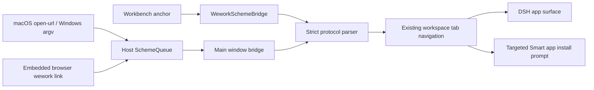

# Wework 深链协议

Wework 使用 `wework://` 作为唯一的客户端深链协议。`wegent://` 已用于附件等内部资源，
不得再把另一种协议写成同一目标的别名。所有外部链接都必须指向一个明确的资源，
不能携带任意 Web 地址、查询参数或回跳地址。

## 路径空间

协议格式固定为 `wework://<resource>/<path...>`。每一段都是单个百分号编码的标识符，
不使用查询串和 fragment。

| 路径                                                     | 目标               | 行为                                                   |
| -------------------------------------------------------- | ------------------ | ------------------------------------------------------ |
| `wework://boards`                                        | 项目空间首页       | 打开或复用项目空间标签                                 |
| `wework://boards/{projectId}`                            | 云端项目空间       | 打开指定项目                                           |
| `wework://boards/local/{projectId}`                      | 本地项目空间       | 打开指定本地项目                                       |
| `wework://boards/{projectId}/issues/{itemId}`            | 工作项             | 打开项目中的 Issue                                     |
| `wework://tasks/{deviceId}/{taskId}`                     | 运行任务           | 按设备与任务身份复用任务标签                           |
| `wework://interactions/{deviceId}/{taskId}/{requestKey}` | 运行中交互         | 打开需要用户处理的交互                                 |
| `wework://apps/{appId}`                                  | 已注册 DSH 应用    | 原生应用回到声明路径，其他应用打开 `/app/{appId}` 标签 |
| `wework://smart-apps/{smartAppId}`                       | 智能工作台市场身份 | 已安装时打开工作台；未安装时打开该工作台的安装引导     |

`smartAppId` 是市场发布身份，不是本机 installation id。客户端先读取本机安装列表，
按 `installation.smartAppId` 匹配；匹配成功后复用现有 `HarnessAppAutoLauncher`
启动并打开标签。未匹配时打开
`/sites?app_type=smart_app&smartAppId={smartAppId}`，展示安装提示和目标工作台详情。

如果本机需要安装 Wework 客户端，外部页面使用 Web handoff：

```text
https://<wegent-web>/open-wework?url=<percent-encoded wework URL>
```

该页面只接受经过白名单校验的 `wework://` 地址，提供“在 Wework 中打开”按钮，
并在同一页面展示下载客户端和重新尝试的入口。旧的
`projectId`、`itemId`、`commentId` 参数继续兼容项目空间通知。

## 入口与安全边界



- 操作系统通过 `open-url`、命令行参数和 `second-instance` 把地址交给主进程队列；
  只有主窗口消费并确认队列，弹出窗口和工作区窗口不得抢占请求。
- Workbench 内普通 `<a href="wework://...">` 由捕获阶段点击处理器拦截；
  内置浏览器中的链接由 Electron host 转回同一条 scheme 队列。
- 解析器拒绝 userinfo、端口、查询串、fragment、控制字符、空段、`.`、`..`、
  超长地址和未知 resource。应用只能导航到已注册 DSH 应用或现有工作区路由。
- 认证依赖的云端目标在连接恢复前保留在主窗口队列中，不提前确认，也不打开失效页面。

## 示例

```text
wework://boards/12/issues/WEG-42
wework://tasks/local-device/task-01
wework://apps/wegent
wework://smart-apps/42
```
