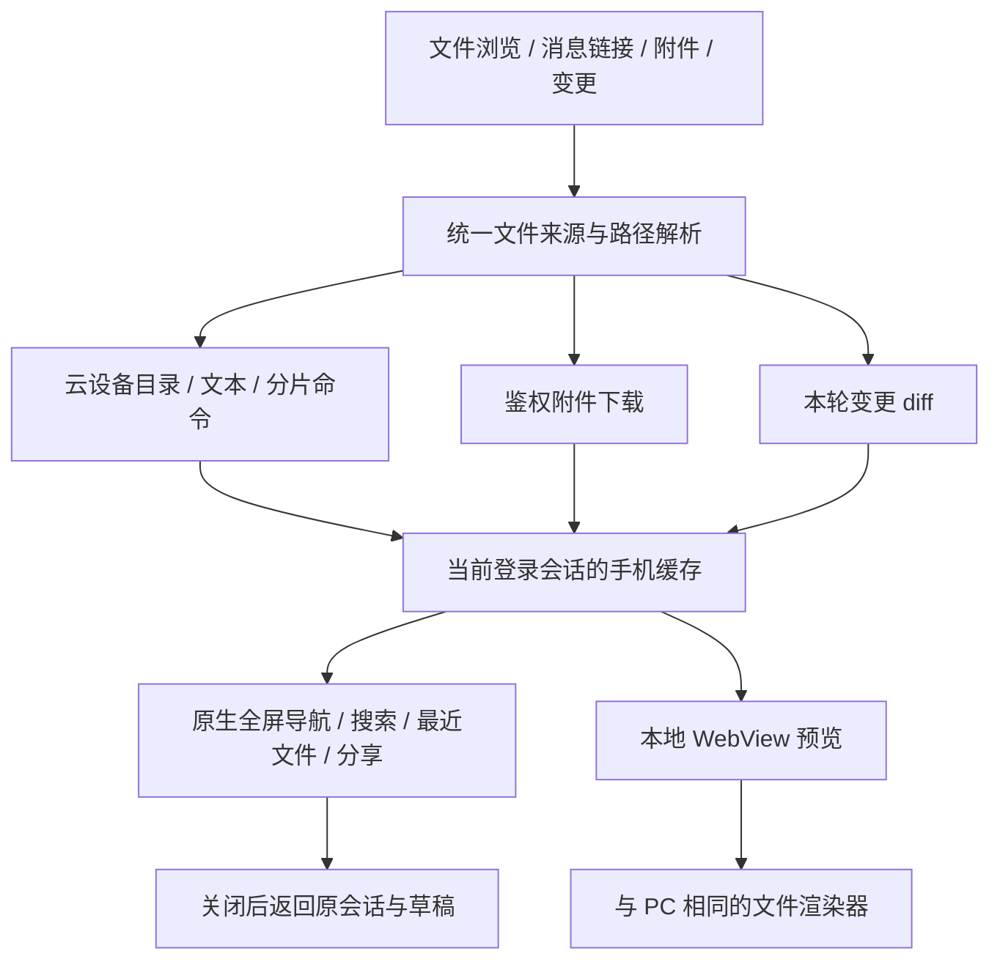

# 移动端文件预览

在 iPhone 或 Android 的会话页查看云设备文件、消息附件和本轮代码变更。当前提供只读预览、
查找和系统分享，不提供电脑端的文件编辑与保存操作。关闭预览后，原会话和未发送草稿继续保留。

## 从哪里打开

| 入口                                        | 操作与条件                                                                   |
| ------------------------------------------- | ---------------------------------------------------------------------------- |
| 会话页右上角文件夹图标 **浏览工作空间文件** | 打开当前会话或已选项目的目录；尚无可访问工作目录时按钮不可用                 |
| 回复正文中的文件链接、工具详情里的文件路径  | 打开对应文件；带行号的链接直接进入源码并定位                                 |
| 输入框中已添加的附件、消息里的附件          | 点击附件名称或缩略图预览；旁边的移除按钮只删除待发送附件                     |
| 工具输出中的生成图片                        | 点击图片查看完整预览                                                         |
| 回复中的 **N 个文件** 或 **编辑 N 个文件**  | 展开后点击路径查看变更；有历史 diff 时，可点 **当前文件** 打开设备上现有内容 |

目录页的 **文件** 标签支持逐层浏览、上级目录、路径输入、搜索和刷新。**最近** 标签保存当前
登录会话内最多 30 个文件及阅读位置；设备文件仍按原所属设备打开。退出登录或重启应用后，
这些记录不保留，也不同步到电脑。左上角 **返回** 回到上一个文件或目录，右上角关闭按钮收起整个预览。

## 阅读与分享

文本支持 **查找**、**换行**，以及 **查找 → 行号 → 跳转**。Markdown、HTML 等可渲染文本提供
**预览 / 源码** 切换；具体格式的查看器提供其支持的阅读功能。顶部可复制文件路径，或点击
**分享或存储文件** 打开系统分享面板；可用的存储位置由 iOS 或 Android 提供。

普通文本文件预览最多显示前 256 KiB，并明确提示内容被截断。分享或存储会取得完整文件，不能把
截断的预览当作完整内容。目录与设备文件遵循原设备授权，允许访问的绝对路径可以位于当前
项目目录之外；能够远程访问某台电脑的任务，并不自动授予该设备的文件接口访问权。

图片、PDF、Office、压缩包、XMind 和图表复用 PC 的渲染组件；视频入口支持 MP4、OGV 和 WebM。
渲染器随应用打包，文件不交给第三方预览网站转换。文档引用的网络资源仍可能联网：Mermaid
在本地渲染，PlantUML 仅在显式配置 `EXPO_PUBLIC_PLANTUML_SERVER_URL` 后向该服务发送图表源码。

HTML 在隔离页面中运行；当前不会自动补载同目录下的本地 CSS、JavaScript 或图片。
依赖这些相对资源的多文件网页可能无法完整展示，可查看源码或分享文件。设备拒绝访问、离线、
文件删除及格式加载失败时会显示错误，原会话仍可使用。

## 实现与 PC 对齐

移动端沿用 PC 云设备文件契约。任务执行设备、文件所在设备、工作目录和最终 worktree 是不同
的身份；远程目录使用 `remoteHostId`，排队中的独立 worktree 不提前展示原目录。

预览网页不接收登录令牌，也不会把云设备路径当作手机路径。文件分片直接写入原生缓存；
完整分享不再把全文读回 JavaScript。格式渲染仍受 WebView 和各查看器的内存、格式兼容性约束。

- `wework/src/api/devices.ts` 与 `attachments.ts`：云设备命令和鉴权下载。
- `wework/src/lib/workspace-target.ts`：目录身份与 worktree 规则。
- `wework/src/components/layout/workspace-panels/WorkspaceFilePreview.tsx`：文件格式与展示。
- `packages/chat-core/src/workspace-file-types.ts`、`workspace-file-paths.ts`：PC 与手机共用的类型识别及路径规则。
- `packages/collaboration/src/files/XMindPreview.tsx`：共用 XMind 预览。
- `packages/collaboration/src/markdown/assistantMarkdownLinks.ts`：链接和行号语义。
- [Codex 手机端](https://learn.chatgpt.com/docs/mobile)和[更新说明](https://learn.chatgpt.com/docs/changelog)：文件链接、附件预览、最近文件与阅读位置交互参考。

## 构建与验证边界

开发命令见仓库中的 `wework-mobile/README.md`。新增原生模块或修改打包的
预览网页后，需要重新构建并安装应用；Metro 重载或 Expo 导出不会替换已安装应用中的原生模块和预览资源。

现有 `workspace-attachments` 云设备 E2E checkpoint 包含超过 512 KiB 的二进制文件分片读取、
offset/size/EOF 和完整 SHA-256 校验，复用现有 CI 云设备服务。这是**真实云文件协议回归**，
不是原生手机 UI 验证；本次未执行该 E2E。类型检查、组件测试、资源构建及 iOS/Android 导出也
不能证明真机兼容性。本次未验证 Android 真机；原生手势、系统分享、WebView 和具体格式的真机结果需单独记录。
