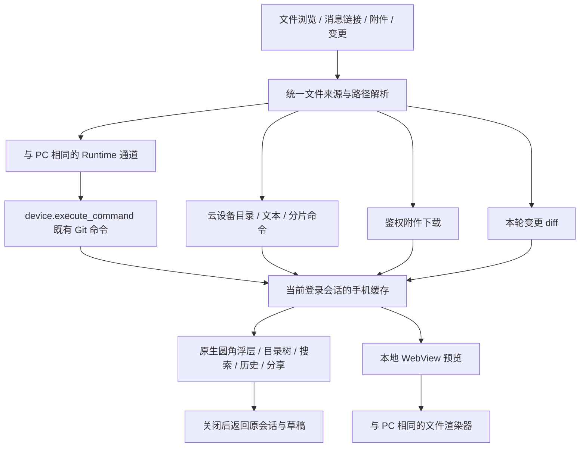

# 移动端文件预览

在 iPhone 或 Android 的会话页查看云设备文件、消息附件和本轮代码变更。当前提供只读预览、
查找和系统分享，不提供电脑端的文件编辑与保存操作。关闭预览后，原会话和未发送草稿继续保留。

## 从哪里打开

| 入口                                       | 操作与条件                                                                                      |
| ------------------------------------------ | ----------------------------------------------------------------------------------------------- |
| 会话页右上角 **更多 → 文件**               | 打开当前会话或已选项目的目录；尚无可访问工作目录时按钮不可用                                    |
| 回复正文中的文件链接、工具详情里的文件路径 | 打开对应文件；带行号的链接直接进入源码并定位                                                    |
| 输入框中已添加的附件、消息里的附件         | 点击附件名称或缩略图预览；旁边的移除按钮只删除待发送附件                                        |
| 工具输出中的生成图片                       | 点击图片查看完整预览                                                                            |
| 回复中的 **N 个文件** 或 **编辑 N 个文件** | 展开后点击路径查看变更；有历史 diff 时，可点 **更多文件操作 → 打开当前文件** 查看设备上现有内容 |

文件以圆角浮层打开。**已修改 / 所有文件** 在同一浮层切换；所有文件使用可展开的目录树，
底部 **搜索文件** 支持搜索，标题菜单提供路径输入、上级目录和刷新。新会话尚无标题菜单时，
右上角文件夹仍可打开已选项目的文件。

**更多 → 更改** 和输入框上方的 **N 个文件 +新增 −删除** 打开当前工作目录的 Git 变更。
点击项目标题选择 **分支、未暂存、已暂存、最近一次提交**。分支模式沿用电脑端自动选择主分支
的规则，底部显示比较方向。手机端通过与电脑端相同的 Runtime 通道读取变更，无需新增后端接口。
未暂存与已暂存遵循 Git 的对应差异语义。确认不是 Git 仓库的普通目录不显示变更摘要条，
更改页面会说明该目录不支持 Git 比较；设备离线或接口鉴权失败仍显示真实错误。
大批量差异按需打开单个文件，保留真实增删统计；空列表显示相应空状态。

文件预览左下角的文件夹返回目录，右下角的历史按钮打开 **最近**，保存当前登录会话内最多
30 个文件及阅读位置；设备文件仍按原所属设备打开。退出登录或重启应用后记录不保留，
也不同步到电脑。左上角 **返回** 回到上一个位置，右上角 **关闭** 或 iOS 下拉手势收起整个浮层。

会话 **更多** 菜单从原来的按钮胶囊展开，提供 **置顶 / 取消置顶、重命名、复制对话 ID、归档**，
并保留 **连接设置**，可查看 Backend 与当前账号、退出登录。
这些操作使用电脑端相同的云会话身份与接口。归档托管工作树会先保存快照；清理失败会单独报告，
不会把已成功归档的会话显示为未归档。

输入框上方的 **N 个智能体** 仅在会话确有子智能体时显示，打开后可查看状态和子对话。
正在运行的子智能体显示实时活动；完成的子线程按原会话所属设备独立读取历史，关闭后返回原会话。

## 阅读与分享

点击预览顶栏的文件名可打开附加操作：查找内容、跳转行号、复制路径、刷新和自动换行。
代码默认自动换行，行号固定在左侧，延续行不重复编号。Markdown、HTML 等可渲染文本在
文件标题下方直接提供 **预览 / 源码** 分段切换；普通代码直接显示源码，二进制文档不提供无效的源码入口。
具体格式的查看器提供其支持的阅读功能。右上角的分享按钮提供
**分享或存储文件**，可用的存储位置由 iOS 或 Android 提供。文件名菜单同时显示完整路径与文件大小。
加载失败时显示重试入口，**查看错误详情** 可展开原始原因；可查看源码的文件仍保留源码入口。

普通文本文件预览最多显示前 256 KiB，并明确提示内容被截断。分享或存储会取得完整文件，不能把
截断的预览当作完整内容。目录与设备文件遵循原设备授权，允许访问的绝对路径可以位于当前
项目目录之外；能够远程访问某台电脑的任务，并不自动授予该设备的文件接口访问权。

在单文件差异页分享时，只导出该文件的 `.diff` 补丁；未指定文件的变更预览才导出完整差异。

图片、PDF、Office、压缩包、XMind 和图表复用 PC 的渲染组件；视频入口支持 MP4、OGV 和 WebM。
渲染器随应用打包，文件不交给第三方预览网站转换。文档引用的网络资源仍可能联网：Mermaid
在本地渲染，PlantUML 仅在显式配置 `EXPO_PUBLIC_PLANTUML_SERVER_URL` 后向该服务发送图表源码。

HTML 在隔离页面中运行；当前不会自动补载同目录下的本地 CSS、JavaScript 或图片。
依赖这些相对资源的多文件网页可能无法完整展示，可查看源码或分享文件。设备拒绝访问、离线、
文件删除及格式加载失败时会显示错误，原会话仍可使用。

## 实现与 PC 对齐

移动端沿用 PC 云设备文件契约。任务执行设备、文件所在设备、工作目录和最终 worktree 是不同
的身份；远程目录使用 `remoteHostId`，排队中的独立 worktree 不提前展示原目录。

预览网页不接收登录令牌，也不会把云设备路径当作手机路径。文件分片直接写入原生缓存；
完整分享不再把全文读回 JavaScript。格式渲染仍受 WebView 和各查看器的内存、格式兼容性约束。

- `wework/src/api/environment.ts` 与 `runtimeWork.ts`：Git 比较和会话操作。
- `wework/src/api/hybrid/hybridServices.ts` 与 `packages/chat-core/src/runtime-ipc.ts`：云设备 Runtime 命令路由。
- `wework/src/api/devices.ts` 与 `attachments.ts`：云设备命令和鉴权下载。
- `wework/src/lib/workspace-target.ts`：目录身份与 worktree 规则。
- `wework/src/components/layout/workspace-panels/WorkspaceFilePreview.tsx`：文件格式与展示。
- `packages/chat-core/src/workspace-file-types.ts`、`workspace-file-paths.ts`：PC 与手机共用的类型识别及路径规则。
- `packages/collaboration/src/files/XMindPreview.tsx`：共用 XMind 预览。
- `packages/collaboration/src/markdown/assistantMarkdownLinks.ts`：链接和行号语义。
- [Codex 手机端](https://learn.chatgpt.com/docs/mobile)和[更新说明](https://learn.chatgpt.com/docs/changelog)：文件链接、附件预览、最近文件与阅读位置交互参考。

## 构建与验证边界

开发命令见仓库中的 `wework-mobile/README.md`。新增原生模块或修改打包的
预览网页后，需要重新构建并安装应用；Metro 重载或 Expo 导出不会替换已安装应用中的原生模块和预览资源。

现有 `workspace-attachments` 云设备 E2E checkpoint 包含超过 512 KiB 的二进制文件分片读取、
offset/size/EOF 和完整 SHA-256 校验，以及分支、已暂存、未暂存、最近一次提交的真实 Git 比较，复用现有 CI 云设备服务。这是**真实云文件协议回归**，
不是原生手机 UI 验证；本次未执行该 E2E。类型检查、组件测试、资源构建及 iOS/Android 导出也
不能证明真机兼容性。本次未验证 Android 真机；原生手势、系统分享、WebView 和具体格式的真机结果需单独记录。
