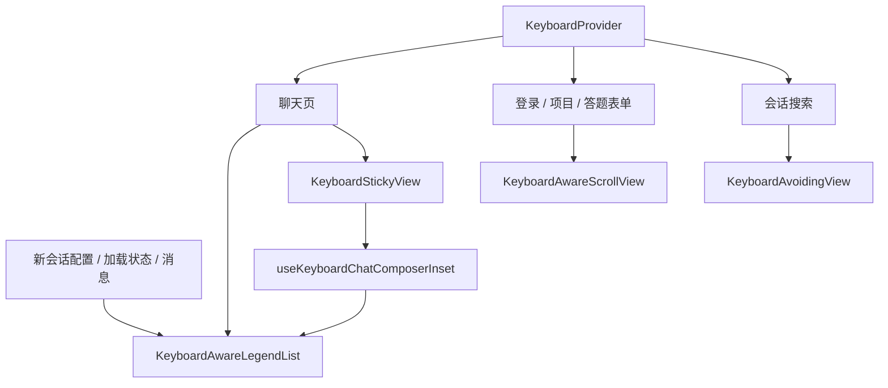

# 移动端键盘与聊天布局

Wework Mobile 在 iOS 和 Android 上共用原生键盘适配。应用根部的
`KeyboardProvider` 同时覆盖登录页、导航页面、Paper Portal 和原生 Modal。

## 页面职责

| 页面或区域           | 键盘处理                                         |
| -------------------- | ------------------------------------------------ |
| 登录、服务地址       | 整页表单滚动，焦点输入和登录按钮均可到达         |
| 会话搜索             | 搜索框与结果列表共享键盘避让后的视口             |
| 新建和已有会话       | 输入框随键盘移动，消息列表接收实测输入框占位     |
| 创建项目             | 名称、路径、设备选择和创建按钮处于同一表单滚动区 |
| 回答模型问题         | 原生弹窗内整张表单滚动，保留草稿、提交和重试行为 |
| 复制、附件和插件菜单 | 位置受键盘与安全区约束，操作无需先点一次收起键盘 |
| 模型、设备及权限选择 | 无输入的选择层打开时收起键盘；保留原有菜单定位   |

打开项目表单、答题弹窗或连接设置时，先收起前一个输入区域的键盘；新表单中的焦点由原生输入框接管。

## 聊天滚动边界

消息列表使用 `@legendapp/list/keyboard` 的 `KeyboardAwareLegendList`。
列表负责动态行高、底部跟随、阅读位置保持及手势打断，应用不再维护逐帧滚动循环。
新增用户消息请求回到末尾；流式更新交给 `maintainScrollAtEnd`，前插历史不抢走阅读位置。
自动跟随使用 `animated: false`，让每次行高变化立即追到新末尾，避免原生滚动动画滞后于持续增高的内容；
用户发送消息的显式定位仍使用动画。不要按任务 `running` 切换自动跟随动画，展示流可能在任务结束后继续更新。
首次加载、切换会话和重新进入会话从最新消息开始。历史分页仅由用户滚动触发。

新会话、加载中和已有消息共用同一个列表实例；切换数据使用 `dataKey`，不通过 React
`key` 重建原生键盘滚动视图。这让首次发送、任务地址确认和加载完成时保留当前键盘状态。
新会话配置作为独立的展示行交给列表测量，并靠底部排列；小屏或多行输入时仍可滚动到全部配置项。
不要将配置伪装成聊天消息，也不要使用不参与列表测量的 `ListEmptyComponent` 承载配置。

输入框高度通过 `useKeyboardChatComposerInset` 传递，列表不再用重复的页脚占位。
底部安全区由页面保留；列表的 `keyboardOffset` 与输入框的 `KeyboardStickyView`
偏移一致，键盘打开时仅补偿这部分安全区。不要在聊天列表外再包
`KeyboardAvoidingView`，否则会重复避让。

业务语义仍以 PC 云设备会话为准，参考：

- `packages/collaboration/src/conversation/useConversationScrollController.tsx`
- `wework/src/components/chat/ScrollableMessageArea.follow.test.tsx`
- `wework/src/components/chat/ScrollableMessageArea.streaming.test.tsx`

本次布局适配不改变设备身份、任务地址、模型选择、执行器路由、消息协议或答题权限。

## 验证

在 `wework-mobile/` 运行 `pnpm typecheck`、`pnpm test`、`pnpm build`。
组件测试覆盖业务触发和组件边界；Expo 导出只验证 JavaScript 打包，不能代替原生键盘验证。
新增或更新原生依赖后须重新构建应用，iOS 需同步 CocoaPods 锁文件。

排查真机遮挡时，可在构建前设置 `EXPO_PUBLIC_CHAT_LAYOUT_DIAGNOSTICS=1`。
`[ChatLayout]` 日志对照列表跟随状态、行高、输入框占位和原生滚动尺寸，每类高频事件最多每 200 ms 记录一次。
日志不记录消息内容、任务或消息 ID、设备标识及凭据；默认关闭，不改变滚动行为。
开启时，应用还将最近 1000 条记录保存到缓存文件 `chat-layout-diagnostics.jsonl`，
每 500 ms 至多写入一次快照；iOS 可从应用数据容器的 `Library/Caches/` 读取，
不需要采集整台设备的系统日志。应用启动会写入 `appStart` 事件，便于先验证诊断通道。

iOS 和 Android 验证应分别覆盖：

1. 键盘已打开时发送新会话第一条消息，首条回复显示在输入框上方。
2. 长回复持续流式增高；上滑阅读历史可暂停跟随，再发消息可回到末尾。
3. 输入多行、添加附件、切换模型面板和连续开关键盘时，输入框与消息不重叠。
4. 加载早期消息保持阅读位置；切换任务和返回同一会话没有旧滚动请求残留。
5. 小屏登录、项目表单和答题弹窗的最后一个输入及提交按钮可滚动到达。
6. 键盘打开时长按复制、打开附件/插件菜单，菜单完整可见且首次点击生效。
7. iOS 拖动收键盘，以及 Android 返回键收键盘和不同导航栏模式。
