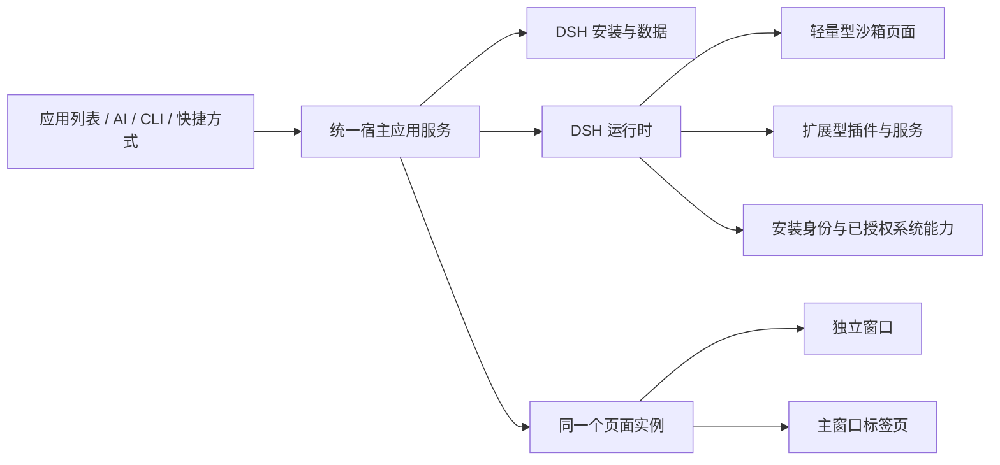

# 工作台应用

智能工作台与轻应用统一为 **工作台**，共用 DSH 的项目格式、安装、运行和数据管理。它们与用于编写代码的“代码工作台”是不同的产品对象。

## 创建和打开

桌面端从 **左侧栏 → 应用 → 工作台 → 我的** 进入，不需要打开实验性功能。市场需要云端连接；本机创建和运行不依赖市场。

主窗口也可从 **顶部标签栏 → + → 管理工作台** 进入。该菜单中的已安装工作台名称可直接在主窗口标签页打开应用；这两个入口都不受实验性功能开关影响。

- **创建工作台**：填写名称，选择 **轻量型** 或 **扩展型**。轻量型适合计算器、便签等小工具；扩展型适合组合 DSH 插件和服务。用途说明和保存位置可选，目录标识可在高级选项修改。未指定位置时使用文档目录下的 `WeworkSmartApps`。随后打开关联目录的开发对话。
- **创建 TODO 便签**：阅读原生安装确认中的名称和系统能力，接受后打开。可添加、勾选完成和删除待办，内容保存在本机。取消确认不会安装或打开。
- **关联文件夹** / **导入工作台**：关联现有 DSH 源码目录，或导入安装包。安装时检查版本与能力；旧轻应用目录经明确导入转换为 DSH，不会继续运行旧引擎。
- **运行** / **打开**：启动或聚焦现有实例。默认使用独立窗口。列表显示安装和运行状态，失败会显示错误，已有列表不会因刷新失败消失。

## 打开方式和快捷打开

从工作台卡片的 **更多操作 → 工作台设置** 选择 **打开方式 → 独立窗口 / 主窗口标签页**。两种类型均支持这两种方式。选择立即保存；运行中的工作台会移动同一个页面，保留未保存的输入和当前页面状态。

**启动 Wework 时自动运行** 控制下次启动是否恢复该工作台。**关闭窗口后继续后台运行** 单独决定关闭按钮是否保留运行；**隐藏窗口并保持运行** 保留当前实例；**停止** 释放运行时，保留本机数据。完全退出 Wework 会停止运行。

在设置的 **全局快捷键** 输入组合，例如 `CommandOrControl+Shift+T`，点击 **保存**。Wework 运行时，按键打开或聚焦目标；目标已聚焦时再次按下会隐藏。留空保存可清除。冲突或无效组合显示错误，不会覆盖其他应用的快捷键。

**创建桌面快捷方式** 在 macOS 生成绑定所属 Wework 实例和数据目录的 `.app` 启动入口，避免开发版与正式版互相打开；Windows 生成 `.url`，Linux 生成 `.desktop`。打开时可直接启动目标工作台，无需先打开主窗口。Windows 和 Linux 须已注册 Wework 协议。重新创建 macOS 快捷方式会清理该工作台原先生成的 `.webloc`；用户修改过的文件会保留。

**移除** 先确认，再停止实例、注销快捷键并删除应用拥有的数据和安装副本；关联的外部源码目录保留。取消确认不改变运行状态。

## 模型和开发

类型不决定是否需要模型。未使用 AI 的轻量工具可以直接运行；使用 AI 时可为每个安装分别绑定 Wework 模型。显式绑定的模型被删除或不可用时，需要重新选择。云端模型仍按当前登录用户的权限校验，独立窗口不要求主界面先打开。

**开发工作台** 继续编辑相同目录；**添加 DSH 插件** 适用于扩展型项目。开发预览支持 **验证**、**添加插件**、**刷新页面** 和 **重新加载 DSH**。导出前必须通过当前源码验证；修改源码会使旧验证过期。市场安装的工作台先 **复制为我的工作台** 再修改。**发布** 和 **管理范围** 仍使用原市场权限。

## 系统能力和本机数据

安装清单声明所需能力，原生确认决定是否授予。通知、剪贴板、文件选择器和外部链接分别受能力限制；应用不能通过页面参数指定其他安装身份或任意文件路径。

数据按安装 ID 隔离，隐藏或停止工作台不会删除已保存的内容。`notifications.show` 即时发送系统通知，还需要操作系统允许；普通数据保存不需要通知能力。

## 开发契约

AI 通过宿主提供的绝对路径 `WEWORK_CLI_PATH` 调用当前任务绑定的 CLI，不依赖裸 `wework` 的 PATH 查找，不修改用户启动器。缺少绑定或命令失败时应报告真实错误；不能宣称已安装或打开。

```sh
"$WEWORK_CLI_PATH" workbench create --project "/absolute/my-tool" --name my-tool --display-name "我的工具" --flavor lightweight --format json
cd "/absolute/my-tool"
node scripts/build.mjs
"$WEWORK_CLI_PATH" smart-app verify --project "/absolute/my-tool" --format json
"$WEWORK_CLI_PATH" workbench install --project "/absolute/my-tool" --format json
"$WEWORK_CLI_PATH" workbench launch --id INSTALLATION_ID --presentation window --format json
```

`smart-app verify` 检查包、构建和隔离 DSH 页面就绪；不会为待安装源码授予原生能力。系统 SDK 和业务操作应在真实安装确认后验证。

安装返回顶层 `id` 才是安装身份；`null` 表示取消，不继续启动。`plugin-manifest.json` 的 `flavor` 为 `lightweight` 或 `extended`，省略时为扩展型。打开方式保存在安装偏好中。

轻量型编辑根目录 `view.html` 和本地资源，保留生成的可信 DSH 桥接模块。页面运行在不透明源沙箱内，通过 `window.weworkWorkbench` 异步调用：

| API                                          | 能力要求                                     |
| -------------------------------------------- | -------------------------------------------- |
| `storage.get()` / `storage.set(value)`       | 安装自己的 JSON，最大 1 MiB                  |
| `notifications.show({title, body})`          | `notifications`                              |
| `clipboard.readText()` / `writeText(text)`   | `clipboard.read` / `clipboard.write`         |
| `files.openText()` / `saveText({name,text})` | `files.read` / `files.write`，通过原生选择器 |
| `external.open(url)`                         | `external.open`，HTTP(S) 或 `mailto:`        |
| `window.hide()` / `setAlwaysOnTop(boolean)`  | 当前工作台窗口                               |

轻量页面使用 `sandbox="allow-scripts"`，不授予 `allow-forms`，并保留 CSP `form-action 'none'`。浏览器可能在触发 `submit` 回调前就拦截原生表单提交，因此不能依赖 `form.onsubmit`、`submit` 事件、`requestSubmit()` 或 `form.submit()` 执行业务操作。使用 `<button type="button">` 的点击事件直接调用操作；文本输入框的 Enter 键处理也调用同一操作，并先执行 `preventDefault()`、忽略 `isComposing` 为真的输入法事件。等待 SDK 调用完成并展示失败。验证按钮点击和 Enter 两个真实入口，不能用人工派发 `submit` 事件代替；不要为此添加 `allow-forms` 或放宽 CSP。

数据存储是单份 JSON 文档。先通过 `await window.weworkWorkbench.storage.get()` 读取，再通过 `await window.weworkWorkbench.storage.set(value)` 保存；等待保存成功后再更新界面，并向用户展示失败。

### 页面生命周期与恢复

SDK 连接属于安装内容创建的初始轻量页面。页面离开或被替换后，原连接关闭，未完成和后续 SDK 调用会失败；新文档不会获得原 SDK，也不会自动重新授权。宿主仍通过原生策略拦截网络导航及重定向；`about:blank` 等本地文档替换可能实际发生，不能依赖所有自导航都被取消。外部链接应通过已声明并授予的 `external.open` 能力调用 `await window.weworkWorkbench.external.open(url)`，不要用轻量页面自身的导航打开。

若页面被替换后变空或 SDK 不可用，返回 **左侧栏 → 应用 → 工作台 → 我的**，在目标卡片选择 **更多操作 → 停止**。等待停止完成、**运行** 按钮可用后，点击 **运行**，从安装内容重新创建页面和 SDK 连接。已保存的本机数据保留；未保存的页面输入不会恢复。

关闭或隐藏可能让原实例继续运行；运行中卡片的 **打开** 会聚焦现有实例。因此关闭后再打开不能保证重建页面。需要恢复 SDK 时，使用上述 **停止 → 运行** 步骤。


