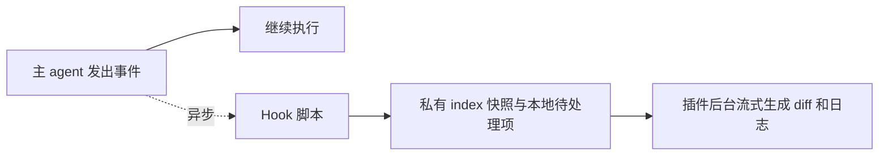

# 异步轮次 Git 日志 Hook

需要 Node.js 18+ 和支持 `--attr-source` 的 Git，并确保 `node` 和 `git` 位于执行设备的 PATH。无需 npm 依赖。

在 **设置 → 编码 → Hooks → 导入** 中选择本目录。插件配置保存在已安装副本的 `config.json`，默认日志路径：

```text
~/.wegent/logs/turn-diff/
  records/<event_id 的 SHA-256>/
    record.json
    diff.patch
    files.jsonl
  queues/<工作区路径的 SHA-256>/
    worker.log
    pending/
    executions/
```

日志目录支持绝对路径或 `~/`，必须位于 Git 工作区外；指向工作区内部的符号链接同样被拒绝。新建的 Unix 目录/文件权限为 `0700`/`0600`。

宿主只在授权后的执行流程发出生命周期元数据。三个事件始终异步消费，主 agent 不等待脚本启动、Git 扫描、快照、diff 或归档；`async: false` 也不会把生命周期 Hook 改为阻塞执行。相同执行内按事件顺序调用脚本，共享命令并发上限，宿主不保存 Git 数据或持久投递队列。

| 事件                 | 脚本行为                                                                                                                  |
| -------------------- | ------------------------------------------------------------------------------------------------------------------------- |
| `TurnStarted`        | 为一次用户请求建立工作树基线，只作内部比较，不生成全量日志。原生 session/turn ID 可能尚未产生，使用 `execution_id` 关联。 |
| `TurnCompleted`      | 固定结束快照，将与上次快照之间的净变更保存为待处理项。自动续轮沿用同一执行基线。                                          |
| `ExecutionCompleted` | 尝试覆盖失败的最终采集并释放执行基线。新用户请求另建基线。                                                                |



异步开始快照可能晚于首次写入，结束快照可能包含稍后的写入；允许少量边界遗漏和相邻轮次合并，不保证精确时间归属。此取舍不通过全量入账或同步等待补偿。统计覆盖同一工作区内主 agent、子 agent、Shell 等来源的净变化，无法区分同时发生的人工写入。独立 worktree 分别统计；忽略文件遵循 Git 规则，已跟踪的忽略文件仍参与统计。

每次 Git 调用显式启用长路径支持，避免 Git for Windows 在完整快照引用超过传统 260 字符限制时失败；不会修改工作区的 Git 配置或缩短引用哈希。

快照使用私有 index，不修改真实 index、HEAD 或分支。待处理的前后 Git 树由私有 refs 保护，避免 GC 清理。后台进程按 64 KiB 缓冲生成完整二进制补丁和 JSONL 文件列表，计算 SHA-256 与字节数；不将完整 diff 或文件列表载入 Node 内存。Git 子进程的资源消耗仍取决于仓库和变更规模。归档目录只有在所有文件持久化完成后才原子发布。

`record.json` 是脚本补全后的完整事件记录，包含宿主原始事件 `event`、采集时间、工作区、脱敏的 `git_url`、前后树 ID、文件数、增删行数及产物描述符。Git 地址在结束快照采集时固定到待处理项，不在延迟归档时重新读取；未配置 `remote.origin.url` 时为 `null`。URL 中的用户名、密码、查询参数和片段不会进入日志。产物路径相对于记录目录。二进制文件保留完整 Git 二进制补丁；无法按 UTF-8 表示的文件名用 `path_bytes_hex` 写入 `files.jsonl`。事件序号只在同一次执行内递增，后台完成顺序可能不同；不要只按时间戳跳过晚完成的记录。

Codex 的模型元数据采用本轮 turn/start 的模型参数；未覆盖时采用原生线程返回的实际模型。
提供方记录实际推理提供方，不使用宿主内部路由标识；这些信息仅用于 Hook 元数据，不修改推理请求。

可复用脚本接口：`gitStream(cwd, args, options)` 流式读取 Git 输出；
`processQueue(root, { processJob, onArchive, onError })` 支持自定义消费。
提供 `processJob` 时直接处理固定的前后快照，不生成默认归档；回调成功后才确认任务、释放引用，
失败会保留任务并退避重试。`onArchive` 在默认归档持久化后调用。
`startWorker(root, { logFile })` 以后台队列进程启动，`logFile: null` 不创建工作日志。
`writeJson(path, value, { modifiedAt })` 在原子发布前持久化指定修改时间，便于外部插件管理数据寿命。
默认日志插件继续归档所有快照差异，包含 pull／merge 引入的变化；不内置上报或过滤策略。

宿主事件协议版本为 `schema_version: 1`，只包含明确选取的元数据，不转发原始请求、提示词、认证信息或完整模型配置：

| 字段                                                      | 含义                                                                                                  |
| --------------------------------------------------------- | ----------------------------------------------------------------------------------------------------- |
| `event_id`、`execution_id`、`sequence`                    | 唯一事件 ID、执行 ID、执行内递增序号；同次执行关联和去重使用这些字段                                  |
| `emitted_at_ms`                                           | 宿主发送时的 Unix 毫秒时间；与脚本的 `captured_at` 区分                                               |
| `task_id`、`request_id`                                   | 来源执行请求的任务 ID 与 subtask ID，不等同于原生 turn ID                                             |
| `runtime_task_id`、`device_id`                            | 当前设备上的本地任务 ID 和实际执行设备 ID，不采用请求中指定的目标设备替代实际设备                     |
| `runtime`、`executor_version`、`platform`、`arch`         | `Codex` / `ClaudeCode`、实际 Executor 版本、操作系统和架构；Executor 版本不是桌面客户端或新插件的版本 |
| `user.id`、`user.name`                                    | 来源请求中已有的用户身份，缺少 ID 时为 `null`，缺少名称时为 `anonymous`                               |
| `model`、`model_provider`                                 | Codex 实际模型和推理提供方；其他运行时取请求值，未知时为 `null`，不读取原生认证或配置文件             |
| `cwd`、`session_id`、`turn_id`                            | 工作目录、原生会话与轮次标识；开始时原生标识可以为 `null`                                             |
| `hook_event_name`、`status`、`permission_mode`、`is_test` | 生命周期事件、状态、执行权限模式及是否为设置页合成测试                                                |

文件路径取 `workspace` 与 `files.jsonl` 中的相对 `path`；每个文件的增删行数也在该文件中。新增、删除代码内容来自 `diff.patch` 的文本块。大内容通过有长度及 SHA-256 的文件描述符读取，不塞进宿主事件或 stdout。二进制补丁保留字节变化，不伪造文本行内容。新插件可由 `event_id` 与文件路径生成稳定上报 ID；上报协议常量、插件版本、客户端版本及分批策略由新插件定义或从其真实执行环境获取，示例不包含具体上报协议。

失败的归档保留待处理项并退避重试，重放会校验已有文件。后台进程退出后，下次有效调用会重新唤起；也可以手动执行：

```sh
node ./bin/log-turn.mjs worker "/绝对日志路径/queues/<工作区路径的 SHA-256>"
```

进程被强杀、脚本超时、磁盘写满等情况可能丢失尚未持久化的事件或快照；不会伪造成功记录。停用 Hook 停止后续调用，已启动的后台进程仍可完成已接受的归档。日志和队列由用户自行归档、清理；修改日志目录后，旧目录未完成项仍需在旧目录处理。

验证时在 Git 工作区实际运行一轮修改文件的 agent，检查 `records/*/record.json` 与 `diff.patch`。Hook 设置页显示调用结果；后台错误在对应队列的 `worker.log` 中。**测试 Hook** 带 `is_test: true`，只检查脚本接收元数据，不创建 Git 状态或真实日志。非 Git 目录不创建采集状态。

插件只写本地日志，不发送网络请求、不计算 AI 占比、不实现上报。

# Asynchronous turn Git logs

Requires Node.js 18+, Git supporting `--attr-source`, and both executables on the execution device's PATH. Import this directory through **Settings → Coding → Hooks → Import**. No npm dependencies are needed. Edit the installed `config.json` to change the absolute or `~/` log directory. It must remain outside the Git workspace after symlink resolution. The layout above applies; new Unix directories/files use `0700`/`0600`.

The host emits lifecycle metadata after authorization and consumes callbacks asynchronously. The main agent never waits for script startup, Git scans, snapshots, diffs, or archival, even when a lifecycle handler declares `async: false`. Events within one execution are invoked in order under the shared command concurrency limit. The host stores no Git data or durable lifecycle delivery queue.

`TurnStarted` establishes an internal working-tree baseline for a user request, without logging the repository as a full inventory. Native session/turn IDs can still be null; `execution_id` correlates events. `TurnCompleted` queues the net change from the previous snapshot; automatic continuation shares that baseline. `ExecutionCompleted` attempts to cover a failed final capture and releases the baseline. A new user request creates a new baseline.

Asynchronous capture can miss early writes or include writes after a boundary. Small boundary omissions and coalesced turns are accepted; exact attribution is not promised. No full inventory or synchronous barrier compensates for this. Same-workspace child-agent and shell writes are included, as are concurrent human edits that cannot be distinguished. Separate worktrees are independent. Git ignore rules apply while tracked ignored files remain included.

Each Git call explicitly enables long-path support so Git for Windows can create full snapshot refs beyond the traditional 260-character limit. Repository Git configuration and complete reference hashes remain unchanged.

Private indexes preserve the real index, HEAD and branches. Private refs protect queued trees from GC. A detached plugin worker streams complete binary patches and JSONL file lists using 64 KiB buffers, records SHA-256 and byte counts, and atomically publishes only complete archives. Node never loads the complete patch or file list; Git subprocess resource use still depends on the repository and changes.

`record.json` is the complete event record enriched by the script. It contains the original host `event`, capture time, workspace, sanitized `git_url`, before/after tree IDs, totals and relative artifact descriptors. The remote is captured with the ending snapshot and persisted in the pending job, rather than read during deferred archival. Missing `remote.origin.url` becomes `null`. URL usernames, passwords, query strings and fragments are removed. Non-UTF-8 paths use `path_bytes_hex`. Event sequences are local to an execution; archive completion order can differ.

Codex model metadata uses the current turn/start override, or the actual model returned by the native
thread when unspecified. The provider identifies inference rather than the internal router. These
values update Hook metadata only and never change the inference request.

Reusable APIs include `gitStream(cwd, args, options)` for streamed Git output and
`processQueue(root, { processJob, onArchive, onError })` for custom consumers. Supplying `processJob`
processes fixed before/after snapshots without creating default archives. Successful consumption
acknowledges jobs and releases refs; failures retain jobs and retry with backoff. `onArchive` runs
after the default archive is durable. `startWorker(root, { logFile })` launches the queue worker;
`logFile: null` creates no worker log. `writeJson(path, value, { modifiedAt })` durably sets the
modification timestamp before atomic publication. Default logging still archives every snapshot
difference, including pull/merge imports; reporting and filtering policies belong to custom plugins.

Host protocol `schema_version: 1` explicitly selects metadata and never forwards raw requests, prompts, credentials or whole model configurations:

| Fields                                                    | Meaning                                                                                                                                         |
| --------------------------------------------------------- | ----------------------------------------------------------------------------------------------------------------------------------------------- |
| `event_id`, `execution_id`, `sequence`                    | Unique event, execution and execution-local sequence for correlation and deduplication                                                          |
| `emitted_at_ms`                                           | Unix milliseconds when the host emits the event, distinct from script `captured_at`                                                             |
| `task_id`, `request_id`                                   | Source request task and subtask IDs, distinct from native turn IDs                                                                              |
| `runtime_task_id`, `device_id`                            | Device-local task and actual execution device, not a target device supplied by the request                                                      |
| `runtime`, `executor_version`, `platform`, `arch`         | `Codex` / `ClaudeCode`, actual Executor version, OS and architecture; the Executor version is not the desktop client or new plugin version      |
| `user.id`, `user.name`                                    | Existing request identity; an absent ID is `null`, and an absent name is `anonymous`                                                            |
| `model`, `model_provider`                                 | Actual Codex model and inference provider; request values for other runtimes, or `null`; native authentication/configuration files are not read |
| `cwd`, `session_id`, `turn_id`                            | Working directory and native identifiers, which can be null at startup                                                                          |
| `hook_event_name`, `status`, `permission_mode`, `is_test` | Event, status, execution permission mode and synthetic settings test flag                                                                       |

Combine `workspace` with each relative `path` in `files.jsonl` for file paths and read per-file added/deleted line counts there. Text additions/deletions are available in `diff.patch` hunks. Large contents remain in file artifacts described by byte length and SHA-256, rather than host events or stdout. Binary patches preserve byte changes without inventing text lines. A new plugin can derive stable report IDs from `event_id` and path; report constants, plugin/client versions and batching belong to that plugin and its actual environment. This example implements no specific reporting protocol.

Archive failures retain queued work and retry with backoff. Replays validate existing archives. The next successful callback restarts a stopped worker; the manual command above also resumes a queue. Forced termination, timeouts and full disks can lose events or snapshots not yet persisted. Disabling the Hook stops future callbacks, while an existing worker may finish accepted archives. Logs and queues do not expire automatically; unfinished work under an old configured directory must still be processed there.

Verify a real agent edit in a Git workspace and inspect `records/*/record.json` and `diff.patch`. Hook settings show invocation results; background errors appear in `worker.log`. Synthetic **Test Hook** input has `is_test: true` and creates no collection state. Non-Git calls also create no collection state.

The plugin only writes local logs. It implements no network reporting or AI attribution.
