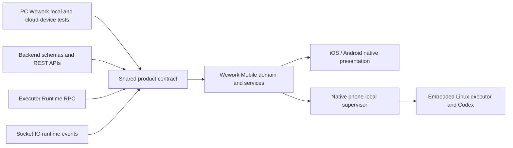

# Wework Mobile contributor guide

Wework Mobile is the iOS and Android client of Wework. It is not an independent product model.
For every Mobile feature, the PC Wework implementation under `../wework/` is the source of truth
for product semantics, protocols, interfaces, data ownership, state transitions, architecture, and
end-to-end flows.

## Execution ownership: follow the corresponding PC Wework path

Wework Mobile opens as a local-first workbench. It operates a phone-local executor when the
installation includes one, and authorized remote Wework devices after optional Backend login.
The **PC Wework implementation for the selected execution target** is the mandatory reference.
For remote devices, trace the cloud-device path; for this phone, trace the local-executor path,
including its protocol, API, device identity, workspace
ownership, data transformation, execution routing, realtime events, task lifecycle, error handling,
and user-visible flow.

Do not route remote devices through the local-executor path. Do not mix local
App data with cloud-device data. A selected cloud device must expose only the projects, workspaces,
tasks, sessions, capabilities, and state belonging to that device, using the same ownership and
routing rules as PC Wework cloud devices.

## Mandatory PC Wework reference

Before changing `wework-mobile/**`:

1. Locate the corresponding PC Wework implementation and its tests in `../wework/`.
2. Trace the complete selected-device flow: source object, storage owner, workspace, executor, task
   address, session lifecycle, request/response schema, and realtime events.
3. Record the relevant PC files in the working notes or final handoff.
4. Implement the same domain behavior in Mobile. Do not invent a Mobile-only protocol, data model,
   fallback, state machine, aggregation rule, or error interpretation.

If no equivalent PC behavior exists, stop and establish the behavior in Wework before adding it to
Mobile. Do not infer a new product contract from screenshots or partial API responses.

## Source-of-truth order

Use these sources in order:

1. PC Wework behavior and tests for the selected execution target.
2. Shared Backend and executor schemas and runtime protocol handlers.
3. Other PC Wework behavior when it does not conflict with that execution target.
4. Mobile presentation and platform integration.

Mobile may adapt visual layout, navigation, gestures, keyboard handling, safe areas, and native iOS
or Android controls. Platform adaptation must not change domain meaning, supported operations,
device ownership, execution routing, or lifecycle behavior.

## Architecture boundary



- Remote devices keep Backend-authorized routing. Phone-local tasks use the native supervisor's
  private IPC and existing executor contracts; never register a synthetic cloud device or route a
  local task to a remote machine as a fallback.
- Phone-local projects, tasks, files, models and Codex authentication belong to a persistent phone
  profile, independent of optional Backend login. Connecting, logging out or switching Backend
  accounts must preserve local work, identity, subscriptions and storage. Backend data, sockets,
  pending responses and caches remain isolated by Backend address and user.
- Adopt an existing native environment once without moving, merging or deleting roots. If multiple
  unselected legacy environments exist, require an explicit selection. Only an explicit phone
  environment switch changes the mount, and must drain all guest processes first.
- Native startup failures must leave the rest of the app openable. Background execution must use
  supported platform lifecycle APIs, with truthful progress and observable expiration; no silent
  sandbox elevation or fabricated activity to keep the process alive.
- Preserve the distinction between project storage, code workspace location, executor location,
  task ownership, RPC routing device, and session lifecycle.
- Preserve PC Wework field semantics exactly, including optional fields. Do not drop metadata that
  participates in routing or ownership, such as `workspaceSource` or `remoteHostId`.
- Use one canonical domain transformation for all screens. Lists, selectors, creation flows, and
  conversation routing must not independently reinterpret the same runtime data.
- Reuse existing Mobile domain, service, and component abstractions before adding new ones. Delete
  obsolete paths when consolidating behavior.

## Implementation workflow

For any non-trivial change, first draw the relevant Mermaid architecture, state, or sequence diagram.
After each material code change, compare the code against the diagram and update either one when they
diverge.

Protocol and data-flow changes require an explicit parity check against PC Wework for:

- endpoint and RPC method names;
- request, response, and event fields;
- device and workspace identity;
- ordering, filtering, grouping, and deduplication;
- loading, empty, offline, retry, cancellation, and terminal states;
- task creation, continuation, transcript recovery, and reconnect behavior;
- authorization and secret-storage boundaries.

Do not hide a contract mismatch with retries, local caches, synthetic defaults, compatibility shims,
or silent fallbacks. Diagnose the primary flow from actual code, logs, and payloads, then fix it.

## TypeScript and React Native

- Use strict TypeScript, function components, `const`, single quotes, and no semicolons.
- Keep protocol types complete and aligned with the PC types in `../wework/src/types/` and Backend
  schemas. A smaller Mobile UI does not justify a lossy transport type.
- Put domain rules in `src/domain/`, transport behavior in `src/services/`, orchestration in hooks,
  and platform presentation in components.
- New interactive controls need descriptive `testID` values. Preserve existing `testID` values.
- Prefer Expo and React Native platform APIs. Native presentation must preserve the PC operation's
  accessibility label, disabled state, confirmation behavior, and outcome.

## Keyboard and scrolling

- Native-stack owns keyboard dismissal on navigation. Composer focus requests belong to one
  screen entry, run after its transition, and are acknowledged once; expire them on departure or
  input unavailability. Never replay old requests after a modal or send completes.
- Use iOS `interactive` and Android `on-drag` scroll dismissal. Keep handled taps for links and
  controls; message body taps explicitly dismiss the keyboard.
- LegendList owns chat scroll compensation. Preserve stable source-block identities and resolved
  workspace controls during refresh; do not repair layout churn with timed scroll/focus loops.
- Follow `docs/zh/wework/developer-guide/mobile-interaction-lifecycle.md` for native dependency
  verification, ownership boundaries and privacy-preserving layout diagnostics.

## Error presentation

- Background connection, discovery, list and transcript read failures use source-owned entries in
  `useRuntimeFailures` and only the sidebar avatar badge. The native avatar menu distinguishes
  cloud connection, device discovery, device work lists and individual transcript pages. Each
  retry repeats only its own operation; it must not chain unrelated reads or restart the executor.
  Keep other sources and settings usable while a retry is pending. A successful read clears only
  its own failure; account changes revoke only remote failures and pending responses.
- The shared authenticated socket snapshot gates cloud device visibility. Phone-local readiness,
  reads and subscriptions remain independent. Cloud reconnection must not reload phone history.
  Preserve cached remote data while hidden, and keep the phone list selectable without waiting
  for cloud recovery. Pull-to-refresh reads the selected work list; device discovery has its own
  explicit action. Explicit operation failures retain their existing actionable boundary.
- List snapshots load initially or after an explicit selection, manual refresh or accepted user
  mutation. Do not refresh them on foreground, socket reconnect, token renewal or task events.
  Keep the active conversation's realtime events and lifecycle updates working independently.
- Operation failures use `showErrorAlert` from `src/services/errorAlerts.ts`. It delegates to the
  native iOS / Android alert; never imitate a system alert with Paper `Dialog`, glass, toast or
  Snackbar. State-driven actionable failures use `NativeErrorAlert`.
- Persistent page, field, settings and transcript failures use `ErrorNotice` next to the affected
  content. Preserve the draft/content and the existing retry operation. Do not dismiss an error
  on a timer or automatically repeat a task submission.
- Pass the original error to these boundaries. `describeMobileError` reuses the PC classifier and
  supplies short, actionable copy. Never interpolate raw exceptions, HTTP payloads, URLs or stack
  traces into primary UI. Unknown failures keep neutral copy rather than an invented cause.
- Diagnostics remain available only through explicit “复制详情”, with credentials redacted. Never
  log/copy secrets or hide the existence of a failure. Native alerts have at most three actions;
  inline actions have at least 48 × 48 points of touch area and support wrapping and text scaling.
- Reuse these boundaries for every future error. Extend the shared presentation and its focused
  tests when a new presentation is needed; do not create another per-screen error style. See
  `docs/zh/wework/developer-guide/mobile-error-presentation.md` for the contract and platform sources.

## Verification

Read the corresponding PC tests before writing Mobile tests. Every changed behavior needs focused
Mobile coverage for the same primary, boundary, failure, and recovery paths.

Run from `wework-mobile/`:

```bash
pnpm typecheck
pnpm test
pnpm build
```

Do not hand off a change with type errors, failing tests, or a failed iOS or Android export.
