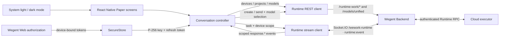

# Wework Mobile

Wework Mobile is the iOS and Android form of Wework. It is an independent Expo application,
but uses the same Backend authorization, REST, Socket.IO, and Runtime protocols as Wework.

## Architecture



There is one execution path. The mobile app never runs an executor and never receives executor
credentials. Login uses `/auth/wework/sessions`, the same Wegent Web authorization page, and the
same ES256 device proof used by Wework. The P-256 private key and refresh token are stored in the
platform keychain/keystore; access tokens stay in memory.

## Supported flow

- Read online cloud executors, remote projects, and active conversations.
- Filter and search conversations.
- Create or register a remote project directory.
- Create a new Codex conversation or continue an existing one.
- Select the executor, project, workspace mode, permission mode, model, and reasoning effort.
- Follow the operating-system light or dark appearance without changing screen structure.
- Load transcript history and consume live `response.*` Socket.IO events.
- Recover from reconnects by reloading the canonical transcript.
- Browse cloud-device files from the conversation's top-right folder icon; preview message links,
  attachments, generated images, and changes without leaving the chat draft.
- Search and share read-only file previews. Recent files and reading positions stay in the current
  authenticated app session; text previews show at most 256 KiB while sharing uses the complete file.

## Development

Keyboard and chat layout: [中文](../docs/zh/wework/mobile-keyboard-layout.md) ·
[English](../docs/en/wework/mobile-keyboard-layout.md). Native keyboard dependencies require an
application rebuild; a Metro reload or Expo export alone does not install native modules.

File previews: [中文](../docs/zh/wework/mobile-file-preview.md) ·
[English](../docs/en/wework/mobile-file-preview.md). Run `pnpm install` at the repository root as
well as in this directory: the offline preview bundle reuses the PC renderer dependencies and shared
components. `pnpm build:preview` creates the ignored `dist/wework-preview` assets. Start/export scripts
build them automatically; Xcode and Gradle stage the same bundle inside the native application.
After changing the preview or its shared renderer sources, rebuild and install the native application
to update the bundled assets. Metro reloads and Expo exports do not replace the installed preview bundle.
PlantUML uses an explicitly configured `EXPO_PUBLIC_PLANTUML_SERVER_URL`; it is not sent to a public
renderer by default.

From the repository root:

```bash
pnpm install
pnpm --dir wework-mobile install
cd wework-mobile
pnpm start
pnpm device
pnpm typecheck
pnpm test
pnpm build
```

`pnpm device` opens an iOS/Android selector. You can also start a platform directly:

```bash
./scripts/run-mobile.sh ios
./scripts/run-mobile.sh android
```

Set an optional build-time Backend default with `EXPO_PUBLIC_BACKEND_URL`. When it is omitted,
the app asks the user for the Backend address before login and remembers a successfully connected
address on the device. The app reads the Web and Socket.IO origins from `/api/auth/wework/config`;
users never enter or copy an access token.

The existing cloud `workspace-attachments` CI checkpoint covers the real file chunk protocol,
including full-file integrity beyond 512 KiB. It does not validate native mobile UI, and E2E was not
run for this change. Android physical-device behavior remains unverified; component tests and Expo
exports do not establish WebView, gesture, or native sharing compatibility.
