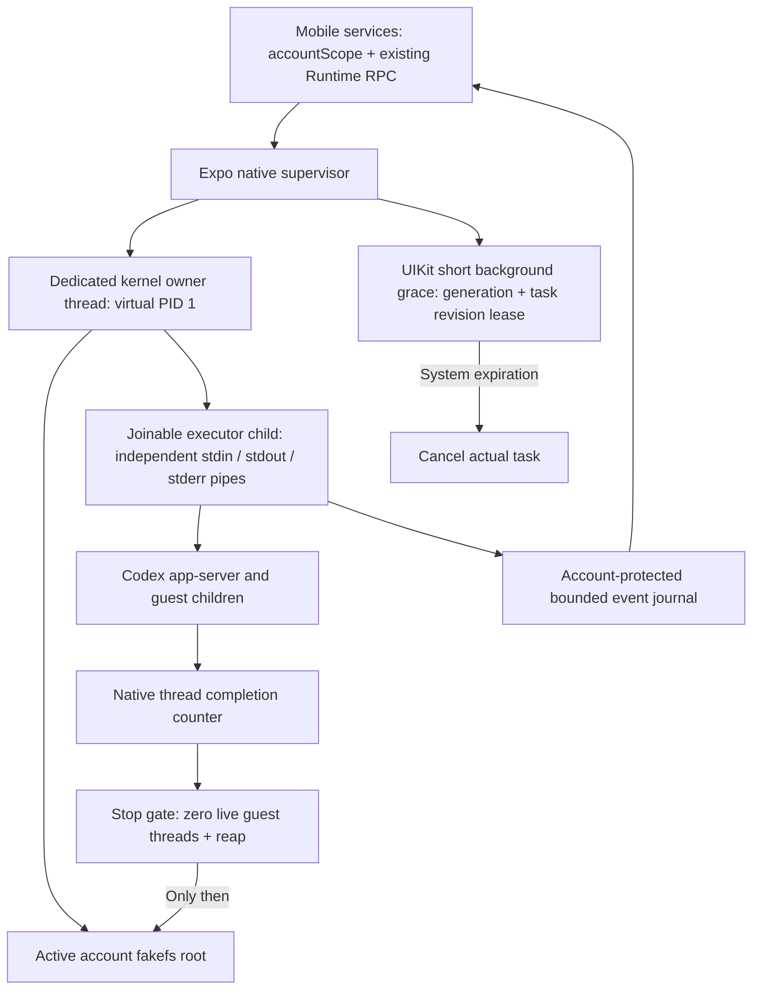
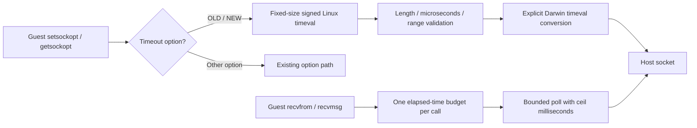

# 手机本地执行原生层

此模块仅适配平台，不重新定义任务协议。RPC 使用 PC 执行器的
`{type:"request", id, method, params}` / `response` / `event` JSONL；请求和事件在
原生层处理，JS 暂停不会丢掉正在等待的 RPC。账号、任务内容、模型配置属于各账号的
执行器数据库。Android 和未包含运行资源的安装包明确报告 `supported: false`，云设备功能保持可用。



PC 依据：`wework/electron/src/host/system-sleep-controller.ts` 及对应测试的
`response.created/completed/failed/incomplete`；`wework/src/api/backend/backendServices.ts`
与 `wework/src/e2e/desktop-cloud-environment.test.ts` 的设备和 Home 所有权；
`executor/src/local/app_ipc.rs` 的 wire 协议和 `runtime_work/handler/lifecycle.rs` 的
`runtime.turn.updated` 终态；
`packages/chat-core/src/runtime-task-api-types.ts` 的执行状态。
本次用户明确要求手机本地 executor，因此本模块使用 PC 本地执行器协议，和云设备路由隔离。

## 生命周期和隔离

- 每个 `accountScope` 使用独立完整 fakefs root（包括 SQLite 元数据）。设备 ID 为
  `mobile-local:<installation UUID>:<scope SHA256>`。每个原生请求都重新验证 scope。
- PID 1 不执行 guest 程序，也不调用上游会结束宿主的 `do_exit(init)`。
  普通退出先等待宿主线程真正完成，再 join 和 reap。停止只发送 guest 信号。
  线程未结束会返回明确错误，禁止换根；不会伪报停止，也不杀宿主 App。
- 文件导入通过 owner 线程的 `generic_open` 写入 guest，更新 fakefs 元数据。
  不直接向宿主 `data/` 复制文件。账号切换首先清空旧事件视图。
- 账号目录使用 `completeUntilFirstUserAuthentication` 文件保护；请求和 stderr 不持久化。
  事件日志最多约 8 MB / 2048 条，轮换保留最近 512 条；完整历史由 executor transcript 恢复。
- 前台任务使用 UIKit `UIApplication.beginBackgroundTask` 申请切到后台后的短时宽限。
  不使用 `BGContinuedProcessingTask`，不把未知总量的输出字节伪装为完成进度。
  系统决定是否授予时间以及何时到期；到期取消实际任务并报告 `expired`，不承诺后台完成。
  前台任务没有人为的后台倒计时；回到前台后按真实任务状态处理。
  终止事件后还会查询 `runtime.tasks.get`，自动续跑处于 active phase 时不提前结束 lease。
  Lease 按运行 generation 和每次前台提交的 task revision 隔离；旧轮状态查询不能结束新轮
  Lease。状态未知时保留任务并报告错误，不伪造完成。
- 使用 `jit=true` / `jit_emit=false`，运行预编译解释器 gadgets；不申请 JIT entitlement，
  不包含 AOT 镜像、Minis offload 或 FFmpeg。Linux namespaces/seccomp 不可用，
  受限 Linux 沙盒请求明确拒绝，不能静默升级权限。

## 构建

先通过 `scripts/prepare-ish-source.py` 准备锁定源代码。所有大文件和构建目录放在仓库外。
`wework-mobile/scripts/build-local-runtime-ios.py` 接收明确的 clean rootfs 和 Linux ARM64
executor 输入，检查 rootfs SHA256、固定 iSH revision 和完整补丁，构建 iPhoneOS ARM64 库，
封装官方 fakefs 导入器，并生成带校验和的资源 manifest。

```sh
uv run --no-project wework-mobile/scripts/build-local-runtime-ios.py \
  --source /external/prepared-ish \
  --rootfs /external/clean-rootfs.tar.gz --rootfs-sha256 <verified-sha256> \
  --executor /external/wegent-executor --output /external/ios-runtime --link-module
cd wework-mobile/ios
pod install
```

本地模块在 `expo-module.config.json` 显式声明根目录的 `apple.podspecPath`。
仅被 CocoaPods/RN 链接不代表已向 Expo 注册；生成的 `ExpoModulesProvider.swift`
必须包含模块 import 和 `WeworkLocalRuntimeModule.self`。完成真机 Release 构建后，
安装前执行下面的产物门禁，检查生成 provider、实际二进制注册、真机 bridge、签名、
rootfs、executor、源码锁、补丁和许可证的校验和。它不能代替正常 App 内的设置/启动验证。

```sh
uv run --no-project wework-mobile/scripts/verify-local-runtime-ios.py \
  --app /external/DerivedData/Build/Products/Release-iphoneos/WeWork.app
```

`vendor/` 是忽略提交的真实目录，内部逐文件链接到仓库外的构建产物，确保 CocoaPods
可以完整枚举库和资源。不要把整个 `vendor/` 替换成目录符号链接。
不提交库、rootfs、截图或构建日志。
构建器依赖 Xcode、uv 和 Zig 的 LLD；Meson/Ninja 版本在脚本中固定。
运行时不下载或执行原生插件。第三方许可证和源代码锁位于 `native/`；随安装包分发
iSH 的 GPL 许可证、iOS 附加条款和对应源代码信息。原生桥接源码遵循仓库 Apache-2.0 许可证。

## 验证边界

在 macOS 上运行 `uv run --no-project wework-mobile/scripts/test-local-runtime-swift.py`，
使用 `swiftc -warnings-as-errors` 验证事件隔离、任务 lease 顺序和真实 Darwin 管道增量读取。
测试编译产物仅位于临时目录，完成后自动清理。管道测试必须在写端仍保持打开时收到短消息，
不能依赖写端关闭或攒够固定字节数才收到 executor ready/流式输出。

`tests/RuntimeEventJournalTests.swift` 覆盖切账号和启动失败窗口的事件隔离。
内核回归见 `native/tests/` 与 `scripts/test-ish-runtime.py`。
`regress_ldpsw.c/.S` 使用真实 ARM64 硬件校准的向量，覆盖有符号双字装载、寻址、
写回和跨页访问。上游 LDPSW 的零扩展错误会破坏 OpenSSL X25519 公钥计算并导致
HTTPS 握手失败；补丁修正指令语义，不修改密码算法或关闭证书验证。

`regress_simd_lane.c/.S` 与 `regress_simd_lane_cases.inc` 使用原始 ARM64 指令编码，
覆盖 560 项 LD1–LD4 / ST1–ST4 lane、奇偶半字、寄存器环绕、未改动 lane 保留、
非写回与立即数/寄存器后索引写回，以及保留编码的 SIGILL 行为；B/S/D 作为对照。
全部向量已在原生 Apple ARM64 硬件校准。上游把半字 lane 的 `size[1]` 误取为
`size[0]`，会破坏 ML-KEM 的消息多项式加法，使默认 X25519MLKEM768 TLS 握手失败。
补丁修复两种寻址分支的指令解码，保留默认密码算法和证书验证。
这些原生回归由本地 runner 执行；当前 GitHub CI 尚未调用该 runner。

`regress_mount_boundary.c` 验证 guest 无法通过 mount/umount 暴露宿主目录或修改跨环境共享的
挂载表。挂载操作只由原生宿主管理；普通 guest 文件读写、宿主建立的 proc/devpts 挂载保持可用。
App 沙盒仍是最外层边界，不能把 guest 的完整访问权限当作工作区之间或凭据之间的隔离。

`regress_socket_timeout.c` 验证 ARM64 的 `SO_RCVTIMEO` / `SO_SNDTIMEO` OLD（20/21）
和 NEW（66/67）选项。补丁显式转换 Linux 的两个 64 位字段与 Darwin 的 `timeval`，
只读写 ABI 结构所需字节；超长长度不触碰后续保护页，短长度和非法微秒明确报错。
接收轮询按单次系统调用保持超时预算，正的微秒超时向上取整到毫秒，不再变成无限等待；
`{0,0}` 仍表示无限等待。原生回归覆盖真实收发超时、`recvmsg` / `sendmsg`、
`read` / `write`、dup 共享选项及清零后等待延迟数据。



这是 Codex 所需的非负超时兼容修复，不是完整 Linux socket 一致性实现。
Linux 的负秒数代表立即超时，但现有 Darwin 阻塞架构无法表达此状态；该输入明确返回
`EDOM`，不伪装成成功或一微秒超时。超过 `INT64_MAX / 1000 - 1` 秒明确返回
`EOVERFLOW`，避免换算溢出；不模拟 Linux 的超大值饱和及内核 tick 舍入。
此验证不代表 iPhone 浏览器 OAuth 或完整产品登录已经通过。
外部协议验证应至少覆盖：真实 executor.ready/health、两账号独立文件导入、正常退出、
所有 guest 线程归零、再次启动、宿主标准 IO 不变。静态链接通过不等于真机运行通过。
iOS 27.3 真机已通过真实 executor health、Codex config/read、停止后重启，以及直接官方
Codex 文件写入、Git 暂存/diff 和真实输出通知；这不是产品任务到模型的完整验证。
已淘汰的 Continued Processing 探针使用未知总量的 Progress，系统 dasd 明确记录其
fraction 为 0 并判为 stalled，一次测试进入后台约 20 秒后过期。这是改用 UIKit 短时宽限的
依据，不能当作 UIKit 固定时限。当前支持前台执行、后台尽力，未知长度模型任务不保证后台完成。
新 UIKit 宽限已在真机后台触发到期回调并取消真实 Codex 命令（exit 137、后续文件未写入），
随后停止/重启健康检查通过。独立纯前台探针持续 45.088 秒，严格记录
`backgroundTransitions=0`、exit 0，真实文件/Git 操作正常且未被误取消。
真实模型、产品任务流式和产品取消全流程不能沿用上述原生探针结论。
锁屏任务仍未验证。已有账号环境的 rootfs 版本不匹配时
会明确要求迁移；当前不会覆盖或删除旧环境，尚未提供跨版本迁移。

# Native on-device runtime

The module preserves the PC executor JSONL protocol and account ownership. A dedicated
native PID 1 thread owns guest operations; executor and Codex run as children with private
host pipes. Each account has an independent fakefs root. Root switching requires all guest
threads to finish and be reaped. Failed cleanup is visible and never shuts down the host app.

Build with the command above using a verified clean rootfs and a Linux ARM64 executor.
The native LDPSW regression uses vectors calibrated on real ARM64 hardware. The compatibility
patch fixes signed pair-load semantics that otherwise corrupt OpenSSL X25519 public keys;
it does not alter cryptographic algorithms or disable certificate verification.
The socket timeout regression covers ARM64 OLD (20/21) and NEW (66/67) options with explicit
Linux/Darwin timeval conversion, bounded memory accesses, real send/receive deadlines,
sub-millisecond waits, shared options across dup, and resetting to an infinite wait.
Receive retries keep one elapsed-time budget per syscall. This supports the nonnegative
timeouts used by Codex; it is not full Linux socket conformance. Negative seconds return
`EDOM` because the existing Darwin blocking architecture cannot represent Linux's immediate
timeout state. Values above `INT64_MAX / 1000 - 1` seconds return `EOVERFLOW`; Linux's huge-value
saturation and kernel-tick rounding are not emulated. No one-microsecond substitution or
false success is used. These probes do not establish that iPhone browser OAuth succeeds.
The explicit root-level `apple.podspecPath` is required for Expo registration, independently
of CocoaPods linking. Run `verify-local-runtime-ios.py` against the signed, unstripped
Release iPhone app before installation. It verifies generated and compiled Expo registration,
device support, signing, and packaged resource integrity. Starting the runtime through the
normal app on a real phone remains a separate required verification.
Run `test-local-runtime-swift.py` on macOS for event isolation, lease ordering, and
real Darwin pipe regression tests. Short ready/streaming messages must arrive while
the writer remains open. Test executables are created in a temporary directory and removed.
The native runner also covers 560 raw-encoding SIMD lane assertions, calibrated on Apple ARM64:
LD1–LD4/ST1–ST4, odd/even halfwords, preserved lanes, register wrap, post-index writeback,
reserved encodings, and B/S/D controls. The halfword decoder must read `size[1]`, not `size[0]`;
the incorrect lane corrupts ML-KEM message addition and default X25519MLKEM768 TLS handshakes.
The fix preserves default cryptography and certificate verification. This native runner is
currently executed locally and is not invoked by GitHub CI.
The mount-boundary regression rejects guest mount/umount syscalls, including read-only host
mounts and shared proc/tmpfs/devpts changes. Only the native host owns mounts; ordinary guest
file I/O and host-created mounts remain available. Full guest access does not isolate one
workspace or its credentials from other files in the same guest environment.
Artifacts stay outside Git. Missing artifacts explicitly disable local execution while the
app remains available. UIKit `beginBackgroundTask` provides only a system-controlled short
background grace period. Expiration cancels the actual task and is reported explicitly;
foreground execution is not subject to an artificial background deadline. Generation and task
revision tokens prevent stale releases from canceling newer work.

The retired Continued Processing probe expired after system logs reported stalled, zero-fraction
progress for unknown-length output. Its observed 20 seconds is not a UIKit allowance. The current
implementation does not use that API or fabricated progress. Executor health/config/restart and
direct Codex file/Git/output checks passed on iPhone. The actual UIKit implementation also
expired and canceled a real Codex command while backgrounded (exit 137, no subsequent file
write), then passed native shutdown/restart checks. A separate foreground probe completed
after 45.088 seconds with `backgroundTransitions=0`, exit 0, and real file/Git operations,
without premature cancellation. Model execution, product task streaming/cancellation, and
lock-screen behavior still need their own evidence.
