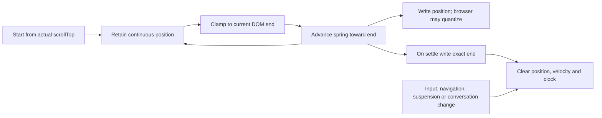
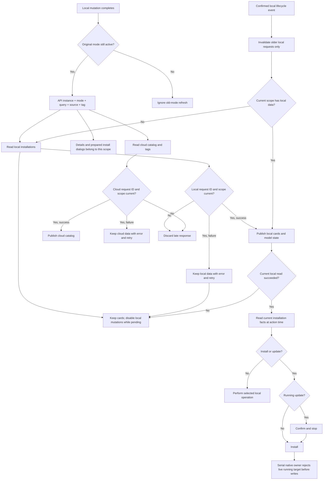
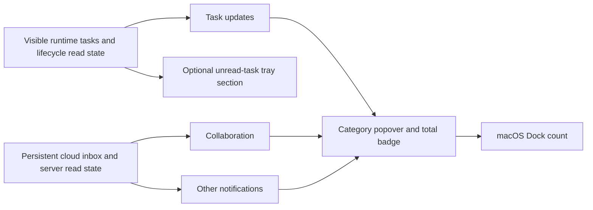

# Wework Codex UI design specification

This document is the durable visual and interaction contract for `wework/`. It
is written primarily for AI contributors. Wework's UI standard is the Codex
desktop UI standard: new and changed Wework surfaces must look and behave like
they belong to the same product family as the Codex desktop app.

The keywords **must**, **should**, and **may** are intentional. **Must** is a
requirement. **Should** is the default and needs a written reason to deviate.
**May** is optional. Existing Wework UI that differs from this document is
migration debt, not a precedent and not a request for an unrelated mass rewrite.

## 1. Source, scope, and update policy

This specification was extracted on 2026-07-16 from the local decoded Codex
desktop WebView bundle at `/Volumes/OuterHD/OuterIdeaProjects/decode-codex` and
calibrated against two user-supplied `3024px × 1794px` light-theme Codex desktop
captures: the new-task home and an active local conversation. Those captures
are the composition baseline; decoded CSS and components supply logical sizes
and responsive behavior that cannot be measured reliably from a scaled image.
The primary evidence was:

- `ref/webview/assets/app-DDJ4sa_V.css` for global tokens, typography, color,
  spacing, radii, elevation, and desktop overrides;
- `restored/ui/button.tsx`, `restored/ui/dropdown/`,
  `restored/ui/dialog-layout/`, `restored/ui/popover.tsx`, and
  `restored/ui/tooltip-b/` for shared component recipes;
- `restored/composer/composer.tsx` and its matching CSS chunk for the composer;
- `restored/app-shell/`, `restored/sidebar/`, and `restored/home/` for desktop
  shell, navigation, panes, tabs, and the home composition.

The decoded source is evidence, not a runtime dependency and not code to copy
verbatim. Do not import it, commit extracted OpenAI assets, or depend on its
hashed class names. Reproduce the rules through Wework semantic tokens and
shared components.

When Codex changes, update this document intentionally from a fresh audit. Do
not mix patterns from different Codex versions in one component. A current
user-supplied Codex screenshot outranks an older generalized conclusion in this
file. When a screenshot and decoded source appear to differ, reproduce the
screenshot's composition first and use source values for sizing, state, and
responsive behavior.

Use this decision order:

1. Accessibility, security, and native platform requirements.
2. This specification and `AGENTS.md`.
3. Wework semantic tokens and shared component APIs that comply with this file.
4. A verified Codex component recipe from the audited baseline.
5. A new local pattern only when the previous sources cannot express the need.

Codex is the visual and interaction baseline. WCAG and native platform rules
remain normative constraints; Apple HIG, Material, and Fluent are not alternate
visual directions for Wework.

## 2. Product character

The interface must feel like a focused desktop workbench: calm, precise,
compact, capable, and almost entirely neutral. Content and work state come
forward; application chrome recedes.

Codex's recognizable visual grammar is:

- grayscale surfaces and text establish nearly all hierarchy;
- blue is reserved for focus, links, and narrow accent or selection semantics;
- green is semantic success or addition, never product chrome or a primary CTA;
- compact controls sit in generous page composition; the home screen's single
  four-card quick-start row is intentional and must not expand into a dashboard;
- soft rounded shapes are systematic, not decorative;
- borders are low-contrast hairlines and elevation is restrained;
- one strong action is allowed; surrounding actions remain quiet;
- information appears progressively instead of every option being visible at
  equal weight.

A normal screenshot should first read as work content, then structure, then
controls. It must not first read as green, colorful, card-heavy, glossy, or
marketing-oriented.

### 2.1 Prohibited visual directions

Do not introduce:

- green or teal page backgrounds, sidebars, cards, composers, dialogs, banners,
  navigation selections, or default primary buttons;
- generic colorful feature tiles; the four Codex home quick-start cards and
  their blue, purple, green, and orange category icons are the explicit
  exception defined in section 5.4;
- a dashboard made from bordered cards when spacing and rows are sufficient;
- gradients, glows, glass effects, or illustrations without a functional reason;
- thick borders, dark outlines around ordinary controls, or several competing
  shadow strengths;
- oversized hero copy in workbench screens;
- arbitrary radii or making every shape a pill;
- saturated color as the main information hierarchy;
- multiple equally prominent CTAs in one action group.

## 3. Foundations

### 3.1 Base unit and spacing

Codex uses a `4px` base unit. Use multiples of 4 for layout. Values such as
`2px`, `5px`, `6px`, and `10px` are allowed only where the audited component
recipe uses them for hairlines, optical alignment, or compact internals.

| Value  | Codex-style use                                   |
| ------ | ------------------------------------------------- |
| `4px`  | tight icon/control gap, compact inset             |
| `6px`  | menu icon-label gap, attachment bottom inset      |
| `8px`  | row padding, control gap, compact surface padding |
| `10px` | sidebar row horizontal padding or radius          |
| `12px` | compact panel padding, composer input padding     |
| `16px` | ordinary group gap, conversation item gap         |
| `20px` | desktop page/panel gutter                         |
| `24px` | composer overhang, larger group separation        |
| `32px` | major section separation                          |

Rules:

- Prefer alignment and whitespace to dividers.
- Related controls normally use `4px–8px` gaps.
- Related groups normally use `12px–16px` gaps.
- Page-level content normally uses a `20px` desktop gutter.
- Do not repair a component's incorrect internals with arbitrary external
  margins; fix or reuse the shared component.

### 3.2 Typography

Use the Wework system UI stack (`--font-ui`) and the existing monospaced stack
(`--font-code`). The audited Codex UI uses the platform/system sans stack for
the general interface and a platform monospace stack for code. Do not copy or
bundle fonts from the decoded application.

The default Electron type ramp is the runtime result after Codex applies its
appearance settings. It supersedes the smaller pre-runtime values visible in
the static CSS bundle:

| Token/role     | Default size | Typical line height | Weight    | Use                                   |
| -------------- | -----------: | ------------------: | --------- | ------------------------------------- |
| `text-xs`      |       `12px` |              `16px` | `445–500` | shortcuts, timestamps, dense metadata |
| `text-sm`      |       `13px` |         `18px–19px` | `445–500` | helper text and compact controls      |
| `text-base`    |       `14px` |              `21px` | `445–500` | rows, menus, forms and ordinary body  |
| `text-lg`      |       `16px` |         `24px–25px` | `445–500` | emphasized UI                         |
| Heading small  |       `18px` |              `24px` | `500`     | section or dialog heading             |
| Heading medium |       `20px` |              `27px` | `500`     | page heading where needed             |
| Heading large  |       `24px` |              `29px` | `500`     | rare prominent heading                |
| Display        |       `28px` |         `32px–34px` | `500`     | exceptional home/onboarding use only  |

Document-style Markdown previews use the heading ramp for clear content
hierarchy: H1 uses Heading large, H2 uses Heading medium, and H3 uses Heading
small. Lower heading levels continue through the semantic UI sizes. Compact
chat and process Markdown keep their denser heading scale.

The default UI font size is `14px`; the default code font size is `12px`.
Appearance settings may change UI size from `11px` through `16px` and code size
from `8px` through `24px`, in whole-pixel steps. Changing UI size scales every
UI and heading token by `configuredSize / 14` and rounds each result to the
nearest pixel. Code size is independent and applies directly to code blocks,
diffs, editors, and terminals. The increase/decrease-font-size shortcuts step
both configured values together while respecting their separate limits. The
reset-font-size shortcut restores the default `14px` UI and `12px` code sizes.

Product code must consume the semantic Tailwind sizes, `heading-*` classes,
`text-chat`, `text-code`, or the corresponding CSS variables. Arbitrary font
utilities such as `text-[13px]`, literal `font-size` declarations, and literal
inline `fontSize` values are forbidden and checked by `pnpm lint`. A computed
font size is allowed only when it derives from the shared typography tokens,
such as an animated transition between two heading roles. Third-party content
that cannot inherit Wework variables requires a narrow documented exception.

The primary Electron UI weight is `445`, matching ChatGPT's platform-adjusted
normal weight. Ordinary UI and conversation text inherit this weight instead of forcing
`font-normal` (`400`) on their containers. Emphasis and headings use `500`. Use `600` sparingly and avoid `700` in product chrome.

Entered composer text uses the primary text color so it reads as content. Normal
menu labels and composer actions such as the quick-phrase trigger also use the
primary text color, but inherit the UI weight so they stay crisp without
appearing bold. Descriptions, metadata, and shortcuts use secondary or tertiary
text colors.

Keep sentence case. Do not use uppercase labels for visual hierarchy. Use no
more than three type roles in a compact surface. Truncate repeated secondary
context only when the full value remains available through a tooltip, detail
view, accessible name, or copy action.

### 3.3 Icon scale

Use the established icon library and this Codex-derived scale:

| Token intent |   Size | Use                                  |
| ------------ | -----: | ------------------------------------ |
| 3XS          | `10px` | exceptional dense indicator          |
| XXS          | `12px` | spinner, micro status                |
| 2XS          | `14px` | compact trailing action              |
| XS           | `16px` | default desktop icon                 |
| SM           | `18px` | emphasized row icon                  |
| Base         | `20px` | larger control or mobile-adjacent UI |
| MD           | `24px` | prominent action or empty state      |
| LG           | `28px` | rare illustrative symbol             |

Icons are normally outline symbols with consistent stroke weight. Icon-only
controls must have a localized accessible name and a tooltip unless the action
is universally recognizable in context.

### 3.4 Radius and corner shape

Codex uses a deliberate radius ramp, with superellipse corners when the browser
supports them. Wework may use ordinary rounded corners until superellipse is
supported, but must preserve the component mapping.

| Radius | Component role                                           |
| ------ | -------------------------------------------------------- |
| `2px`  | tiny embedded marks                                      |
| `4px`  | compact internal element                                 |
| `6px`  | small control                                            |
| `8px`  | default control and inner tab surface                    |
| `10px` | sidebar/navigation row and tab container                 |
| `12px` | dropdown, popover, compact floating panel                |
| `16px` | prominent card when a true card boundary is needed       |
| `20px` | multiline composer and dialog                            |
| `24px` | exceptional large shell surface                          |
| Full   | text CTA, single-line composer, status/badge/avatar only |

Do not flatten everything to one global `8px` radius. Do not apply pills to
ordinary sidebar rows, menu items, cards, tabs, or multiline inputs. Pill text
buttons are allowed because they are an explicit Codex pattern.

### 3.5 Elevation and borders

Codex borders are derived from the current foreground instead of medium gray
outlines:

- light border: about `5%` foreground;
- default border: about `8%` foreground;
- heavy border: about `12%` foreground;
- focus border: blue at about `70%` opacity;
- overlay rings: usually a `0.5px` hairline.

Use a normal `1px` border only when the component recipe needs a visible
boundary. Do not outline every section.

The audited elevation recipes are intentionally light:

- `sm`: `0 1px 2px -1px rgb(0 0 0 / 8%)`;
- `md`: `0 2px 4px -1px rgb(0 0 0 / 8%)`;
- `lg`: `0 4px 8px -2px rgb(0 0 0 / 10%)`;
- `xl`: `0 8px 16px -4px rgb(0 0 0 / 12%)`;
- prominent surface: a `0.5px` stroke plus very soft `0 3px 7.5px / 4%` and
  `0 0 20px / 5%` shadows.

Ordinary page content has no shadow. Use elevation for composers, menus,
popovers, floating sidebars, and dialogs. Never reproduce the rejected Wework
composer shadow `0 18px 44px`; it is not the Codex recipe.

## 4. Color system

The neutral Codex reference below defines the default theme. Users may explicitly
choose a named appearance theme, including colored surface and accent palettes.
In that case, the selected theme's semantic tokens replace these reference
colors across all Wework-owned surfaces, content-renderer controls, portals,
and auxiliary windows. Layout, density, typography, contrast, focus visibility,
and non-color status cues remain mandatory. Never hardcode the neutral reference
into a component to override a user's selected theme. The remote Wegent Agent
page keeps its own theme; Wework chrome around it still follows appearance.
Startup flow and startup colors continue to use the upstream implementation.

### 4.1 Neutral palette and surfaces

The Codex neutral reference palette is:

`#FFFFFF`, `#F9F9F9`, `#F3F3F3`, `#EDEDED`, `#AFAFAF`, `#5D5D5D`,
`#4F4F4F`, `#414141`, `#303030`, `#282828`, `#212121`, `#181818`,
and `#0D0D0D`.

Required semantic results:

| Role                 | Light                                 | Dark                                   |
| -------------------- | ------------------------------------- | -------------------------------------- |
| Main surface         | `#FFFFFF`                             | `#181818`                              |
| Surface under        | `#F9F9F9`                             | `#000000`                              |
| Editor/quiet surface | `#EDEDED` at about `40%`              | `#212121`                              |
| Elevated primary     | white at about `70%`, or opaque white | `#212121` at about `96%`, or `#282828` |
| Primary text         | `#1A1C1F`                             | `#FFFFFF`                              |
| Secondary text       | primary text at `70%`                 | primary text at `70%`                  |
| Tertiary text        | primary text at `50%`                 | primary text at `50%`                  |

These are reference values. Product code must consume semantic Wework tokens,
not scatter literals. Every reusable token must define both themes.

Theme-aware application chrome must use semantic tokens even when a component
has multiple layout variants. A prop such as compact, remote, mobile, or
embedded may change spacing and composition, but it must not select a
light-only or dark-only color recipe. Apply this rule to nested surfaces as
well as their containers: dialogs, directory pickers, menus, inputs, list rows,
tooltips, footers, and action groups must all inherit the active theme.
Surfaces rendered through a portal must explicitly set their semantic
foreground color instead of relying on an ancestor outside the portal target.

Literal white, black, or neutral fills are allowed only when color is part of
the content contract rather than application chrome. Examples include a QR
code's required white quiet zone, an authored HTML document or image canvas, a
syntax-highlighted code theme, a brand icon, and native window controls. Keep
these exceptions narrow and visually contained; do not use them to justify a
light-only panel or control.

Surfaces should be separated in this order: spacing, a small neutral tone
change, a hairline, then elevation. Do not jump directly to a bordered card.

### 4.2 Accent and status colors

Codex's interactive accent is blue:

- focus/link blue: `#339CFF`;
- light accent surface: `#E5F3FF`;
- dark accent surface: `#00284D`.

Blue is for links, keyboard focus, selected emphasis, and narrow interactive
accents. It is not the default page background and is not normally the primary
button fill.

Green is semantic only:

- light success/addition: `#00A240`;
- dark success/addition: `#40C977`;
- success backgrounds are very low opacity, approximately `7%` light and `16%`
  dark.

Orange is warning/modified, red is error/destructive/deleted, and purple is
reserved for a feature with explicit semantic meaning. Status must always have
a non-color cue such as text, icon, shape, or accessible label.

### 4.3 Absolute green/teal restriction

This restriction applies to the default product theme. An explicitly selected
named theme such as Matrix or Everforest may use its authored green palette;
components must consume that palette through semantic tokens.

Wework must not look green or teal. The current legacy Wework `primary` and
`hover` tokens are teal-based and therefore are not Codex visual tokens. Do not
use them for new or changed general UI until those tokens are deliberately
rebased.

Green/teal is allowed only for:

- confirmed success;
- added lines or resources;
- a small progress or status indicator whose meaning is also expressed another
  way;
- the `16px` green outline icon on Codex's home “审查代码并提出修改建议”
  quick-start card; this is a narrowly scoped baseline exception, not permission
  to color the card, label, hover state, or another feature green;
- an existing brand mark that cannot be changed.

Green/teal is forbidden for:

- page, pane, sidebar, title bar, drawer, modal, menu, popover, or card surfaces;
- composers, inputs, list rows, tabs, navigation selections, and empty states;
- default primary actions, ordinary hover, focus, or selection;
- decorative gradients, glows, illustrations, and feature icons.

In a normal screenshot, strong green/teal should occupy effectively `0%` unless
a success/addition state or the one home quick-start icon is visible, and less
than `5%` even then. If the first color impression is green, the screen fails
review.

### 4.4 Action colors

The primary action is an inverse neutral button:

- light theme: dark foreground-colored fill with a light label;
- dark theme: light foreground-colored fill with a dark label;
- hover: reduce the fill to approximately `80%` opacity;
- disabled: keep the same semantic treatment at approximately `40%` opacity.

Secondary actions use a foreground tint around `5%`; hover raises it to about
`10%`. Ghost actions are transparent and gain the neutral list-hover surface.
Danger actions use a low-opacity red surface with red text; reserve solid danger
for the final destructive confirmation when needed.

## 5. Layout and desktop shell

### 5.1 Main composition

- Desktop reading/conversation content has a normal maximum width of `48rem`
  (`768px`).
- Wide markdown blocks may extend to `56rem`; terminals, diffs, tables, and
  canvases may use their pane width.
- The desktop page gutter is normally `20px`.
- The home composer aligns to the same content column instead of floating at an
  unrelated width.
- Content may be full bleed only when the task requires a canvas, terminal,
  browser, diff, or similar work surface.

The home screen is not a card dashboard. It is one centered hero, one exact
four-card quick-start row, and one bottom composer. Do not replace the cards
with generic rows, add more card sections, or move the composer into the hero.

### 5.2 Toolbars, panes, and tabs

Codex desktop reference sizes:

- main toolbar/title area: `46px`;
- small title/menu toolbar: `36px`;
- pane toolbar: `40px`;
- sidebar navigation row: `30px`;
- app-shell tab: `28px` high;
- composer action button: `28px` high;
- collapsed/compact icon action: normally `28px` or the shared control size.

Use one height within an action group. A visible icon can remain `16px` inside
a larger hit area. Mobile targets remain at least `44px × 44px` even though the
desktop UI is denser.

Tabs are compact neutral containers: `28px` high, `10px` outer radius, `8px`
inner hover/active surface, `8px` horizontal padding, `8px` icon-label gap, and
`14px` text. Inactive text is secondary; active text is primary. Close controls
may reveal on hover/focus but must remain keyboard accessible.

### 5.3 Sidebar

- First-launch default width is `300px`, matching the decoded persisted default.
  Clamp resize to `240px–520px` and preserve the user's choice. The supplied
  `1512px × 897px` logical-size capture shows a resized width of about `275px`;
  screenshot-matched review artifacts must use that width.
- Sidebar rows are `30px` high with a `10px` radius, `8px–10px` horizontal
  padding, `14px` text, and an ordinary `16px` icon.
- Leading status icons may occupy reserved indentation only when their negative
  offset is fully contained by the row's left padding. Keep icons in the normal
  flex flow for shallow pinned and top-level task rows so the glyph and its hit
  target remain inside the sidebar viewport.
- Priority task entries are selectable two-line data rows rather than compact
  navigation rows. They use a `48px` minimum height so the title and `12px–14px`
  source metadata remain readable.
- Hover and active states use subtle neutral surface changes, not colored fills.
- Running-task indicators use the same neutral `16px` spinner in every state.
  An active goal is distinguished by a small centered dot; do not replace the
  neutral status with a larger or saturated target glyph.
- Keep the sidebar base surface stable when the application window gains or
  loses focus. Window focus must not darken the task or work-items sidebar.
- Sortable sidebar rows must keep the sortable container separate from the
  pointer activator. The primary non-action area, including unused space beside
  a short label, may start pointer sorting after at least `6px` of movement.
  Trailing actions and metadata must remain outside the activator. Preserve
  keyboard sorting on the sortable container.
- Section spacing may be larger than row spacing; avoid divider-heavy grouping.
- On macOS light theme, use the captured warm translucent/off-white sidebar
  material and keep the main canvas pure white. Preserve the traffic-light safe
  area and Wework's four-item global top navigation, in order: sidebar toggle,
  Wework current-app entry, TODO/work-items entry, and application-list entry.
  Style those controls with Codex sizing and neutral states; never replace,
  reorder, or remove them merely to imitate Codex's Back and Forward controls.
- The sidebar content order is structural: product title and Search; primary
  destinations; pinned projects; projects; expandable tasks; and the account
  footer. Do not replace this with an app-switcher or a generic SaaS workspace
  navigation.
- Search has one visible sidebar entry: the icon beside the product title. Do
  not duplicate Search as a primary-navigation list row.
- Secondary row actions can appear on hover/focus but must not steal the row's
  primary click and must have a keyboard path.
- Overflowing sidebar lists keep an overlay scrollbar visible at every scroll
  position. Match the Codex desktop sidebar with a quiet theme-aware `8px`
  thumb inset `3px` from the sidebar edge; scrollbars must not change the content
  width or inherit the content-edge mask.
- Task titles use a `12px` edge fade instead of ellipsis. After `600ms` of hover
  or keyboard focus, scroll at `30px/s`, decelerating continuously over the final
  `40px` to rest. Keep the end visible until pointer exit or blur, then return to
  the start over `150ms`. Respect reduced motion and stop during dragging.
- Trailing task actions overlay the row without changing its layout width. Clip
  and measure the title against the visible actions before starting its motion.
- Collapse or float the sidebar before the main work area becomes unusable.

The audited shell changes behavior around `960px` and again around `720px`.
Wework may retain its established responsive breakpoints, but must switch
composition before panes overlap or primary content is squeezed below a useful
width.

### 5.4 New-task home baseline

The user-supplied Codex home capture is normative. Reproduce this composition:

- The main content and composer use the same `48rem` (`768px`) column plus the
  established composer overhang; they do not span the application viewport.
- The hero/suggestion block occupies the upper `39%` of the available home
  content height and aligns its contents to the bottom with `24px` bottom
  padding. This leaves deliberate empty space above and between the hero and
  composer.
- Center a quiet Codex/Wework mark above the heading. The heading is
  `28px/1.2`, weight `500`, centered, and uses the exact localized intent “我们
  该构建什么？”. Do not add a subtitle.
- Show exactly four root quick-start categories in a single row when space
  permits: explore, create, review, and fix. Use the exact product-equivalent
  labels and order.
- The grid uses `repeat(auto-fit, minmax(10rem, 1fr))` with a `12px` gap and a
  maximum of four visible root categories. Below `42.249rem`, hide item 4;
  below `31.499rem`, hide item 3; below `20.749rem`, hide item 2.
- Each card is at least `104px` high, has `16px` radius, `16px × 12px` padding,
  a white main surface, an Electron `0.5px` heavy-neutral ring, and the Codex
  medium-strong shadow. The icon sits at the top; the `14px/20px`, weight `500`
  label is anchored to the bottom. Do not add descriptions or arrow glyphs.
- The root icons use Codex's original SVG paths at a rendered `16px`. Their
  colors are, in order, blue `#0285FF`, purple `#924FF7`, green `#04B84C`, and
  orange `#FB6A22`. Only the icons use category color; card fill, border, label,
  focus, and hover remain semantic neutrals/blue focus. Do not substitute
  generic Lucide symbols when building this exact baseline.
- Root-card selection may drill down to Codex's compact suggestion list. It must
  not navigate away before the user selects a concrete prompt.
- Anchor the Composer toward the bottom of the main content, not immediately
  below the cards. On the home baseline, the project selector is a separate
  quiet rounded surface visually tucked behind the Composer; the input surface
  overlaps it and remains the foreground layer.

### 5.5 Active conversation baseline

The active-conversation capture is also normative:

- Keep the same sidebar and use a `46px` top title bar with the task title at
  the left, an adjacent overflow action, and panel/window controls at the right.
- The thread reads in a centered `48rem` column. Code blocks and user bubbles
  are neutral gray; inline code uses a slightly darker neutral chip. Links or
  code syntax may use restrained semantic accent colors.
- User messages are right-aligned compact neutral bubbles. Assistant content is
  left-aligned prose, not wrapped in a card. Turn metadata and feedback actions
  are quiet and subordinate.
- Conversation prose and tool-process rows inherit the primary UI `445` weight; chat
  headings, strong text, and table headings use `500`. Keep document-preview
  typography separate. Tool summaries use tertiary text and expandable details,
  without a full-width divider. Optional MCP App discovery failures do not
  create app UI. Confirmed app initialization failures use a borderless error
  row with retry and close; only loaded applications need an app container and
  display-mode controls.
- The compact turn-navigation rail reflects every conversation turn intersecting
  the viewport. A turn includes its user messages and assistant responses, so
  assistant-only viewport content still activates the corresponding marker and
  multiple markers may be active when content from multiple turns is visible.
- The bottom Composer shares the thread column and stays visible. It uses the
  same input hierarchy as home but without the home project-selector layer.
- Runtime stream lifecycle events update only the affected task's in-memory
  status. They must not refresh the whole sidebar work list. A generated task
  title is authoritative over older list requests already in flight until the
  local executor confirms the same title.
- When opening, closing, or resizing a side panel reflows conversation content,
  preserve the reader's visible message or content anchor. Continue following
  the bottom only when the reader was already at the bottom before the reflow.
- When the right work panel is open, render it as a floating `12px`-radius white
  panel near the top-right with a subtle ring and shadow. “输出” and “来源” are
  stacked sections separated by a quiet hairline, each with its own trailing add
  control. Do not turn it into a full-height colored inspector.

## 6. Component recipes

### 6.1 Buttons

Use the shared Wework `Button`; evolve it toward this contract instead of
styling new raw buttons independently.

Codex button rules:

- text buttons are normally pill-shaped;
- medium/toolbar rectangular controls use an `8px–10px` radius;
- icon buttons use an `8px` desktop radius in Electron, not necessarily a pill;
- default text size is `12px` for the smallest compact control and `14px` for
  ordinary controls;
- icon-label gap is `4px`;
- primary is inverse neutral, secondary is a `5%` neutral tint, ghost is
  transparent, and outline uses a quiet hairline;
- disabled opacity is `40%` and the cursor/state must clearly indicate
  unavailability;
- loading keeps the button width stable and replaces or precedes content with a
  `12px` spinner.

Use at most one primary action in a group. Use visible text for consequential,
unfamiliar, or low-frequency actions. Use red only when the action itself is
destructive.

### 6.2 Composer

The composer is the most prominent elevated control and must follow the Codex
recipe closely:

- align to the `48rem` content column;
- use the input/elevated neutral surface at about `90%` opacity, with a subtle
  backdrop blur only when platform rendering makes it useful;
- multiline composer radius is `20px`; a single-line composer may be a pill;
- use the prominent light elevation from section 3.5, not a large floating-card
  shadow;
- do not add a dark visible border in the normal state; forced-color mode may
  add an explicit outline;
- the default desktop input starts at two text lines; compact composers start
  at one line and grow only when content requires it;
- multiline input horizontal inset is `12px`;
- attachment inset is `8px`, with the nested radius derived from the outer
  composer radius rather than chosen independently;
- footer controls use compact `4px–8px` gaps and `28px` actions;
- In an active thread, work-item and goal context belongs inside the input
  surface before the editor, not in a separate bordered rail. Context-bearing
  composers remain expanded so context and model recovery stay reachable.
  Keep contextual actions and input-leading chips independent.
- 目标与协作上下文同时出现时保持左右分栏，为右侧协作区域保留宽度；长目标在左侧截断，
  不得把协作入口挤出输入框。
  When goal and collaboration context are both present, keep them in separate
  left and right columns with reserved width for collaboration. Truncate long
  goals within the left column so collaboration controls remain inside the composer.
- desktop project, quick-phrase, model, execution-mode, and branch selectors
  use the same `text-sm` role at regular weight; mobile variants may retain
  their larger touch-oriented typography;
- selecting a model is a terminal menu action and closes the model selector;
  reasoning and speed adjustments keep it open for consecutive changes;
- keep the last successfully loaded local model catalog visible when a
  background refresh fails; a transient catalog or authentication-status
  request must not remove the model currently attached to an active thread;
- when no valid local catalog has ever loaded and the selected model is
  unavailable, keep the model selector visible with an explicit disabled
  unavailable entry so the user can understand the state and choose another
  model; reserve the blank loading placeholder for the initial pending load;
- on the home screen only, render the project selector as a separate background
  layer above the input surface, with the foreground Composer overlapping its
  lower edge; do not merge the selector into an internal top toolbar;
- the home placeholder is the short “随心输入”; the active-thread placeholder
  is contextual, such as “要求后续变更”. Do not add explanatory helper copy;
- the left footer begins with Add and the quiet “自定义” control; the right
  footer holds model/reasoning, microphone, and the circular submit control in
  that order. The submit control is neutral gray when unavailable and must not
  be green;
- collapse low-priority footer labels when the composer container is narrower
  than roughly `440px–475px`;
- drag state uses a subtle neutral overlay; blocked/submitting state dims and
  becomes inert without destroying entered content.
- In an active desktop thread, the workbench viewport owns vertical scrolling.
  Its conversation column must be a `min-height: 100%`, non-shrinking flex
  column, with the composer rendered as the sticky footer inside that flow.
  Short threads start at the top, leaving spare space between the messages and
  the bottom composer. Long and virtualized threads grow naturally. End anchoring
  controls overflow scrolling, not vertical message alignment. Keep bottom following
  stable across delayed virtual measurements, but stop following immediately after
  an explicit user scroll.
- The active-thread viewport uses normal `0..scrollHeight-clientHeight`
  coordinates. The overlay scrollbar maps its track, thumb, pointer and keyboard
  to that same range. Keep it at the workbench's outer edge and reuse sidebar
  theme tokens. Track clicks and thumb drags are explicit reader input.
- TanStack owns ordinary prepend/append anchoring. One `resizeItem` writer owns
  synchronous Markdown and ResizeObserver measurements. The waiting indicator
  is a virtual row; prefix and footer geometry are counted exactly once.
  Reading pauses end-follow immediately, including upward movement within the
  bottom tolerance. Text anchoring corrects only residual reflow after actual
  virtualizer compensation. Streaming and bottom-button motion share one spring.
- While the scrollbar is held, its pointer owns the viewport and measured height
  changes keep the grabbed thumb point under that pointer. Disable both row and
  text compensation during the drag; release samples the new reading position.

切换任务只恢复该任务的视口，不播放滚动动画。离开时正在阅读历史内容，切回后保持同一
文字在视口中的位置，主动回到底部后才继续跟随；离开时已经贴底，则切回后保持贴底。
实时阅读和切换恢复共用消息、运行时条目与 Markdown 分块内的文字锚点。占位文本与实际
Markdown 的字符数不同，不能把整段内容中的字符偏移当作稳定阅读位置。
后台在同一段尾追加文字时，保留已采样文字的字符位置。

Task switching restores the task's viewport without scroll animation. Preserve a
reader's text position until they explicitly return to the bottom; restore bottom
pinning when the task was already pinned. Live reading and saved restoration use
the same text anchor within its message, runtime item and Markdown chunk. A
whole-item character offset is unstable when chunks switch between raw Markdown
placeholders and rendered markup.
Appending to the anchored paragraph preserves its sampled character position.

虚拟列表的排版输入来自稳定的正文样式和根字号，不能从当前已挂载的消息段落取样。
计划预览等紧凑卡片有不同的行高；滚动导致它们成为首个段落时，不得清空整份列表的
测量缓存，否则会形成估算、挂载和滚动相互触发的布局循环，使输入框也离开底部。

Virtual layout inputs come from stable body styles and the root font size, never
from whichever message paragraph happens to be mounted. Compact plan previews
use another line height. Their appearance in the virtual range must not invalidate
all row measurements and create an estimate, mount and scroll feedback loop that
also displaces the composer.

恢复任务或挂载 Markdown 时，行高在布局阶段用同一测量函数提交给 TanStack，再注册
后续尺寸观察。原生滚动事件尚未结束不代表行高可以延迟到下一帧，否则短回复会先以
流式估算高度出现，再把文字推回实际位置。

Restore and Markdown mount commit actual row sizes through the same measurement
function and TanStack writer in the layout phase, then register ongoing observation.
An outstanding native scroll event must not defer the initial size until another
frame and expose a streaming estimate in place of a short reply.

已挂载的消息行保持在正常文档流中，估算高度仅为未挂载内容留位。不能用缓存行高
绝对定位可见消息或固定整个列表高度，否则列宽变化后，真实换行会越过旧行坐标，
造成叠字，并让输入框进入正文区域。

Mounted message rows stay in normal document flow; estimates reserve space only
for unmounted content. Cached heights must not absolutely position visible rows
or fix the entire list height: wrapping after a column resize can cross stale
coordinates, overlap messages and put the composer inside the transcript.

跟随动画从实际滚动位置开始，持有连续位置计算下一帧；浏览器取整后的显示位置
不能覆盖未完成的亚像素进度。内容缩短时将连续位置限制到新的实际底部，弹簧收敛后
精确写入底部。用户输入、导航、暂停或会话切换均清除位置、速度和时钟。
Streaming follow starts from the actual scroll position and retains a continuous
position between frames. Browser quantization affects presentation, not the next
spring step. Content shrink clamps the retained position to the new DOM end;
settling writes that exact end. Input, navigation, suspension and conversation
changes clear the position, velocity and clock.



The Composer is not a green brand block, a thick outlined form, or a card with
an exaggerated shadow.

Issue activity composers follow the per-frame geometry and acceptance contract
in [任务动态评论框交互规范](../docs/zh/wegent/user-guide/coding/issue-comment-interaction.md)
and its [English version](../docs/en/wegent/user-guide/coding/issue-comment-interaction.md).
Do not claim pinned scrolling is verified from a static screenshot or CSS declaration alone.

### 6.3 Navigation and list rows

- A compact navigation row follows the `30px` sidebar recipe.
- A standard selectable data row is at least `40px`, uses `12px` horizontal
  padding and an `8px` radius, and may use `12px` vertical padding when it has
  multiple lines.
- Use `14px` primary text and `12px–14px` secondary metadata.
- Selected and hover states use neutral surface changes. Blue may provide a
  narrow selected cue when needed.
- A whole row is clickable only when it has one clear primary destination.
- Enter and Space activate a custom row button; prefer native elements when
  possible.

### 6.4 Dropdowns and popovers

Dropdown and popover surfaces use:

- `12px` radius;
- `4px` internal surface padding;
- `0.5px` semantic ring;
- a lightly translucent elevated surface with subtle blur;
- restrained `lg`/`xl` elevation;
- `4px` default trigger offset and `6px–8px` viewport collision padding;
- maximum width and height constrained to the viewport minus `16px`.

Anchor the menu edge facing its trigger: the bottom edge when opening above,
the top edge when opening below. A `max-height` is only a size limit, never the
rendered height used to calculate an offset. Content filtering and resizing
must keep the trigger gap stable. Portal regressions must check that geometry,
in addition to checking that the menu escapes clipping ancestors.

Menu items use `14px` text, an `8px` radius, `8px–10px` horizontal padding,
`4px` vertical padding, a `6px` icon gap, and a neutral hover/focus surface.
Icons default to `16px` at `75%` opacity and become fully visible on hover or
focus. Disabled items use `50%` opacity and do not activate.

In the narrow environment popover, workspace and executor metadata form one
compact two-line item. Lead with a folder icon and the recognizable workspace
directory name. For local execution, show the executor name beside a laptop
icon; for cloud execution, show the device IP beside a cloud icon. Keep
execution-location and field labels available to assistive
technology and tooltips instead of repeating them visually. Keep the complete
workspace path available through the tooltip, accessible name, and copy action;
copy feedback must not change the row's geometry.

Use a menu for commands, a popover for a compact interactive surface, and a
dialog when a decision blocks continuation. Do not substitute one merely to get
a preferred shape.

### 6.5 Dialogs

Dialogs use:

- a centered elevated surface with `20px` radius;
- semantic theme surfaces such as `bg-background` or `bg-popover`; never
  hardcode a light-only background for a theme-aware dialog;
- `0.5px` semantic ring, light `lg` shadow, and subtle translucent blur;
- a restrained scrim (`#00000022` in the audited Electron light treatment);
- a maximum width of `92vw`;
- default width `520px`;
- named widths `380`, `400`, `420`, `600`, `680`, and `800px` only when the
  content role warrants them;
- a close control at `16px` from the top/right using a `16px` icon;
- a stable header/content/footer structure with scrolling in the content region.

Opening moves focus into the dialog. Closing restores focus to the trigger when
it still exists. Escape closes the topmost dismissible dialog. Clicking outside
must not discard entered data without warning. Do not stack modal dialogs.

### 6.6 Tooltips

- Default delay is `700ms`; the warm handoff window between nearby tooltips is
  `300ms`.
- Use `14px` text, `8px` radius, a normal border, and `8px × 4px` padding.
- Default maximum width is `20rem` and the tooltip must flip/shift within `8px`
  of viewport edges.
- A tooltip supplements a control label; it never contains required actions,
  validation, or persistent system feedback.
- Open on keyboard focus as well as hover and dismiss on blur, pointer exit, or
  Escape.
- A hover-only card closes on pointer exit even if its row or an action inside
  retains focus. Cards that need focus-driven visibility must explicitly enable
  `openOnFocus`; `interactive` enables pointer actions without retaining visibility.
- Use the shared `Tooltip` component for compact controls instead of the native
  HTML `title` attribute. Icon-only controls must keep a localized
  `aria-label`; controls that currently have neither a visible label nor a
  tooltip must add both where applicable.
- Shared icon-only menu triggers should add their tooltip inside the menu
  abstraction. Context-menu-only triggers that are visually hidden must opt out
  so a tooltip wrapper cannot create layout space for the hidden control.
- Tooltips inside clipped sidebars, cards, tables, and panels must render
  through the shared portal-based layer so ancestor `overflow` rules cannot
  hide them.

### 6.7 Cards and empty states

项目看板卡片按短编号/标签、两行标题、进展摘要、负责人/日期排列。
只突出高和紧急优先级，完整编号和标签通过提示保留；卡片日期固定展示创建时间，
不随更新时间或截止日期变化，提示明确标注“创建时间”。
点击卡片打开 Issue 详情与动态，点击“查看进展”打开可回复的
任务对话浮层。进展入口必须有关联任务：任务正在运行、事项正在执行或待确认时显示；
桌面端还保留未关闭 PR/MR 的任务入口。无绑定或无详情权限时隐藏，拖拽或已打开
Issue 侧栏时禁用预览。已完成且无活动任务、未关闭 PR/MR 的卡片不显示入口。

Project-board cards order short reference/tags, a two-line title, progress summary,
and an assignee/date row. Highlight only high and urgent priorities; retain
full references and tags in tooltips. Always show the creation date with a Created
tooltip and accessible label; updates and deadlines must not change that date.
Card clicks open Issue details and activity; View progress
opens the existing task conversation with its reply composer. The progress action
requires a bound task that is running, an active execution, or an Issue in review;
desktop also retains access for an open PR/MR. Hide it without a binding or detail
permission, and suppress previews during drag or while the Issue drawer is open.
Completed Issues without active tasks or open PR/MRs have no progress action.

Use a card only when a boundary communicates grouping, preview, selection, or a
single contained action. Prefer rows, whitespace, and a quiet surface. Do not
nest visible cards more than two levels.

Empty states are concise and task-oriented. They may use one quiet symbol and
one relevant action. Avoid generic colorful suggestion grids, large
illustrations, and marketing headlines. The exact four-card home quick-start
baseline in section 5.4 is not an empty-state anti-pattern and must not be
“simplified” into rows.

Board progress conversations open only through an explicit, visible “View
progress” button. Hovering or focusing an Issue card must not open the
conversation; clicking the card opens Issue details. Moving the pointer inside
the panel must not switch conversations or alter the card geometry. Follow the
[board progress interaction contract](../docs/zh/wegent/user-guide/coding/board-progress-interaction.md)
and its [English version](../docs/en/wegent/user-guide/coding/board-progress-interaction.md)
for activation, dismissal, keyboard behavior, and verification boundaries.

The active board page uses arrow cursors for actions, including navigation,
filters, cards, and portaled menus or popovers. Enforce this at the shared page
boundary instead of adding per-control cursor fixes. Hidden board tabs must not
affect other pages. Preserve text editing, drag, and resize cursor semantics.

Boards with more columns than the viewport expose an overlay horizontal
scrollbar, and each overflowing column exposes an overlay vertical scrollbar.
Neither scrollbar may add a permanent footer gutter or change the column width.
Constrain third-party intrinsic measurement wrappers to the viewport width so a
long unbroken card title cannot widen or clip the card, and reserve a small
content inset so card edges do not overlap the vertical thumb.

## 7. Interaction and state

### Page loading and failure boundaries

页面和标签页按当前可见内容加载数据；同属一个设置入口不构成数据依赖。
成员、智能体等独立页面分别维护加载、错误和重试状态，一个页面的请求失败
不能阻塞另一个页面或导航。未打开的弹窗和编辑器按需加载。刷新失败保留当前
作用域内已成功加载的数据并显示局部错误，不能伪装成空列表；切换作用域时
不得显示旧作用域数据，迟到响应不得覆盖新页面。

Pages and tabs load data for their active content. A shared settings shell is
not a data dependency. Independent pages own independent loading, error and
retry states; one failed catalog cannot block another page or navigation.
Load unopened dialogs and editors on demand. Refresh failures preserve valid
same-scope data and show a local error, never an empty-state substitute. Scope
changes hide old data and reject late responses. Follow the shared
[implementation contract](../frontend/AGENTS.md#page-data-loading-and-error-isolation).

智能工作台列表由 `useSmartAppCatalog` 按 API 实例、页面模式、查询、来源和标签
隔离作用域。本机安装列表与云端目录各自持有请求身份、数据、加载和错误状态，
并行读取并独立发布；任一来源变慢或失败都不能隐藏另一来源的有效卡片。
同作用域后台刷新保留卡片和模型选择器，只有更新的本机数据才能更新模型值；
切换作用域时隐藏旧数据，迟到响应不能覆盖当前内容。失败保留该来源的有效数据，
显示错误和重试入口，不能伪装为成功空列表。本机变更完成后刷新原页面模式的当前查询，
仅等待本机读取完成即可恢复操作，云端刷新继续在后台运行。
已确认的本机生命周期事件只使本机旧请求失效并更新本机数据，不能取消云端读取。
独立展示不代表操作可以使用未知本机状态：本机读取尚未完成、正在刷新或失败时，
保留现有卡片和模型值，禁用安装、更新、模型绑定和移除等依赖本机事实的操作。
对话框确认与异步下载完成后重新检查当前作用域和请求身份；就绪后使用当前安装状态，
详情与安装准备对话框绑定发现作用域；切换时立即隐藏旧对话框，同作用域刷新保留详情。
运行中的更新仍须用户确认停止。
原生安装在串行操作内、写文件及注册表前检查实时运行状态，
防止另一窗口启动工作台后被覆盖。

`useSmartAppCatalog` isolates discovery by API instance, page mode, query, source
and tag. Local installations and the cloud catalog each own their request
identity, data, loading and error state. They load concurrently and publish
independently; a slow or failed source cannot hide valid cards from the other.
Same-scope refreshes keep cards and model controls mounted, and only newer local
data can update model values. Scope changes hide previous data and reject late
responses. Failures preserve the affected source's valid data with an error and
retry action, never a successful empty result. Completed local mutations refresh
the current query of their original page mode and await only local discovery;
cloud revalidation continues in the background. Confirmed local lifecycle events
invalidate only older local reads and update local data; cloud discovery continues.
Independent discovery does not make unknown local state safe for mutations.
Initial, refreshing or failed local reads retain cards and model values but disable
install, update, model binding and removal. Dialog confirmation and completed
downloads recheck the current scope and request identity. Ready actions use current
installation facts. Details and prepared install dialogs belong to their discovery
scope: switching scopes immediately hides them, while same-scope refreshes retain
details. A running update still requires stop confirmation. Native
installation checks live runtime ownership inside its serial operation before
writing files or the registry, preventing an app started in another window from
being overwritten.



Every interactive component must account for the applicable states:

- default;
- hover for pointer input;
- active/pressed;
- keyboard focus;
- selected/current;
- disabled;
- loading/pending;
- success, warning, error, or unavailable.

Hover, focus, and selection are distinct. Do not use the same styling and
semantics for all three.

Blue focus borders, outlines, and rings use the shared `keyboard:` variant;
gate ring width, inset, and offset together with its color. Pointer focus keeps
the original border and ordinary shadow. Preserve error feedback and other
focus behavior, such as revealing actions. Handwritten CSS uses the equivalent
`:where(html:not([data-input-modality='pointer']))` scope at the paint definition.

For native inputs, textareas, and selects, suppress the native `auto` outline
for pointer focus at base-layer specificity. Making its color transparent alone
can mask the field's ordinary border. Keep keyboard focus visible and allow
component-level validation outlines to override the native-outline reset.

- Acknowledge input immediately with pressed, pending, or local state.
- Keep useful content visible during refresh, reconnect, and long-running work.
- 设备刷新须分别维护本地结果与云端快照。本地刷新不能清除已加载的云端设备；
  云端成功返回的新结果（包括空列表）才更新云端设备，保持选择框和有效选择稳定。
  Device refreshes preserve the loaded cloud snapshot when updating local devices.
  A successful cloud response, including an empty list, updates cloud devices so
  device controls and valid selections remain stable while refreshing.
- Prevent duplicate submissions while pending.
- Preserve unsent input and valid form values after recoverable failure.
- Never convert a failed cloud or local-runtime action into apparent success.
- Use optimistic updates only when failure is clearly reversible.
- Put status next to the affected object whenever possible; use a toast for a
  completed non-blocking result and a dialog only for a blocking decision.
- Secondary controls may reveal progressively, but current status, errors, and
  required decisions remain visible.

### 7.1 Forms

- Every field has an accessible name; ordinary settings fields also have a
  persistent visible label.
- Placeholder text is an example or prompt, not the only label.
- Helper and error text sit next to the field they describe.
- Native `select` popups must explicitly theme their `option`, `optgroup`, and
  disabled text from Wework semantic tokens. Do not rely on the host platform
  to inherit the WebView's light or dark colors for the expanded popup.
- Validate format after blur or a reasonable pause; validate completeness on
  submit.
- Preserve valid values and focus the first invalid field or an error summary.
- A switch applies an immediate setting; a checkbox participates in a larger
  submitted selection.
- Enter submits a single-purpose form when expected. Multiline composer send and
  newline shortcuts must remain explicit and tested.

### 7.2 Navigation and context

- Issue 动态以当前 Issue 的 ProjectChat 消息流为准。接入消息服务的宿主不得再混入
  REST 评论、指派或执行记录，也不得在订阅失败时切换数据源。Web 的执行选择须排除
  禁止远程控制的 APP 设备；这些设备的工作目录保留展示但不可用于 Web 发起执行。
  ProjectChat is the canonical per-Issue activity stream. Connected hosts must not
  add REST comments, assignments or runs, or switch sources after subscription failure.
  协作 exp 的只读任务时间线还可以独立呈现 Issue 已持久化的状态与指派历史，
  使用其原始身份与用户署名；这些历史事实不得伪装成 ProjectChat 消息，
  不得重复合并 REST 评论或执行记录，也不得作为消息订阅失败的替代源。
  The collaboration experiment may separately present persisted Issue status and
  assignment history using native identities and user attribution. These facts
  are not ProjectChat messages, must not duplicate REST comments or executions,
  and must never substitute for a failed message subscription.
  Browser execution selection excludes APP devices from standalone targets and marks
  their workspaces unavailable, following the backend remote-control policy.
  看板卡片、进展弹层、任务侧栏及执行详情还须在挂载会话读取组件前检查设备能力。
  APP 任务保留入口并提示在 PC App 查看；不发起历史、目标、模型或实时订阅读取，
  不提供无效的权限错误重试。目录查询临时失败仍显示错误并允许重试。
  Remote hosts provide checkDeviceAccess; in-process hosts use their existing local access.
  Cards and viewers gate runtime readers before mounting them, preserve the execution
  dialog shell and close controls, and offer retries only for catalog lookup failures.

- 看板拖拽以 PC 为准：两端共用 6px 指针激活距离、卡片优先的碰撞检测、
  卡片前插入与列末尾追加规则，以及 272px 拖动浮层。拖拽注册由共享卡片持有，
  宿主仅处理持久化；不得另建 HTML 原生拖拽路径。
  Board dragging shares the PC pointer sensor, 6px activation distance, card-first
  collision detection, insert-before/append semantics and 272px overlay. Shared
  cards own drag registration; hosts persist changes without separate HTML drag handlers.

- Web and desktop project boards share their presentation in
  `@wegent/collaboration`: board/card structure, drawer motion and chrome,
  thread grouping, activity cards/messages, content expansion, and the comment composer. Hosts supply data, platform services,
  and capability-specific actions; they must not fork these surfaces.

  ```mermaid
  flowchart TD
    Chat[Shared ProjectChat transport] --> Web[Web API adapter]
    Chat --> Desktop[Desktop runtime adapter]
    Chat --> IssueScope[Filter messages by current Issue]
    IssueScope --> Feed
    Catalog[Account devices and workspaces] --> Policy[Browser remote-control eligibility]
    Policy --> Models[Eligible device model catalog and execution target]
    Policy --> Gate[Runtime device access boundary]
    Gate --> Allowed[Allowed: mount goal and conversation readers]
    Gate --> Restricted[APP: PC-app guidance without runtime requests]
    Gate --> Error[Catalog failure: visible error and retry]
    RPC[Shared runtime RPC: device routing, events and transcript transport] --> Desktop
    RPC --> Web
    Projection[Shared transcript normalization and turn merge/update/projection] --> Desktop
    Projection --> Web
    Identity[Execution DTO: distinct execution, backend task and runtime address] --> Web
    Web --> Shared[Shared board and Issue editor]
    Desktop --> Shared
    Theme[Shared desktop palette and typography] --> Web
    Theme --> Desktop
    Web --> Scope[CollaborationTheme and portal roots]
    Desktop --> Root[applyAppearance root tokens]
    Shared --> Board[ProjectBoardBody and ProjectBoardGroupPicker]
    Board --> Dnd[Shared pointer sensor, collision and drop resolver]
    Dnd --> Overlay[ProjectBoardDragOverlay]
    Board --> Card[IssueBoardCard]
    Card --> Drag[Shared card drag and drop registration]
    Card --> Progress[IssueCardTaskSummary and task-selection popup]
    Progress --> CardProjection[Shared runtimeTaskProgress and response preview]
    CardProjection --> Projection
    Web --> BoardRuntime[Board runtime-work adapter: actual device/task bindings]
    BoardRuntime --> Progress
    Shared --> Drawers[IssueConversationDrawers]
    Shared --> Activity[IssueActivityThread]
    Shared --> Feed[IssueActivityFeed: header, list, loading, empty state and footer]
    Feed --> Tools[IssueActivityTools: approval, status, rerun and acceptance]
    Web --> ToolActions[Versioned Issue API and shared rerun pipeline]
    ToolActions --> Tools
    Desktop --> Tools
    Feed --> Activity
    Activity --> Message[IssueChatMessage and IssueActivityContent]
    Message --> Facts[Shared activity execution turn identity and status]
    Message --> Cancel[Shared addressed cancellation and error state]
    Web --> Sessions[Issue-scoped visited runtime sessions]
    Sessions --> Facts
    Desktop --> Facts
    Activity --> Reply[IssueThreadReplyComposer]
    Shared --> Composer[IssueMainCommentComposer]
    Composer --> Controls[Shared ModelSelector and PermissionModeSelector]
    Composer --> Editor[Shared ComposerProseMirrorEditor: Markdown schema, selection and editing]
    Editor --> EditorHost[Host window focus, empty-caret policy and catalog icon resolution]
    Editor --> LinkEditor[Shared LinkEditPopover with themed portal roots]
    Controls --> Menu[Shared ActionMenu, keyboard hints and themed portal roots]
    Composer --> Attachments[ComposerAttachmentBadges and AttachmentImageView]
    Web --> Content[Execution content and action slots]
    Desktop --> Content
    Content --> Drawers
    Content --> Execution[RuntimeExecutionConversation: execution modal and complete conversation]
    Execution --> ExecutionChrome[RuntimeExecutionDetails: status, actions, retry and modal chrome]
    Execution --> Scroll
    Web --> Session[Runtime conversation session: history, live events, paging and cleanup]
    Session --> Projection
    Session --> RPC
    Session --> Execution
    Drawers --> TaskPanel[IssueTaskConversationPanel: PC sidebar header and surface]
    TaskPanel --> SideLayout[TemporaryConversationLayout: transcript and composer placement]
    SideLayout --> Scroll
    SideLayout --> TaskComposer[ProjectChatComposerSurface: native form and responsive styles]
    TaskComposer --> Toolbar[ComposerToolbar: context menu, mode, permissions, model and sending]
    TaskComposer --> Editor
    Toolbar --> Controls
    Web --> Drafts[Task-scoped browser drafts shared by board popups and drawers]
    Drafts --> TaskComposer
    Progress --> SideLayout
    Cards --> RuntimeQuestions[Answer and ignore through the addressed runtime]
    RuntimeQuestions --> Session
    Content --> History[MessageTurnNavigation: markers, previews and history loading]
    Content --> Cards[Shared file changes, references, plans, runtime questions and selection actions]
    Cards --> Markdown
    Content --> Scroll[ScrollableMessageArea: history loading, restoration and streaming follow]
    Scroll --> List[MessageList: visible rows, virtual measurements, selection and editing]
    List --> User[UserMessage: Markdown, mentions, images, attachments and comments]
    User --> Edit[UserMessageEditForm and ComposerTextInput]
    Edit --> InputPolicy[Shared IME, submit, transfers and link editing]
    Edit --> Editor
    List --> Assistant[AssistantMessage: ordered timeline, final response, failures and artifacts]
    Assistant --> Tools[ToolBlocksDisplay and ToolBlockItem: commands, edits, searches and subagents]
    Assistant --> Images[GeneratedImageGallery with host image services]
    Assistant --> Actions[MessageHoverActions with shared clipboard services]
    Content --> Preview[CodeCommentPreview and ImSourceBadge]
    Content --> Viewport[Shared viewport cache, validated height estimates and TanStack virtualizer]
    Tools --> ToolHost[Host file reads, URL opening, settings navigation and telemetry]
    Message --> Markdown[Shared AssistantMarkdown: code, tables, diagrams, links and images]
    Web --> Services[MarkdownServices: links, clipboard, attachments and theme]
    Desktop --> Services
    Services --> Markdown
    Content --> Composer
  ```

  桌面端数学公式由共享 `AssistantMarkdown` 统一排版。参考 Codex 的
  KaTeX 路径，支持 `\(…\)`、`\[…\]`、`$…$`、`$$…$$` 和 `math`
  代码块。解析器先识别真正的数学节点，再将 TeX 分隔符转换为 Streamdown
  支持的美元分隔符；保留引用、列表缩进、代码示例与链接目标。单美元公式
  不接受两端空白或紧随数字的结束符，避免将常见金额识别为公式。
  展示公式只在可容纳块的 Markdown 容器中展开；表格、标题、强调与链接
  标签中的公式保留行内形式，不能插入换行破坏容器。
  KaTeX 使用其开源发行包的专用数学字体、HTML 与 MathML 输出；禁用可信
  HTML 命令。长行间公式在消息内横向滚动，原始消息及复制内容保持不变。

  Desktop math belongs to shared `AssistantMarkdown`. Like Codex, it uses
  KaTeX for inline and display TeX, dollar delimiters and `math` fences. Only
  parsed math nodes have their TeX delimiters normalized before Streamdown's
  block splitting and streaming completion. Quotes, list indentation, code,
  link destinations and common currency text retain their Markdown meaning.
  Display delimiters expand only in block-capable Markdown containers. Table
  cells, headings, emphasis and link labels retain inline math without inserted
  line breaks.
  KaTeX's open-source math fonts, HTML and MathML are bundled locally, with
  trusted HTML commands disabled. Display equations scroll horizontally within
  the message; stored messages and message-copy content remain unchanged.

  ```mermaid
  flowchart LR
    Source[Original message] --> Parse[Markdown parser with math delimiters]
    Parse --> Normalize[Normalize parsed TeX using block and inline container boundaries]
    Normalize --> Streamdown[Streamdown blocks and streaming completion]
    Streamdown --> Math[Remark math nodes]
    Math --> Sanitize[Existing HTML sanitization]
    Sanitize --> KaTeX[KaTeX HTML and MathML]
    Parse --> Literal[Code, links and escaped text remain literal]
  ```

  `RuntimeExecutionDetails` owns the desktop execution dialog chrome, status
  badges, metadata, stop state, transcript error/retry state and footer actions.
  Its host supplies the authoritative runtime session, transcript body and real
  callbacks. Never enable an action without its handler.
  `MessageTurnNavigation` owns history markers, hover previews, missing-history
  loading and scroll targeting. Turn projection and DOM geometry live in shared
  helpers; native wrappers supply only the locale. Navigation portals inherit
  the same theme as their conversation.

  `RuntimeExecutionConversation` owns the entire execution modal, including its
  `ScrollableMessageArea`; desktop and browser adapters supply session data and
  real file services. Execution-status actions open this modal. Task-title
  actions instead open `IssueTaskConversationPanel` in the adjacent drawer;
  these actions must remain distinct. Preserve the Issue editor and its draft
  while opening or closing either surface.

  Browser execution sessions subscribe before loading history, preserve newer
  live state when an older snapshot completes, and invalidate pending requests
  and subscriptions on cleanup. They use the desktop turn reducers and paging
  rules from shared core. Workspace attachment reads use the same path, chunk,
  size and complete-file validation as desktop; device commands and attachment
  HTTP transport remain host services.

  Conversation leaf presentation also belongs to the shared package:
  `FileChangesCard` (including hover diffs and revert confirmation),
  `CodexReferenceList`, `CodexMemoryCitations`, `AssistantThinkingIndicator`,
  `SelectionActionsPopover`, `AssistantPlanCard`, and `RequestUserInputCard`.
  `ConversationTranslationProvider` supplies the common locale; desktop adapters
  additionally provide Markdown platform services. File/review callbacks retain
  original paths, line ranges, turn IDs and artifacts. User-input payloads,
  response matching and IME handling are shared core contracts, not host UI
  logic. Portals keep the conversation theme.

  Tool output rendering, grouping, duration tracking, expansion state, inline
  diffs and file-change animations are shared by `ToolBlocksDisplay` and
  `ToolBlockItem`. Keep their focused processing, detail, label and diff modules
  independent of desktop imports. Markdown services provide local image reads
  and external URL opening; `ToolInteractionServices` provides settings
  navigation and output-action telemetry. A host without a settings action
  cannot expose an enabled settings button. Tool summary plurals use the same
  locale rules in both hosts. Explicit transition properties avoid collisions
  with the Web animation plugin.

  Tool detail and group expansion belong to a conversation, canonical turn and
  stable member block IDs. Transcript reconciliation can change an assistant
  view's guidance anchor while retaining the same tools; remounting that view
  must read the existing tool state. Groups use member IDs rather than segment
  positions. Messages without a canonical turn retain their message scope.
  Completed-response shell expansion remains local to its assistant view and
  includes expanded tools belonging to that view.

  ```mermaid
  sequenceDiagram
    participant User
    participant View as Assistant view
    participant Store as Shared expansion state
    participant Projection as Canonical turn projection
    User->>View: Expand tool detail
    View->>Store: Store conversation + turn + call ID
    Projection->>View: Reconcile guidance anchor and replace view ID
    View->>Store: Read the same conversation + turn + call ID
    Store-->>View: Keep tool detail expanded during final text
    View->>Store: Collapse only this view's member tools on shell close
  ```

  `ComposerProseMirrorEditor` and its schema, Markdown parser/serializer,
  editing commands, mention/link node views and diagnostics belong to the shared
  composer module. Both hosts use the same tables, lists, selection, undo/redo,
  structured paste and caret handling. `ComposerEditorServices` supplies window
  focus subscriptions, platform empty-caret policy and catalog icon lookup;
  the browser adapter uses DOM focus events and preserves its native empty caret.
  Desktop mention adapters resolve the actual plugin inventory and appearance;
  mention parsing, registration and DOM rendering remain shared. Never register
  a global host resolver that could leak between independently hosted editors.
  `LinkEditPopover` owns URL/text editing, validation and delete/open actions,
  and keeps theme tokens when switching between its action and input views.
  Shared composer CSS owns the same typography, table layout and caret animation.
  `useComposerInputEvents`, `useComposerTransfers` and `useComposerLinkEditing`
  own keyboard/IME submission, atomic mention deletion, selected-text/file paste
  and drop, and link replacements. The native autocomplete composer and shared
  `ComposerTextInput` consume these same controllers; desktop transfer services
  resolve real workspace paths. Escape delegates to message cancellation when
  no autocomplete menu is open.

  `AssistantMessage` owns the complete assistant row, including the order of
  response text and processing blocks, guidance segments, interrupted-run timing,
  failure details, retry controls, generated-image galleries and final artifacts.
  Its native adapter supplies image loading/downloading and inline visualization
  services. The Executor advertises the inline visualization contract through
  Codex developer instructions on thread start, resume, and fork; text-only
  auxiliary threads do not receive it. Generated fragments use unique durable
  task-owned paths and an absolute `visualize` content reference in the final
  response. Codex keeps that reference in its normal transcript. Replaying a
  message reads the original file through the desktop file service and runs it
  in an opaque-origin `allow-scripts` iframe. The host owns a complete HTML
  document in standards mode and reports its intrinsic content height to size
  the frame. Fragments supply scoped styles and local interactions using the
  documented host theme tokens; they do not depend
  on a ChatGPT widget bridge. Inline fragments are response content; an explicit
  export is a separate deliverable. Loading failures remain visible and retryable.
  The visualization host is transparent and unframed; the generated content owns
  its cards and borders so the conversation never adds a second enclosing panel.
  The sandbox contains native scroll chaining at its document root. Wheel input
  stays native while an internal scroll region can consume it; at a boundary the
  bridge consumes the internal remainder and forwards only the remaining pixel
  delta. The host dispatches wheel input through the existing conversation scroll
  controller before moving its actual viewport, so user scrolling cannot be
  mistaken for a layout change and snapped back to the bottom. Custom controls
  that cancel wheel events and internal overscroll containment keep ownership.

  桌面 E2E 先激活操作所属的工作区标签页，等待控件可见，再将目标区域移入视口；
  后台保留的 DOM 不能作为交互就绪的证明。通过 Chromium 输入协议命中实际 iframe 后发送原生滚轮，并逐条等待
  回执；不能把跨进程 iframe 的输入直接送给主渲染器。鼠标移动前后观测同一输入点，
  仅当其仍命中原 iframe 且位于目标区域内时发送滚轮；遮挡或移出目标直接报错，
  附前后几何、命中元素及最近可识别祖先信息，不重试。祖先诊断限制层数和标识字段长度，
  不读取文本。临时根页面被动监听器只记录可信原生事件，
  在所有退出路径清理，并先于 debugger 使用权释放。回执不代表 DOM 已收到事件；
  根页面探针只提供即时诊断，实际投递由业务断言确认。内联可视化输入、主工作台
  截图、堆读取和持续媒体模拟共用 debugger 使用权，最后一个使用者释放时才断开自建连接，
  外部检查器的连接始终由外部持有。意外断开使原有使用权失效，不能误关新连接。
  Desktop E2E first activates the owning workspace tab, waits for visible
  controls, and reveals the target region. Retained background DOM does not
  establish interaction readiness. It dispatches native wheel input through Chromium hit testing and
  awaits each protocol acknowledgement. Before
  and after the mouse move, the fixed input point must hit the same owned iframe
  and remain inside the target region. Occlusion or loss of the target fails with
  both observations, without retries. Hit diagnostics include the nearest
  identified ancestor with bounded traversal and identifier field lengths, without text.
  A temporary passive root listener records
  only trusted native events and is cleaned up on every exit before releasing
  the debugger lease. Acknowledgements do not establish DOM delivery, and the
  root probe is an immediate diagnostic snapshot; business assertions verify
  actual delivery. Inline
  visualization input, main workbench screenshots, heap reads and persistent
  media overrides share debugger leases. Only the final lease detaches a
  connection owned by the workbench;
  externally attached inspectors retain ownership. Unexpected detachment
  invalidates old leases so they cannot detach a replacement connection.

  ```mermaid
  sequenceDiagram
    participant Test as Desktop E2E
    participant Lease as Shared debugger leases
    participant Chromium
    participant Frame as Opaque-origin iframe
    Test->>Test: Activate owning tab, wait for visibility and reveal target
    Test->>Lease: Acquire input lease
    Test->>Test: Install root probe; observe fixed point ownership and identified ancestor
    Test->>Chromium: Dispatch mouse move and await acknowledgement
    Chromium-->>Test: Acknowledge mouse move
    Test->>Test: Recheck point ownership and target region; fail if lost
    Test->>Chromium: Dispatch wheel at clipped frame coordinates
    Chromium->>Frame: Hit test and deliver trusted native input
    Chromium-->>Test: Acknowledge dispatch
    Test->>Test: Read trusted root events; finally remove probe
    Note over Test,Chromium: Dispatch acknowledgement does not establish DOM delivery
    Test->>Lease: Release input lease
    Note over Lease: Detach owned connection after the final consumer releases
  ```

  ```mermaid
  sequenceDiagram
    participant Executor
    participant Codex as Codex CLI / app-server
    participant Storage as Task files + Codex transcript
    participant Markdown as Shared message renderer
    participant Host as Desktop visualization host
    Executor->>Codex: Start / resume / fork with visualization instructions
    Codex->>Storage: Write unique HTML fragment and final absolute reference
    Storage->>Markdown: Stream or replay unchanged assistant message
    Markdown->>Host: Parsed visualization reference
    Host->>Storage: Read complete HTML through desktop file service
    Storage-->>Host: Fragment or explicit read failure
    Host->>Host: Compose HTML document in standards mode
    Host->>Host: Render sandbox, report content size, follow Wework theme
  ```

  ```mermaid
  sequenceDiagram
    participant Wheel as Sandbox wheel input
    participant Region as Internal scroll regions
    participant Bridge as Opaque-origin message bridge
    participant Controller as Shared conversation scroll controller
    participant Viewport as Actual conversation viewport
    Wheel->>Region: Plan scroll consumption along event path
    alt Entire delta stays inside sandbox
      Region->>Region: Preserve native scrolling or control interaction
    else Delta reaches conversation
      Wheel->>Wheel: Cancel native chaining
      Wheel->>Region: Consume available internal distance
      Wheel->>Bridge: Post remaining pixel delta with frame token
      Bridge->>Bridge: Validate source, token and finite deltas
      Bridge->>Controller: Dispatch wheel to record user intent
      Bridge->>Viewport: Scroll once after intent is recorded
    end
  ```

  `MessageHoverActions` owns copy/edit/fork controls and localized time
  labels. `MessageList` owns the complete message-row composition, visibility,
  virtual measurements, text selection and edit lifecycle. `UserMessage` and
  `UserMessageEditForm` preserve native rich Markdown, image/document attachment
  layout, mentions, code comments, collapse controls and edit submission. Hosts
  provide user-message services for files, images, plugin navigation, editor
  focus/transfer handling and preview boundaries. Reference tokens keep their
  source URI even when no host action exists; those tokens are marked disabled.
  `ScrollableMessageArea` owns the complete scroll surface, history loading,
  turn navigation, saved reading positions, text anchors during width changes
  and streaming follow. Its controller and geometry helpers preserve the native
  normal DOM coordinates and explicit viewport ownership; hosts supply real loaders and explicit rendering
  capabilities. Missing history remains visible but cannot be clicked without
  a loader. Desktop adapters share their visualization and measurement services.

  `CodeCommentPreview` owns code/browser annotation content and hover/focus timing;
  hosts can supply a right viewport boundary, without embedding desktop DOM
  selectors in shared code. Its portal inherits collaboration theme variables.
  `ImSourceBadge` retains authoritative channel labels and shared localized names.
  Runtime transcript normalization and turn merge/update/projection also belong
  to `@wegent/chat-core`. Both hosts must preserve canonical turn IDs, ordered
  tool blocks, terminal outcomes, guidance splits, reference metadata and
  code/browser comments. Native adapters reexport these shared functions;
  transport effects remain outside the pure turn state machine.
  Full runtime conversation/annotation contracts and live activity projection
  belong to `@wegent/chat-core/runtime-conversation` and related core modules.
  `conversationViewportCache`, `messagePretextLayout` and
  `useConversationVirtualizer` preserve the bounded LRU cache, typography-aware
  estimates and standard TanStack chat anchoring. Native conversation
  eviction must also clear the corresponding shared viewport entry.

  Runtime RPC transport belongs to `@wegent/chat-core`: both hosts must use the
  same request envelope, acknowledgement deadlines, compressed response decoding
  and event contract. Authentication and socket discovery remain host services.
  `response-api-stream` decodes native response events; `runtime-stream-handlers`
  maps them to the same scoped turn actions for both hosts. Desktop development
  diagnostics are explicit options, never `import.meta.env` in shared code.
  Web binds task-title links through the Issue's device/task binding to
  `IssueTaskConversation`; execution-status actions open the execution modal.
  Browser task drafts, selected options and uploads are scoped by device/task
  at the collaboration app boundary and survive switching between a board
  progress popup and the second drawer. Closing either surface does not discard
  uploads or release an in-flight submission lock. Both hosts use
  `ProjectChatComposerSurface`, `ComposerToolbar`, `AddContextMenu` and the
  same ProseMirror input policy. Host adapters supply model catalogs, attachment
  APIs and runtime commands. Browser continuation must send the backend's
  `modelSelection` contract; separate modelId/modelOptions fields do not
  configure a backend execution. Rejected requests retain the draft and files.
  Browser question cards send the canonical `requestUserInputResponse` to the
  original runtime address and mark the matching turn block answered only
  after acceptance. Rejected answers remain editable. Ignoring a question
  hides it only after the stop request succeeds; answer and ignore cannot race.
  The Web host registers `RuntimeConversationClient` on `SharedWorkspaceApi`
  for canonical transcript reads, scoped live events and accepted stop requests.
  Missing canonical turns and subscription/stop failures remain explicit errors.
  `IssueExecutionDetails` consumes this port and the canonical runtime-work API
  for current task/model/device metadata. The desktop cloud adapter and Web
  share `createRuntimeConversationApi` for listing, sending, guidance and
  cancellation; a ProjectChat comment write must never stand in for execution.
  `@wegent/chat-core/runtime` owns transcript, turn, message, attachment, tool
  block, file-change and context-usage contracts; desktop API types re-export
  them so Web and desktop cannot silently reduce different transcript shapes.
  Execution DTOs preserve the actual runtime device/task address separately from
  the execution ID and backend task ID; an unbound run has no conversation
  address and must never borrow its execution ID as a task ID.

  `IssueBoardCard` owns the complete card chrome, assignee tooltip, configuration
  badge, workflow row, menu, progress trigger and popover task selector.
  `IssueCardTaskSummary` owns goal indicators, process/tool summaries, shimmer,
  final-response previews and conversation framing. `runtimeTaskProgress` and
  `runtime-task-response-preview` compute those summaries from canonical turns
  for both hosts. The Web board resolves actual device/task bindings from
  runtime work, then subscribes to the corresponding conversation; terminal
  live events override stale running metadata. Transcript failures remain
  visible with an explicit retry. Progress popup and sidebar reuse
  `BrowserTaskConversationContent`, including the PC transcript and composer.
  The shared composer surface owns compact-mode expansion on focus/click and
  outside-click collapse. Desktop subscriptions and
  change-request contributions remain in the runtime adapter; task conversations
  are supplied by the host conversation service. Do not fork card markup to bind
  those services. `ProjectBoardBody` owns all static toolbar icons and tooltips;
  both hosts use `ProjectBoardGroupPicker` for searchable grouping selection.
  Issue 负责人和父 Issue 等候选数量可能增长的属性选择器必须使用可搜索弹层，
  并在打开时聚焦搜索输入框。定位、外部点击、Escape 和关闭后的焦点恢复属于
  共享弹层基础组件，不得在业务组件中重复实现。
  Issue property pickers whose candidate lists can grow, including assignee and
  parent Issue, must use a searchable popover and focus its search input when
  opened. Positioning, outside-click handling, Escape and focus restoration
  belong to the shared popover primitive and must not be reimplemented in
  feature code.
  Desktop appearance and the Web collaboration scope obtain palette, typography
  and semantic aliases from `resolveThemeVariables`. Web retains its document's
  light/dark selection; desktop retains its user appearance preferences. Shared
  portal roots carry the scope's tokens through `useCollaborationPortalTheme`;
  they must not inherit the Web shell's unrelated palette after leaving the
  board DOM. The theme scope adds no layout box. Outside a scope, desktop
  portals continue to inherit the document appearance.
  `IssueChatMessage` owns message avatars, timestamps, run disclosures, status
  pills and execution actions. `IssueThreadReplyComposer` owns the complete
  reply input, attachment chips, uploads, send state and inline errors. Desktop
  wrappers provide runtime callbacks and rich-content services; Web wrappers
  provide backend callbacks. Do not reimplement these components in a host.
  `IssueActivityFeed` owns the activity layout, heading, count, ordering label,
  loading and empty states, list and composer container in both hosts. Hosts
  retain the original record identities and supply data and action callbacks;
  legacy REST comments must not be disguised as ProjectChat messages to reuse
  presentation. Both record types use `IssueActivityAvatar` and the shared
  message/card presentation.

  `IssueActivityTools` 统一 PC 与 Web 的批准、拒绝、立即执行、重跑、验收和
  执行状态按钮及显示条件。宿主只提供实际可用的操作。审批使用服务端授权或
  明确匹配的机器人创建者身份；身份缺失不能视为匹配。Web 从 ProjectChat
  快照读取当前用户，批准／拒绝携带 Issue 所属项目和版本。重跑复用
  `selectActivityRerunModel` 与 `startTaskAiRun`，选择最后一次用户请求的模型，
  使用默认独立任务设备，不沿用评论框中的代码目录。Web 的主评论、回复和
  工具栏共享一个执行目录；工具栏与主评论共享 Issue 操作锁而不清空草稿。

  `IssueActivityTools` owns both hosts' approval, rejection, run-now, rerun,
  acceptance and execution-status controls and visibility rules. Hosts supply
  working action callbacks. Approval requires an explicit backend capability or
  a known matching robot creator; missing identities never match. Web reads the
  user from the ProjectChat snapshot and sends the owning project and Issue
  version when approving/rejecting. Rerun uses `selectActivityRerunModel` and
  `startTaskAiRun`, the last user-requested model and the default standalone device,
  independently of the comment composer's selected code workspace. Browser main
  comments, replies and tools share one execution catalog. Tools share the Issue
  operation lock with the main composer and preserve the comment draft.

  ```mermaid
  flowchart LR
    PC[Desktop activity adapter] --> Tools[Shared IssueActivityTools]
    Web[Browser activity adapter] --> Tools
    Web --> Actions[Versioned Issue approve, reject and update API]
    Web --> Rerun[Shared model selection and startTaskAiRun]
    PC --> Rerun
    Catalog[Browser Issue execution catalog] --> Web
    Catalog --> Main[Main comment composer]
    Catalog --> Replies[Card replies]
    Lock[Issue operation lock and retained draft] --> Web
    Lock --> Main
  ```

  A reply retains its draft and attachments after failure and clears both only
  after successful submission. Uploading files block submission; IME confirmation
  and Shift+Enter never submit. Status normalization and terminal-message
  precedence live beside the shared message component.
  `IssueMainCommentComposer` owns the main textarea, settings/attachment/send
  toolbar, keyboard and paste behavior, and mention selection. Both hosts use
  `ComposerAttachmentBadges` and `AttachmentImageView` for document/text cards,
  upload thumbnails and the image lightbox. Image loading, local file access and
  downloading are host services; hosts do not render separate preview UI.
  Card replies share the same queue presentation, scheduler and dispatcher.
  Persist and execute a reply only after its owning card's session becomes idle;
  a busy card must not block a different idle card. A persisted reply is removed
  from the queue even when its execution fails, so retry never duplicates the
  user comment. Pending entries and in-flight claims outlive drawer remounts.
  Activity-owned runtime addresses remain authoritative even before they appear
  in the runtime-work list. Only an explicit session-not-found response permits
  recreating the session.

  活动卡片和执行详情必须显示同一次执行的事实。两端复用
  `activity-execution-turn` 的匹配与状态规则；只有完整历史中的唯一执行、
  唯一轮次才允许关联旧记录。确认后的轮次关联保留到 Issue 关闭，后续轮次
  不得覆盖旧执行结果。空历史且执行器明确空闲时显示状态待核实，读取失败
  不能伪装成成功。Web 的 `RuntimeConversationScope` 按设备和任务复用已打开
  的会话；只查看活动列表不加载全部历史，关闭详情继续订阅已访问的执行，
  关闭或切换 Issue 时释放订阅。重新打开详情刷新事实并保留已确认的历史。

  Activity cards and execution details use the shared `activity-execution-turn`
  identity and status rules. Legacy association requires complete history with
  exactly one execution and one turn. Keep verified turn identity until the Issue
  closes; later turns cannot overwrite an earlier execution's outcome. Empty
  history with confirmed idle execution means unknown; failed reads never prove
  success. Web's `RuntimeConversationScope` shares visited sessions by device and
  task. Activity lists do not eagerly load history. Closing a viewer retains its
  live subscription; closing or changing the Issue releases it. Reopening refreshes
  facts while preserving confirmed history.

  两端活动区的停止操作使用 `useIssueExecutionCancellation`：阻止重复提交，
  在共享活动区显示可重试的错误，忽略已关闭 Issue 的迟到响应，不自行生成
  终态。Both activity hosts use `useIssueExecutionCancellation` to prevent duplicate
  submissions, show retryable errors in the shared feed, ignore stale Issue
  responses, and leave terminal outcomes to the executor.

  ```mermaid
  flowchart LR
    Feed[Activity message] --> Identity[Shared execution identity and status]
    Viewer[Web execution viewer] --> Scope[Issue scope: device and task]
    Scope --> Session[Shared runtime conversation session]
    Session --> Identity
    Identity --> Badge[Shared card and dialog badges]
    Native[Desktop conversation cache and lifecycle] --> Identity
    Feed --> Stop[Shared cancellation hook]
    Stop --> Runtime[Addressed executor cancel]
    Stop --> Error[Shared activity error alert]
  ```

  Browser history invalidation discards stale live busy flags and pauses queue
  dispatch until subscriptions and the refreshed runtime catalog are ready.

  `useIssueActivityScroll` owns activity-list scrolling for both hosts. A new
  parent comment reveals the list top; a card reply follows only that card's
  bottom. Incoming activity alone never moves the list. User scrolling away or
  a terminal response ends following, and linear mode never scrolls the outer
  Issue drawer. Draft operations and queue claims live above individual drawers
  so closing and reopening a drawer cannot send a pending operation twice.

  ```mermaid
  flowchart LR
    Reply[Shared reply composer] --> Queue[Shared reply queue store]
    Queue --> Ready{Owning session idle?}
    Ready -->|No| Queue
    Ready -->|Yes| Dispatch[Shared reply dispatcher]
    Dispatch --> Persist[ProjectChat reply under original root]
    Persist --> Kind{Execution owner}
    Kind -->|Codex| Run[Shared startTaskAiRun]
    Kind -->|Wegent| Team[ProjectChat team continuation]
    Kind -->|Custom manager| Manager[Manager response and runtime send]
    Run --> Native[Native runtime port]
    Run --> HTTP[HTTP runtime port]
  ```

  The main comment uses the shared `startTaskAiRun` orchestration. A top-level
  comment creates a new session; a reply continues its own card's address. Bind
  the Issue, create its durable agent response, and subscribe to runtime failure
  events before dispatch. A rejected start closes the pending response and rolls
  back the binding. An ambiguous create timeout retains the binding so a
  possibly running task stays inspectable and is never automatically duplicated.
  The browser main composer uses runtime attachment uploads, then imports their
  actual context IDs into the Issue attachment store. Repeated imports return
  the existing attachment identities so retrying comment persistence preserves
  its links. Drafts clear after persistence, even if execution later fails.

  `ProjectWorkBar` and its project/workspace option logic are shared. Host wrappers
  provide localization, viewport and desktop contribution slots. Code workspace
  selection belongs to the comment; the assignee record is not an implicit
  workspace selection. The HTTP adapter uses the actual device/workspace and
  project identity selected by this menu. Both hosts use the same model identity
  encoding, provider options, permissions and automatic model resolution.

  ```mermaid
  sequenceDiagram
    participant Composer as Shared main comment UI
    participant Chat as ProjectChat
    participant Run as Shared startTaskAiRun
    participant Host as Native / HTTP runtime bridge
    Composer->>Chat: Persist user comment
    Composer->>Run: Start comment with selected model and workspace
    Run->>Host: Prepare runtime task
    Host->>Run: Bind Issue and establish response + event subscription
    Run->>Chat: Start durable agent response
    Host->>Host: Dispatch runtime create
    Host-->>Run: Accepted or explicit failure
    Run-->>Composer: Refresh binding / show failure
  ```

  Model selection presentation, family/control rules, reasoning and power
  sliders, speed selection, mobile sheet, permission menu and confirmation
  belong to `@wegent/collaboration/controls`. Model and permission types belong
  to `@wegent/chat-core`. The desktop adapter supplies locale, viewport, saved
  keyboard shortcut, settings navigation and native browser occlusion; these
  effects must not be imported by shared controls. Hosts must persist the
  selected parameters into the actual execution request before enabling the
  controls in a new entry point.
  `AssistantMarkdown` owns the streaming parser, typography, code highlighting,
  tables and expansion dialogs, diagram preview/export, links and image states.
  Both activity adapters call it through `IssueActivityMarkdown`; there is no
  host override for the message body. `MarkdownServices` supplies clipboard,
  navigation, attachment loading and theme. Local file reads and local HTML
  visualization hosts remain desktop capabilities. Parser behavior must be
  tested with the real renderer; Web host tests may mock the ESM parser boundary.
  Both Tailwind builds consume `@wegent/collaboration/tailwind-preset`; shared
  styles load the corresponding semantic font sizes and overlay-layer tokens.
  Web global focus resets and universal theme transitions must exclude the
  collaboration theme scope, including portals. The scope uses the PC font
  rasterization defaults; do not add Web-only smoothing or text-rendering
  overrides. Use explicit transition properties when a Tailwind animation
  plugin makes a shared duration or easing utility ambiguous.
  `TemporaryConversationLayout` chooses its empty state from `messageCount`,
  not from the presence of a host-supplied React element. Switching between
  empty content and messages keeps the composer mounted.

  Retry and runtime file-change actions use shared orchestration. Hosts provide
  the addressed send/command transport, structured API-error details and their
  canonical session updater. A rejected retry removes only its optimistic user
  message. File review uses the artifact's device/workspace; revert publishes
  the returned artifact status, including explicit conflict results.
  Refreshing the same artifact must preserve a locally confirmed reverted or
  conflicted status when history still reports it as active. A different
  artifact remains authoritative. Model lookup matches the complete stored
  provider/namespace/owner identity; sending and retrying preserve that task's
  settings even before its model catalog is loaded.

  ```mermaid
  flowchart LR
    PC[PC temporary conversation] --> Actions[Shared retry and file-change actions]
    Web[Web conversation] --> Actions
    Actions --> Transport[Host runtime and device-command ports]
    Actions --> Turns[Host canonical conversation turns]
    Turns --> UI[Shared transcript and file-change cards]
  ```

  Board goal summaries use the shared `IssueCardGoalSummary` presentation and
  the canonical `/runtime-work/goal/get` client in both hosts. The browser loads
  goals by the bound device/task address and shares that result between the card
  title and popup; opening the popup must not issue another goal request.
  A shared component must not depend on a utility defined only by one host.
  Temporary conversation queues use one shared controller and the same
  `ConversationQueuePanel`. Hosts supply addressed transport, lifecycle changes
  and canonical-message updates. Queued content retains its attachments and
  selected model. Busy rejections wait for a lifecycle transition; other
  failures stay visible and editable. Guidance remains pending until an applied
  event or canonical history confirms it.

  ```mermaid
  flowchart LR
    Composer[PC and Web composer] --> Queue[Shared conversation queue]
    Queue --> Panel[ConversationQueuePanel]
    Queue --> Ports[Host send and guidance ports]
    Ports --> Runtime[Addressed Runtime task]
    Runtime --> Lifecycle[Lifecycle and applied guidance events]
    Lifecycle --> Queue
    Ports --> Canonical[Canonical transcript]
  ```

  Task conversation composers use a shared body for sizing, attachments,
  disabled/supervisor/context rows, drag feedback, live-value submission and
  toolbar placement. Both hosts use the same autocomplete controller; native
  extension services enter through explicit ports. Remaining host tool menus
  must connect those same capabilities without forking the body or its rules.
  Keyboard and toolbar submissions use the same eligibility checks and read
  the live editor value. Runtime side conversations require nonempty message
  text because their send API rejects attachment-only requests. Transfers must
  preserve edits made while resolving files and show failures in the composer.

  ```mermaid
  flowchart LR
    PC[PC task composer adapter] --> Body[Shared project composer body and input rules]
    Web[Web task composer adapter] --> Body
    Body --> Attachments[Shared attachment badges]
    Body --> Editor[Shared ComposerAutocompleteInput]
    Editor --> RichEditor[Shared ProseMirror editor and input events]
    Editor --> Autocomplete[Shared catalog, mention and slash controllers]
    Autocomplete --> Ports[Host catalog, file and extension services]
    Body --> Toolbar[Shared toolbar and host capability ports]
  ```

  Both task composers use `ComposerAutocompleteInput`: trigger parsing, candidate
  construction, catalog loading, menu selection, keyboard/IME behavior, and the
  slash model menu have one implementation. Desktop wrappers supply native
  bindings, extension contributions, plugin usage and logo services. Web supplies
  the bound device and workspace to the existing runtime skill and file APIs.
  Catalog snapshots remain host/task scoped; authoritative empty responses and
  metadata changes invalidate old requests. Unavailable file picking must stay
  disabled for both mouse and keyboard without consuming the draft trigger.
  Menu options and search inputs use at least 44px targets below 768px; desktop
  sizing remains unchanged. File
  mention search uses one shared request lifecycle: an empty query or absent
  search capability is idle, stale responses cannot replace a newer query, and
  retry repeats the failed file search as well as refreshing catalog candidates.

  The plugin picker surface lives in the shared composer package. It shares the
  catalog controller with slash autocomplete. Both desktop entry points use
  one catalog adapter; hosts supply sorting, logo resolution, selection effects
  and marketplace navigation. A completed empty catalog clears the menu and
  preview icons. Failed refreshes retain loaded rows with a visible retry action;
  do not use timed retry loops or republish stale React state on every update.
  Icon slot centering, borders and logo fit belong to shared CSS. Avoid conflicting
  border utilities; their result otherwise depends on the host CSS import order.
  Anchor the menu in a themed portal so adjacent drawers cannot clip it. Escape
  closes the picker and restores trigger focus. Preserve desktop sizing and use
  44px controls on mobile.

  插件选择必须直接调用所属输入框的引用，不能通过 window 广播插入事件；
  同时打开的其他抽屉与主输入框必须保留各自草稿和光标。快捷短语在插件菜单前，
  插件菜单必须使用共享工具栏的 compact 状态，在窄抽屉中收起文字和图标预览。
  侧边对话遵循 PC TemporaryChatPanel 的 iconOnly 设置，在宽抽屉中也只显示插件图标。

  Plugin selection calls its owning editor handle directly, never a window-wide
  insertion event. Other mounted drawers and the main editor retain their drafts
  and selections. Quick phrases precede the plugin menu. Pass the shared toolbar's
  compact state to the picker so narrow drawers collapse its label and previews.
  Side conversations use TemporaryChatPanel's icon-only picker even in a wide drawer.

  试用提示使用共享 PluginTrialTemplateStrip；选择、关闭和填入的状态属于当前
  输入框。主工作台通过显式状态接口展示提示，侧边对话持有独立提示状态，不能继承
  主工作台的试用模板或填入回调。填入直接更新当前编辑器并恢复焦点，不自动发送。
  模板替换必须保留对应插件的引用，即使引用不在草稿开头。

  Trial suggestions use the shared PluginTrialTemplateStrip. Selection, dismissal
  and application belong to the current composer. The main workbench exposes an
  explicit state interface; side conversations own separate guide state and must
  not inherit the main workbench's templates or application callback. Applying a
  template writes to the current editor, restores focus and never auto-sends.
  Preserve the selected plugin reference even when it is not at the draft's start.

  ```mermaid
  flowchart LR
    Host[Host plugin catalog and selection effects] --> Picker[Shared PluginPickerMenu]
    Picker --> Catalog[Shared catalog controller and store]
    Slash[Shared slash autocomplete] --> Catalog
    Picker --> Portal[Themed anchored portal]
    Picker --> Host
    Host --> Handle[Owning composer handle]
    Handle --> Insert[Shared insertion at the live selection]
    Host --> TrialState[Current composer guide state]
    TrialState --> TrialUI[Shared PluginTrialTemplateStrip]
    TrialUI --> Handle
  ```

  Composer directory reads use the addressed task. The browser calls
  `runtime.composer.catalog.read`; the executor resolves workspace and project
  plugin IDs from its task store, never from a stale client workspace string.
  It reads paginated `app/list`, `plugin/installed`, `skills/list` and the local
  Wegent plugin store. It must not call `plugin/list`, install/sync mutations or
  resume persisted work merely to populate a menu. A malformed page, repeated
  cursor or source failure rejects the snapshot rather than publishing a partial
  installed catalog. Explicit refresh reaches both app and skill providers.
  PC and browser responses use the same app/skill decoders. Installed-plugin
  matching, enabled-state filtering, references and skill-only entries also live
  in shared core; desktop adapters supply package logos and trial presentation.

  PC 与 Web 通过共享 `buildComposerPluginInventory` 合并实际设备的安装版本、
  项目启用范围和可见插件。图标、简介与试用模板通过共享展示函数生成；宿主只提供
  图片地址转换和已有市场元数据。加载失败必须向调用方报告，不能改成空列表或绕过
  安装筛选。成功的空列表替换旧缓存。PC 离线时明确不请求云端；图标补全复用同一次
  安装快照，不再次读取库存或恢复已移除条目。

  PC and Web use `buildComposerPluginInventory` for actual-device release membership,
  project enablement and visible apps. One presentation factory produces logos,
  descriptions and trial templates; hosts supply image URL resolution and available
  marketplace metadata. Report inventory failures to the caller instead of treating
  them as empty or bypassing membership. A successful empty result replaces stale
  cached apps. Offline PC skips cloud reads explicitly. Logo hydration reuses the
  same installation snapshot and cannot restore removed entries.

  ```mermaid
  flowchart LR
    PC[PC reads: apps and complete local inventory] --> Inventory[Shared device and project inventory]
    Web[Addressed Web catalog snapshot] --> Inventory
    Cloud[Connected account: device-scoped installs] --> Inventory
    Inventory --> Presentation[Shared description, logos and trial templates]
    Host[Host image resolver and market metadata] --> Presentation
    Presentation --> UI[Shared picker and autocomplete]
  ```

  已绑定任务的 PC 侧边对话与 Web 共用 `createRuntimeComposerPluginSource`。
  `composerCatalogApi` 根据现有设备路由选择本机 IPC 或云端中继，并保留 APP 设备
  的远程控制限制。每个侧边输入框提供独立目录上下文，菜单和斜杠候选使用同一来源、
  同一缓存，不能继承主输入框的任务目录。切换任务先清空旧候选并作废旧请求，再读取
  新任务目录；不能重置草稿来实现目录隔离。插件图片通过同一设备的分块文件接口读取，
  亮色与暗色图片路径相同时合并读取。尚未创建任务的输入框继续使用项目控制器的目录，
  但缓存也独立；任务绑定后改用任务目录。

  Bound PC side conversations and Web share `createRuntimeComposerPluginSource`.
  `composerCatalogApi` uses existing local IPC or cloud relay routing, preserving
  remote APP-device restrictions. Each side composer supplies its own catalog
  context: picker and slash share its source and store, never the main task's
  catalog. A task change clears candidates and invalidates old requests without
  resetting the draft. Plugin images use the same addressed chunk reader; identical
  light/dark assets share one request. Before a task exists, project controls still
  supply the catalog into an isolated store; binding switches to the task source.

  ```mermaid
  flowchart LR
    Address[Side conversation device and task] --> Route[Existing executor device route]
    Route --> Local[Local IPC]
    Route --> Remote[Cloud runtime relay]
    Local --> API[Shared catalog API and decoder]
    Remote --> API
    API --> Source[Shared task catalog source]
    Source --> Scope[Composer-owned catalog context]
    Scope --> Picker[Shared plugin picker]
    Scope --> Slash[Shared slash candidates]
    Source --> Images[Shared device image reader]
  ```

  Web 的任务输入框与 PC 共用插件菜单、安装记录转换、个人插件优先级、
  设备库存合并、项目启用规则、使用频率排序和光标位置插入逻辑。Web 的菜单与
  斜杠候选共用任务作用域库存，同时发起的读取合并为一个请求。设备本地图片
  通过指定设备的文件读取接口转换为图片数据，不能把绝对文件路径当作 Web URL。
  更换任务必须重建库存，旧任务响应不得发布到新任务。

  The browser task composer and PC share the picker, installed-record normalization,
  personal-plugin preference, device inventory merge, project enablement, usage
  sorting and caret insertion. Browser picker and slash share a task-scoped store
  and coalesce simultaneous reads. Device-local images are read through the addressed
  file port; absolute device paths must not be used as browser image URLs. Switching
  tasks creates a new store, isolated from previous task responses.

  ```mermaid
  flowchart LR
    PC[PC native catalog adapter] --> Decode[Shared app and skill decoders]
    Browser[Web task composer] --> RPC[Device-addressed catalog RPC]
    RPC --> Task[Executor task store: workspace and plugin scope]
    Task --> Sources[Codex read APIs and local plugin store]
    Sources --> Decode
    PC --> Normalize[Shared installed-plugin normalization and merge]
    Browser --> Cloud[Device-scoped cloud installations]
    Sources --> Normalize
    Cloud --> Normalize
    Normalize --> Match[Shared installed-plugin matching and references]
    Match --> Picker[Shared picker and slash menus]
    Browser --> Assets[Addressed device image reader]
    Assets --> Picker
    Decode --> Skills[Shared skill autocomplete]
  ```

  Context usage belongs to the addressed conversation. Both hosts use the shared
  usage indicator, metrics and revision-aware usage store. A live usage event
  supersedes an earlier transcript request; loading older history must never
  replace current usage. Side conversations must not inherit the main composer's
  usage. The compaction action follows the same addressed send path as the PC.
  Hover-ring CSS belongs to the shared composer stylesheet. Tooltip hover bridges
  must anchor above the trigger's full height so a 44px mobile target stays clickable.

  Quick phrase menus and editing controls belong to the shared composer package.
  Desktop preferences and Web account preferences remain explicit host storage
  ports; agent quick-launch strings are a separate product and must not be used
  as composer preferences. The shared menu owns search, keyboard selection,
  attachment-stash presentation, portal theme and action errors. Hosts own file
  URL resolution, persistence, telemetry and settings navigation.
  Semantic heading roles are defined once in the shared Tailwind preset. Hosts
  must not redefine those roles or leave a shared editor dependent on native CSS.

  ```mermaid
  flowchart LR
    Desktop[Desktop preferences adapter] --> Menu[Shared quick phrase menu]
    Account[Web account preferences adapter] --> Menu
    Menu --> Selection[Composer insertion and mode selection]
    Menu --> Editor[Shared quick phrase editor]
    Editor --> Desktop
    Editor --> Account
  ```

  ```mermaid
  flowchart LR
    Task[Bound device and task] --> Transcript[Latest transcript]
    Task --> Live[Scoped usage events]
    Transcript --> Usage[Shared revision-aware usage store]
    Live --> Usage
    Usage --> PC[PC composer adapter]
    Usage --> Web[Web conversation session]
    PC --> Indicator[Shared context usage indicator]
    Web --> Indicator
    Indicator --> Send[Addressed compact command]
  ```

  ```mermaid
  flowchart LR
    PC[PC adapter] --> Editor[Shared autocomplete controller]
    Web[Web adapter] --> Editor
    Editor --> Menus[Shared mention, slash and model menus]
    Editor --> Parser[Shared trigger parser and command filtering]
    Editor --> Catalog[Shared catalog and candidates]
    Catalog --> CatalogPort[Host skill and app catalogs]
    Editor --> Search[Shared workspace mention search]
    Search --> FilePort[Device-addressed file search port]
    Menus --> Selection[Caller selection handlers]
    Selection --> Editor
  ```

  Composer execution settings must configure the current comment's execution
  context. A project-wide configuration action is not a substitute for that
  command; only enable the control when its matching host service is available.

- Issue details and their task conversations are right-edge sidebars scoped to
  the project workspace. The first drawer slides in from the right at a bounded
  width (up to `560px`); it must never replace the board with a full-width page.
  When the project workspace is at least `1024px` wide, the second drawer slides
  in from the same edge and pushes the first left by one drawer width plus an
  `8px` gap. Both panes occupy one translating track: only the track animates,
  so their separation stays constant on every frame, including reversals. Keep both
  widths stable and leave the surrounding application navigation in place.
  The track viewport clips overflow without becoming a scroll container, so
  focus restoration and `scrollIntoView` cannot shift the panes horizontally.
  Both panes share the same surface, complete `1px` border, `16px` corners, shadow,
  `52px` header, and close-control styling. In narrower project workspaces,
  show the conversation alone while keeping the Issue mounted.
  Both drawer bodies and the conversation input keep scrolling available without visible scrollbar chrome.
  Back, conversation Close, and Escape return to the Issue without resetting its
  draft or scroll position. Selecting another execution replaces the right pane;
  closing the Issue slides both panes out. Keep exiting content mounted and inert
  until the track's actual animation finishes; do not use a removal timer.
  Reopening during exit reverses the same track without remounting the Issue.
  Respect reduced motion and complete removal immediately when no animation runs.
  Board progress previews must close when an Issue opens and stay disabled while
  the drawer is present.
  Load shared drawer CSS from the main shell entry: runtime-imported DSH plugin
  JavaScript does not automatically load its extracted CSS asset.

  ```mermaid
  stateDiagram-v2
    [*] --> Issue: Track enters from right
    Issue --> Pair: Mount conversation and shift shared track left
    Pair --> Returning: Back / close conversation / Escape
    Returning --> Issue: Track finishes; unmount conversation
    Returning --> Pair: Reopen; reverse track from current position
    Issue --> Leaving: Close Issue
    Pair --> Leaving: Close Issue
    Leaving --> [*]: Track finishes; dismiss overlay
  ```

- Back returns to the previous meaningful context; Close dismisses a layer.
- Opening or closing sidebars, previews, terminals, and settings preserves the
  active task and unsent composer input.
- Opening the bottom workspace panel starts or restores its Terminal directly;
  it must not show an IDE launcher or require an intermediate tool choice.
- 底部工作区面板可缩小到仅显示一行终端；最小高度必须根据当前代码
  字号、面板控件高度和终端内边距计算，不得使用较大的固定像素下限。
- The bottom workspace panel may be resized down to one visible terminal row.
  Its minimum height must derive from the current code font size plus the panel
  chrome and terminal padding instead of using a fixed large pixel minimum.
- Terminal sessions may remain mounted while the bottom panel is hidden so the
  shell session and scrollback survive panel restoration. Only the active
  terminal should be fitted and resized; after activation, window focus, or
  document visibility restoration, refresh the buffered xterm rows so the
  existing session remains visible.
- PTY output must not be streamed before the renderer is ready to receive it.
  A terminal session starts reading from the PTY only after the embedded
  terminal registers its output listeners and explicitly attaches via
  `attach_local_terminal`; the embedded component reuses the underlying xterm
  resource while the session stays mounted and defers disposal so re-mounts do
  not drop early shell output.
- Workspace IDEs and native editors launch only from the titlebar “Open
  location” control, including its local-editor picker and remote code-server
  behavior.
- Resizable panes keep useful minimum sizes and preserve user-owned allocation
  where the feature supports it.
- External URLs, applications, and windows must be clear before activation.
- Essential information and actions cannot exist only on hover.

### 7.3 Runtime and conversation state

- 分栏中的编辑器状态必须按任务作用域隔离，包括未发送文本、附件、上传进度和
  上传错误；一个分栏的粘贴、移除或发送操作不得改变其他分栏的编辑器。
- Composer state in split panes must be isolated by task scope, including
  unsent text, attachments, upload progress, and upload errors. Pasting,
  removing, or sending in one pane must not change another pane's composer.
- Keep task execution lifecycle state separate from conversation delivery
  state. The runtime task state machine owns execution, turns, and goals; the
  conversation queue reducer owns queued messages and guidance delivery.
- Runtime conversation events are keyed by task address and must update the
  shared conversation cache even when that task's pane is not active or
  mounted.
- Turn lifecycle events are additionally keyed by turn identity. A settlement
  from an older turn must not clear the running state of a newer active turn.
- A guidance item remains pending until a matching runtime
  `guidance_applied` event settles it. Match the client identifier first and
  use guidance content only when the runtime replaces that identifier.
- Returning to a conversation before its guidance is applied must restore the
  pending guidance item. After it is applied, returning must show exactly one
  user guidance message and no pending guidance item.
- UI labels such as “Guiding” are projections of typed delivery state. Do not
  use localized display text as state or transition input.
- Navigation between tasks must not leak queue state into the newly active
  conversation, and reopening a background task must show every event received
  while it was inactive.

## 8. Motion

Codex motion is short and functional:

- default CSS transitions: `150ms` with `cubic-bezier(0.4, 0, 0.2, 1)`;
- small opacity fades: `100ms–200ms`;
- sidebar/floating panel spring: about `200ms`, zero bounce;
- resizable/right panel spring: about `220ms`, zero bounce;
- dialog content height adjustment: `200ms ease-out`;
- deliberate composer footer entry may use a soft `350ms` spring with very low
  bounce when it explains continuity.

Use motion for continuity, hierarchy, or active status. Do not animate merely
to make a screen feel lively. Avoid large full-window slides, decorative loops,
parallax, and staggered card entrances. Respect `prefers-reduced-motion`; remove
nonessential transforms and set panel motion to immediate where appropriate.

## 9. Responsive behavior

Wework keeps its established product breakpoints:

| Mode    | Width          | Behavior                                                 |
| ------- | -------------- | -------------------------------------------------------- |
| Mobile  | `<=767px`      | touch-first, one primary surface at a time               |
| Tablet  | `768px–1023px` | collapse or overlay secondary panes as needed            |
| Desktop | `>=1024px`     | compact pointer/keyboard workbench with persistent panes |

Responsive behavior must preserve Codex's hierarchy and component grammar.
Change composition rather than proportionally shrinking desktop UI.

- Mobile interactive targets are at least `44px × 44px`.
- Desktop exceptional dense targets never fall below WCAG's `24px` floor.
- Collapse lower-priority labels before controls overlap.
- Development-only status and diagnostic overlays default to a compact control;
  reveal full text and details only after deliberate activation, and never cover
  primary controls.
- Switch panes to overlays or sequential views before the main content becomes
  unusable.
- Test long Chinese and English text, constrained height, system scaling, and
  `200%` text zoom.

## 10. Accessibility

Target WCAG 2.2 AA and native desktop accessibility conventions.

- Normal text reaches `4.5:1` contrast. Large text may use `3:1`.
- Meaningful icons, control boundaries, and state indicators reach `3:1` where
  the success criterion applies.
- Keyboard focus is visible and unobscured. Use the semantic blue focus token;
  do not substitute teal or remove focus without an equivalent indicator.
- Every essential action works without a mouse.
- Prefer native button, link, input, dialog, and menu semantics.
- Custom rows expose role, focusability, disabled state, and Enter/Space
  activation.
- Modal focus is trapped and restored correctly; menus and tabs implement their
  expected arrow-key behavior.
- Status changes use appropriate live-region semantics without repeated
  interruption.
- Color is never the only status cue.
- Decorative icons are hidden from assistive technology; meaningful icons have
  an accessible name or adjacent label.
- Authentication and permission flows support paste and password managers.

Accessibility overrides a visually exact Codex imitation when the audited
implementation and WCAG conflict.

## 11. Copy and localization

- All user-visible copy uses `@/hooks/useTranslation`.
- Add both English and Chinese strings in the appropriate namespace.
- Action labels describe the result: “Create task”, “Open folder”, “Delete
  file”, not vague “OK”.
- Errors state what failed and what the user can do next.
- Confirmation text names the object and consequence.
- Use one term per concept. English UI uses Agent for `Team` and Bot for `Bot`;
  Chinese UI uses “智能体” and “机器人”.
- Use the single ellipsis character `…` only when an action opens another step
  before taking effect.

## 12. Desktop platform behavior

- Preserve native title-bar drag regions and window controls; interactive
  elements are `no-drag` equivalents.
- 原生标题栏拖拽区域不得与可交互控件的可见边界重叠；即使控件声明为
  `no-drag`，也必须从拖拽区域的几何范围中明确排除。
- Native title-bar drag regions must not geometrically overlap visible
  interactive controls. Explicitly carve controls out of the drag region even
  when they declare `no-drag`.
- 标题栏内绝对定位的拖拽区必须以标题栏为定位边界；调试面板展开时停用
  底下的原生拖拽区，收起或关闭后恢复。
- Anchor absolutely positioned title-bar drag regions to the title bar. Disable
  underlying native drag regions while the debug panel is expanded, and restore
  them when it collapses or closes.
- 刷新期间收到的原生工作区菜单操作必须在工作区挂载后执行一次。
- Replay native workspace-menu actions received during refresh once the workspace
  mounts, without executing consumed actions again after a remount.
- Respect macOS traffic-light safe areas, Windows controls, system scaling, and
  actual platform shortcuts.
- Use the platform modifier in both behavior and visible shortcut labels.
- File paths, terminals, permissions, and external applications reflect the
  actual current environment.
- Keep pane resize and open/close motion stable under window zoom.
- 进程浏览器关闭时，进行中的 DOM 快照读取必须随原生窗口或渲染器销毁立即结算，
  返回既有的窗口不存在状态；活窗口的读取错误仍须上抛。执行脚本前注册生命周期
  监听，并在所有结算路径移除监听，不得以超时、重试或等待渲染器响应代替关闭事件。
- Process Explorer snapshots must settle when their native window closes or its
  renderer is destroyed, preserving the existing absent-window result. Register
  lifecycle listeners before executing renderer code, remove them after every
  settlement, and propagate failures from a live window.

  ```mermaid
  sequenceDiagram
    participant Caller
    participant Snapshot as Native snapshot collector
    participant Window as Process Explorer
    Caller->>Snapshot: Request window snapshot
    Snapshot->>Window: Register closed and destroyed listeners
    Snapshot->>Window: executeJavaScript
    alt Renderer responds while window is live
      Window-->>Snapshot: DOM snapshot or execution error
    else Window closes or renderer is destroyed
      Window-->>Snapshot: closed / destroyed
      Note over Snapshot: Settle without awaiting the abandoned script
    end
    Snapshot->>Window: Remove both lifecycle listeners
    Snapshot-->>Caller: Snapshot, absent-window result, or live execution error
  ```

- Verify changes through the isolated real-Electron flow in `AGENTS.md`, never a
  personal Wework window.

## 13. Implementation and review contract

Before adding a component, search `src/components/ui/`,
`src/components/common/`, and the feature directory. Improve a shared component
when the recipe is reusable. Do not create a second design system in feature
code.

Use semantic tokens. Literal values are allowed only when defining a token,
matching a verified one-off Codex recipe, or expressing local data
visualization semantics. Both themes must be verified.

Every new interactive element needs a stable, descriptive `data-testid`.
Preserve existing selectors unless their automated coverage changes in the same
patch.

For each material UI change, review:

- Does it look like Codex rather than a generic SaaS dashboard?
- Is the normal state grayscale and content-first?
- Is green/teal absent except for a real success/addition state?
- Is the primary action inverse neutral rather than brand-colored?
- Do type, spacing, icon, radius, row-height, and elevation match the component
  recipe in this file?
- Are default, hover, active, focus, selected, disabled, pending, and failure
  states handled where applicable?
- Do keyboard behavior, accessible names, focus restoration, reduced motion,
  long translations, and constrained widths work?
- Are light and dark themes both correct?
- Was the affected flow verified in the isolated real Electron application with a
  screenshot of the final normal state and any critical transient state?

When a screenshot feels wrong, compare it in this order: composition, surface
hierarchy, typography, spacing, control sizing, radii, elevation, then color.
Do not try to rescue incorrect composition by adding accent color or decoration.

### 13.1 Composition and information density

Simplicity means a clear hierarchy with few competing decisions. A small number
of controls is not evidence of a successful composition. Whitespace must help
users read, understand relationships, and act; it must not leave essential
content visually weak or disconnected.

Review the whole application window at its intended display size, not only a
cropped component or an enlarged screenshot. Check these points explicitly:

- **Visual hierarchy:** Can a user immediately identify the primary question or
  work item, understand its source, and find the next action? Repeated source
  titles and metadata must not compete with the actual work content.
- **Spatial relationships:** Do the source, question, supporting context, and
  response form read as one coherent group? Avoid detached controls at opposite
  edges, unrelated gaps between connected elements, and content that appears to
  float in an otherwise unstructured pane.
- **Proportion and density:** Are pane widths, reading width, top inset, and
  vertical spacing appropriate for the amount of content? A single pending item
  is a normal working state, not an empty state. A sparse list or short question
  must still have a deliberate composition in a wide desktop window. Do not
  stretch a short response field merely because horizontal space is available.
- **Context for decisions:** Does the initial view contain enough available
  context to make the requested judgment? Show a concise explanation or evidence
  summary when the task provides one; keep lengthy logs and secondary details
  progressively disclosed. Do not hide all useful context behind a generic
  disclosure, invent supporting information, or force users to open the original
  conversation for every simple decision.
- **Restraint:** Fix hierarchy, grouping, and proportions before adding UI.
  Decorative cards, redundant instructions, extra controls, and fabricated
  metadata must not be used to fill space. Unused space is acceptable when the
  content that remains is intentional, readable, and complete.

For list/detail and human-response surfaces, inspect zero, one, and multiple
items, short and long content, and both wide and constrained windows. Include
the ordinary unfocused state; a blue focus ring must not be the only visible
anchor. Preserve the hierarchy when details expand, drafts grow, an item is
handled, or an error appears. Apply the responsive and accessibility checks
above rather than judging only a populated desktop happy path.

### 13.2 Review evidence and conclusions

Review functional correctness, interaction usability, and visual quality as
separate dimensions. Passing tests, matching screenshot hashes, and finding no
functional blockers do not establish that a screen is visually well designed.

When an independent reviewer is requested, explicitly include the composition
checks above in the assignment. Ask the reviewer to assess the actual work at
the full-window scale, including the one-item state, rather than only verify
controls and screenshot provenance. Give the reviewer the user's visual
requirements and relevant before/after evidence.

The review conclusion must identify the states and window sizes actually
inspected, findings in each dimension, and any unverified scope. Describe visual
defects concretely, such as excessive reading width, weak question emphasis, or
disconnected context and response controls; do not dismiss structural problems
as subjective taste. Reserve an unqualified UI approval for a review that
actually assessed composition. The implementing agent must also inspect the
result and remains responsible for addressing the user's requirements.

These are review acceptance criteria, not authorization to run verification
tools. Follow the repository's E2E and `ai:verify` execution policy.

## 14. Notification inbox and unread contract

The title-bar bell is the product's single notification inbox. Its badge is the
sum of unread items from every registered source. The macOS Dock badge mirrors
that sum; it does not count tray-menu rows. A tray preference may hide the
unread-task section in the tray, but must never change the bell or Dock total.

The bell also links to the singleton **Needs your input** workspace tab. Its
pending count tracks unresolved structured questions independently of unread
notifications: reading, dismissing, or marking notifications read never answers
a question. In-app reminders, that tab, and the original conversation share the
same request identity and response state. Simple business questions can be
answered inline; approvals, authorization, and complex forms link to their
original context. Keep one notification-settings surface and one reply control
implementation; do not recreate per-source human-response forms.



- Count one unread item per source identity. Runtime tasks use the device and
  task address; persistent notifications use their server ID. If a future
  producer represents the same event in both sources, it must declare a shared
  event identity and deduplicate before aggregation.
- Only visible runtime tasks count. A stored lifecycle key whose task has been
  removed from the runtime work list must not produce a notification or badge.
- The bell opens a compact category index, inspired by message inboxes. Show
  Task updates, Collaboration, and Other notifications as separate rows with
  each category's unread count and latest title. Selecting a row opens only
  that category's entries; never interleave unrelated events in one list.
  Keep the popover approximately 374px wide, with one 48px header and compact
  two-line category rows. Use a neutral 32px icon surface, short timestamps,
  and a count on the trailing edge. Do not add a second title bar, an overview
  dashboard, or an explanatory footer inside the popover. In category details,
  place each unread indicator in the same layout row as its title so the dot
  stays vertically centered as text and row height change.
  Sort entries within each category by event time, newest first. Cloud category
  counts and pagination must be computed by the server, not inferred from the
  first page. Cloud `assignment`, `mention`, `execution` and
  `issue_dispatch_assignment` events
  belong to Collaboration; every other cloud kind belongs to Other notifications
  until given an explicit category in the product contract.
- Make the full notification entry open its destination, including the icon,
  padding, and empty space below the title. Inline actions and input controls
  handle their own interaction without navigating. Paint hover backgrounds
  behind content so text and icons retain their contrast.
- Keep source-specific navigation and
  read operations: opening a task marks its lifecycle state read; opening a
  cloud entry acknowledges its server record. Opening the popover alone does not
  mark anything read. “Mark all read” acknowledges every available source.
- System notifications carry the same `wework://` destination as the in-app
  entry. Task completion targets the device-owned runtime conversation; project
  assignment targets the backend project Issue. Register the native click action
  before showing the notification, restore and focus the main window, and retain
  the destination in the host scheme queue until the renderer navigates. Cloud
  destinations remain pending while authentication is restored. Only the main
  window consumes and acknowledges the global host scheme queue; popout and
  workspace windows must not take requests, even when their hidden renderers
  remain mounted. Do not route
  new system notifications through task-only tray events. Regression coverage
  must check the notification capability's native click callback and its exact
  destination, plus navigation to a newly created task after its first turn
  when the main window is hidden. Retain the native notification's JavaScript
  object until click, close, or delivery failure; Electron's platform delegate
  does not keep that wrapper alive. Garbage-collection regression coverage must
  verify that delayed clicks survive and terminal events release the wrapper.
  Notification navigation must select an existing tab for the same device and
  task first. Otherwise reuse the active tab of the destination kind, its fixed
  default tab, or another tab of that kind. Create a tab only when that kind has
  no existing tab; repeated notification clicks must not accumulate tabs.

  ```mermaid
  flowchart LR
    TaskCompletion[Runtime completion with task URL] --> Native[System notification]
    Assignment[Project assignment with Issue URL] --> Native
    Lifetime[Host retains JavaScript notification until terminal event] --> Native
    Native -->|Click| Queue[Host scheme queue]
    Queue --> Main[Restore and focus main window]
    Queue --> Bridge[Main-window WeworkSchemeBridge]
    BellEntry[In-app notification link] --> Bridge
    Bridge -->|Navigate then acknowledge| Tabs[Destination workspace tab]
  ```

- The bell's settings view is the single notification-preference surface.
  Preferences are account-scoped and grouped by Task updates, Collaboration,
  and Other notifications. Each category exposes only channels that it can
  actually deliver: in-app, system, and IM independently. Disabling in-app
  delivery prevents new unread items and acknowledges existing unread items in
  that category without deleting notification history. The sidebar IM control
  may open this settings view or select an IM target, but must not maintain a
  second notification toggle.
- Preserve the current local task list and read actions while disconnected.
  Show cloud unavailability in the popover rather than disabling the whole bell.
  Never discard already loaded cloud items because a refresh fails.
- Keep the compact, neutral title-bar bell and row design. Unread rows have a
  quiet neutral fill; read rows have no fill. Cap the visual count at `99+`,
  keep its exact numeric value for the Dock, and give every action a stable
  test ID and accessible name.
- A new notification source must provide stable event identity, timestamp,
  title/body, destination, unread state, read-one and read-all operations, plus
  an account scope. Register it with the feed before adding another badge.
