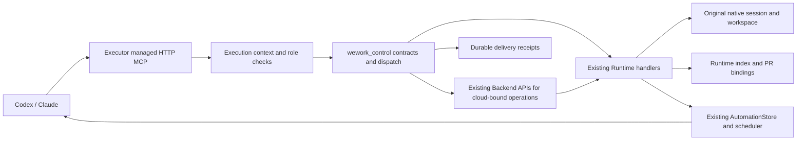
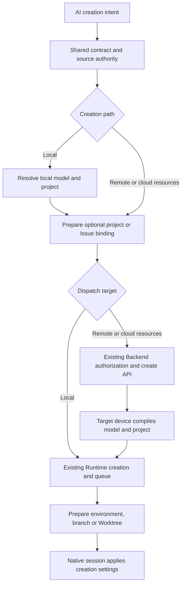
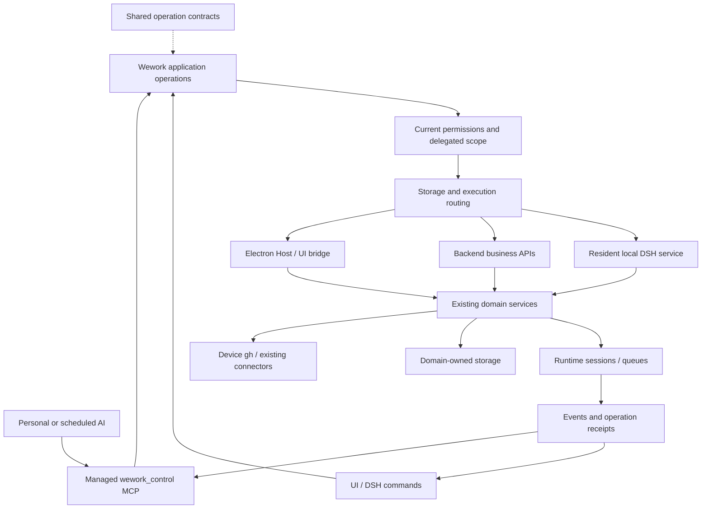
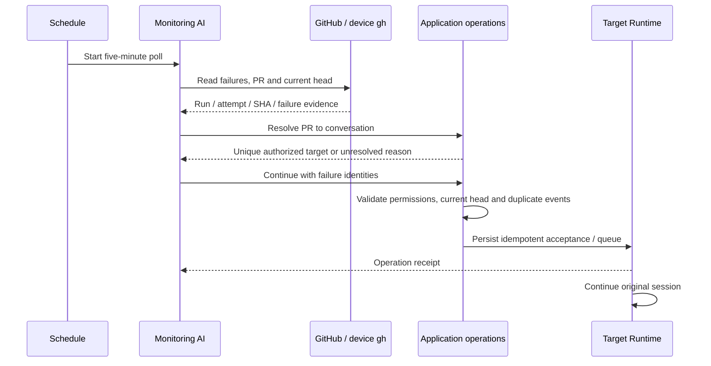

# Wework product operations for AI

Issue: WEWORK2D8526-43. Source baseline: `f0482a994d55191f82dd211ccd12e090ae741b8e`.

The sections after the implementation record retain the original full-product proposal. They are not an implemented capability inventory. The [Chinese plan](WEWORK2D8526-43-ai-workbench-control.md) contains the detailed inventory and verification matrix.

Updated to `origin/main` commit `5e380fe5934872ca896b147ae50ecb376dbc8503` on 2026-10-27. The new stand-in MCP and scheduler paths are preserved. Stand-in identities and external connection work retain their scoped tools and confirmation flow without receiving personal control.

Updated again to `66e6e3e8a9fe94cf405960e12740cf56c1f9e704` on 2026-10-28, preserving the latest CI shards and Runtime dispatcher split. Creation intent and model-profile synchronization use the new boxed RPC dispatcher. Claude retains both upstream artifact instructions and personal-control instructions, with delegated execution restrictions intact.

## Implemented managed wework_control

The Executor now exposes 30 application tools plus `list_capabilities`, `describe_capability` and `invoke_capability`. Personal Codex/Claude conversations and personal scheduled runs receive the managed MCP automatically, without a separate MCP setup or personal API key.

Cloud-bound conversation checks reuse `/runtime-work/transcript` with its top-level `deviceId`, `taskId` and `workspacePath` fields. Listings and searches expose `coverage.unavailable_reasons` to distinguish invalid Backend requests, denied access, connectivity failures and authorization timeouts; incomplete results do not establish that a conversation is absent. Regressions cover strict request parsing, Chinese title search and mixed allowed/denied matches. The existing `workbench-control` CI checkpoint also covers creation and discovery through the real cloud Backend.

Implemented operations cover owning-device conversation listing, pagination, search, safe metadata, native history, creation, continuation, rename, archive, cancellation and guidance; goals/supervisors can be read or cleared. Explicit PR/MR bindings are persisted on the Runtime and resolve as unique, missing or ambiguous. Schedule CRUD, version checks, enable/disable, immediate runs and run history reuse the existing scheduler. Five minutes is `{"type":"interval","value":5,"unit":"minutes"}`.

This reuses the existing managed MCP host instead of adding a DSH resident service. HTTP sessions bind the instance bearer, MCP surface and context handle. Delegated runs cannot acquire personal control or be continued through personal tools. Project-space operations remain with `wework_space`; cloud-bound operations use existing backend entry points.

Continuation journals a stable request key and a fingerprint of the message and normalized queue policy before delivery, then persists its acceptance receipt. Identical requests return the original receipt, changed delivery arguments conflict, and uncertain pending/needs_attention states are never blindly replayed. This distinguishes delivery acceptance from execution completion and does not claim atomic exactly-once execution across crashes.

New schedules persist execution intent and a source conversation reference, not copied credentials. Runs compile the current profile, refresh cloud models through the existing authorized catalog/gateway and use native account configuration. Unrecoverable custom local model configuration after restart returns `model_configuration_required` explicitly.

Discovery and continuation cover the **owning device**. Creation supports explicit remote targets permitted by the existing Backend policy; this does not provide multi-device aggregation or complete product parity. Authoritative cloud Issue PR bindings remain in project-space services. Branch guesses and historical URLs do not become confirmed bindings automatically. Settings writes, plugin installation, window navigation and attachment upload management remain proposal items. Existing `gh` tools check CI; callers construct stable repo/PR/head SHA/run/attempt keys and verify current head.

Focused tests cover contracts, delegated authority, HTTP isolation, durable and ambiguous PR relationships, schedule versions, native-thread continuation, duplicate suppression and actual schedule startup. The new self-contained `workbench-control` desktop checkpoint is registered in the shared runner and selected by CI Core shard 5. It uses real Runtime/MCP/native sessions and simulates only the model; GitHub itself is not exercised. E2E and ai:verify have not been run, as requested, so full desktop verification is not claimed.

Local checks passed: 25 tests selected by Rust `--lib control`, 59 existing send-contract tests, 6 Python tests selected by `send_runtime_message`, and focused managed-MCP, Codex/Claude configuration, schedule, API-context and CI-classifier regressions. Formatting and diff checks passed. These are working-tree results, not remote CI or a deployed desktop release.

## Complete conversation creation options (2026-10-27)

`get_conversation_creation_options` returns the actual parameter schema, local projects, native/configured models, skills and plugins; `include_remote` adds authorized execution environments and cloud models. `create_conversation.options` derives its fields from the shared V2 producer contract, excluding credentials, execution identity, raw thread handles and dispatch origin.

Supported creation settings include Codex/Claude Code, model selection, reasoning/service tier, permissions and plan mode, device and code-project/workspace selection, local-path/Worktree execution, branch selection or local branch creation, attachments, skills/plugins, typed context, initial goal/supervisor and ephemeral sessions. The outer `project_space: {space_id, store, item_id?}` binds a project or Issue before dispatch; local spaces retain local executors. `reference_conversation_id` resolves an authorized native Codex side-conversation reference, with the existing same-device constraint and delegated-target rejection. Files must be accessible on the target device; remote attachments use existing uploaded `attachmentIds`.

Model options use `reasoning`, `summary` and `speed`; the existing `reasoningEffort` / `serviceTier` aliases normalize before merging explicit overrides. Permissions use `permissionMode`, plan mode uses `collaborationMode`, and Claude uses the outer `runtimePermissionMode`.

The UI publishes model profiles through authenticated device IPC into Executor memory, using the existing model compiler. Refreshes include removals and serialize per device to prevent stale credentials overwriting new profiles. MCP accepts model identities, never materialized `modelConfig` or `executionRequest`. Remote intent compilation requires an advertised capability and preserves Backend account proxy and APP device restrictions. Source attachments, Issue origin, forks and inherited history are cleared for new sessions. Local project bindings remain readable offline.

Definite rejection cleans up the binding; uncertain transport/server outcomes retain the address for reconciliation without automatic resending. Acceptance is distinct from completion. After Executor restart, model-catalog preparation republishes custom profiles; unavailable profiles fail explicitly instead of using another model's credentials.

Regression coverage includes all composer fields, exact model identities and refreshes, primary/supervisor proxy policy, actual native plan/permission parameters, real Git branches, project/Issue bindings and cleanup, delegated-reference denial and remote dispatch. Related frontend tests (127), Backend create/RPC tests (152), TypeScript and ESLint passed. The existing CI-covered desktop checkpoint now creates a configured conversation and checks its visible result. E2E and ai:verify were not run.

## Outcome

Every product operation available to a user in Wework should have an AI equivalent, including the same readable data, permissions, state transitions and persisted effects. Personal conversations and scheduled agents use the same capabilities. Business operations must work without the relevant page or conversation being mounted.

Coverage includes conversations, projects, workspaces, Git, PR/CI, schedules, project spaces, Issues, comments, deliveries, tables, members and resource bindings, models, skills, plugins, Hooks, notifications, applications and desktop settings. Navigation and window operations explicitly declare their desktop requirements. Plugins register their operations through the same contract.

## Existing foundations and gaps

| Area                   | Existing implementation                                                                                                          | Missing work                                                                                                                     |
| ---------------------- | -------------------------------------------------------------------------------------------------------------------------------- | -------------------------------------------------------------------------------------------------------------------------------- |
| Conversations          | Runtime list/get/search/transcript, native pagination and rich messages                                                          | Managed AI discovery, complete safe metadata, aggregation and availability reporting                                             |
| Execution              | Create/send, busy queues, guidance, interruption, cancellation, fork, rollback, compaction, goals, supervisors and input answers | AI entry points and a page-independent execution-intent compiler                                                                 |
| Personal HTTP API      | Device/conversation/model discovery and native Responses adapter                                                                 | Uses a separate personal API key; limited catalog metadata; continuation requires an idle Codex conversation and model selection |
| PR/CI                  | Device Git CLI queries and a UI change-request monitor                                                                           | Background queries, detailed failed run identities and global reverse lookup                                                     |
| PR relationships       | Persistent cloud Issue task bindings with uniqueness and resolution                                                              | Equivalent relationships for standalone/local conversations and an aggregate query                                               |
| Schedules              | Runtime cron/interval/one-time scheduling, independent/continued conversations and persistent runs                               | AI CRUD/control and dynamic cross-conversation handoff                                                                           |
| Deduplication          | Active schedule-run exclusion; project incoming event deduplication                                                              | CI failure deduplication across completed polls and durable target-side acceptance                                               |
| Project automation     | Incoming hooks/polling, normalized events, PR resolution and continue_binding                                                    | Personal-scope adapters and complete product-tool coverage                                                                       |
| Project MCP            | Many local/cloud Issue, comment, attachment, delivery and table operations                                                       | Remaining member/resource/execution/automation operations; current comment tool does not identify a reply session                |
| Workspace and settings | ExecutorClient, Runtime RPC, Host capabilities and existing APIs                                                                 | Complete product contracts with safe configuration projections                                                                   |
| Commands and UI        | DSH commands/context/menu/keybindings; desktop inspect/click/fill/press CLI                                                      | Command schemas and business authorization; existing DOM control still requires a window                                         |

`wework.session.current` provides identifiers, not authorization or a complete tool surface. Existing public APIs remain supported integrations. Internal managed tools use execution-bound authorization without requiring a new personal API key.

## Architecture

Use shared operation schemas, suggested under `wework/contracts/operations/`, for identifiers, inputs, outputs, resource types, effects, ownership, execution targets and availability. Existing DSH commands reference these identifiers; do not create a parallel frontend command system. Existing project-space, browser, computer and connector tools retain their domain handlers and authorization.

Add a resident DSH application service under `wework/dsh/workbench-control/`. Extract execution compilation, model/proxy resolution, attachments and project context from localServices into modules with injected ports and no DOM. UI, local schedules and AI invoke that service. Runtime retains authority over sessions, queues and histories. Refresh configuration through current references; redacted persisted execution profiles are not durable credentials.

Remote execution reuses current Backend materialization and routing. New Backend APIs belong in Rust with Application registration, active routes and focused tests. Existing Python-owned APIs retain ownership. Check each method/path rather than assigning an entire URL family to one implementation. Do not duplicate their business logic in a new Rust handler.

Bind the MCP and local service bridge to authenticated execution contexts and exact runtime instances. Expose explicit product operations, not arbitrary RPC names, URLs, execution requests or raw Host capabilities. General tools discover, describe and invoke schema-validated operations; common conversation and schedule tools are generated from the same definitions.

## Conversation data and continuation

Reuse RuntimeTaskSummary, RuntimeTranscriptResponse, existing conversation ID encoding and origin/task bindings. Keep device/task, native thread, response, project and Issue identities distinct. Link synchronized replicas through existing transcript identity when available.

Return safe complete product metadata, state, queue/input status, model, project/Issue/activity/execution, workspace/worktree, repository/branch, confirmed PRs, CI timestamps, plans/goals, outputs and allowed operations. Page native history and large resources. Never serialize raw runtimeHandle or executionRequest. Report unavailable devices and partial results; offline is not an empty catalog or permission to fabricate unsynchronized history.

Continuation resolves authoritative target metadata and preserves the session, model, team, plugins, context and workspace unless the user requests a change. Queue by default when busy; interruption is explicit. Return a durable operation receipt and follow existing Runtime events through completion. Accepted is distinct from completed.

Deduplicate requestKey at the receiving Runtime in the same persistence boundary as acceptance/queuing. Identical retries return the original receipt; changed parameters conflict. Query receipts after timeouts. Test crashes both before and after acceptance.

## PR identity and five-minute CI workflow

Use provider, canonical instance, full repository and PR number as identity; head SHA, workflow run and attempt identify failure evidence. Reuse repository identity and cloud ProjectChangeRequestBindingService. Store standalone/local relationships on the owning Runtime; aggregate indexes are derived. Message URLs and branch matches produce candidates until confirmed. Return ambiguity explicitly, including multiple conversations or synchronized replicas.

Reuse the existing five-minute interval schedule to start a monitoring agent. It reads failed CI using the execution device's existing gh authorization, resolves the PR to one authorized conversation and sends a continuation with failure evidence. Existing project incoming-event normalization/resolution is reusable; personal queries must retain personal scope.

Deduplicate the same failure across polls, manual calls and restarts. A new commit or rerun attempt can trigger new work. Aggregate current failures into a repair message; already active repairs expose their existing status. Stale head failures are recorded as obsolete. Missing/ambiguous mappings, offline targets and expired authorization return actionable states. Delivery of a repair request and completion of the repair have separate records.

## Delivery sequence

1. Shared contracts, capability coverage inventory and resident application service; extract frontend compilation and routing.
2. Managed MCP, safe full conversation reads and lifecycle operations for Codex and Claude, with explicit support discovery for other harnesses.
3. Persistent PR relationships, reverse lookup, background Git queries and durable target receipts.
4. Complete schedule controls and the dynamic CI-to-conversation scenario.
5. Remaining product areas and plugin registration; every user operation must map to a handler, authorization rule and verification entry.
6. Remove obsolete frontend business compilation and PR monitoring logic; run focused checks and perform final review after the entire feature is complete.

These are dependencies within one complete delivery. The final scope remains all frontend product capabilities. UI-only navigation uses existing DSH command/Host bridges with explicit availability.

Plugin SDK interactions bind to registered operations, and installation/update validates declarations against handlers. Arbitrary third-party plugin or Smart App pages require explicit semantic adapters; installation alone does not provide them. Unadapted operations remain visible coverage gaps. Full coverage can be claimed only after the built-in and in-scope plugin inventory is complete.

Preserve CP01–CP20, including shared-session reads that never reveal a device owner's catalog, delegated manager/executor limits, Viewer restrictions, secret isolation and current permission checks at acceptance and dequeue. Native personal work remains available without cloud connectivity. Existing login/confirmation requirements become explicit waiting-for-user states; ordinary authorized operations proceed directly.

## Verification

Add focused contract, Runtime, persistence, permission and frontend adapter tests. Cover native pagination, rich data, redaction, multiple devices, offline partial reads, both runtimes, queues/input, PR collisions, forks/replicas, stale SHA, repeated attempts, concurrency, timeout recovery, restart and authorization revocation. Assert UI/AI operation parity and plugin lifecycle.

Reuse existing runtime send, MCP, automation, incoming-hook, public-API, DSH command and collaboration permission suites. Add desktop regressions to the shared scenario/checkpoint runner and actual GitHub CI classification. Each checkpoint establishes minimal prerequisites. E2E may mock only models; GitHub integration requires a real test repository and CI evidence.

Run focused unit/contract/type/format/lint checks during implementation. Run E2E and ai:verify only when explicitly requested. Compare every implementation batch against the architecture and workflow diagrams. Perform the review defined by `/Volumes/OuterHD/OuterIdeaProjects/review/WEGENT.md` after functional development is complete. This design-only change has no execution-validation claim.
