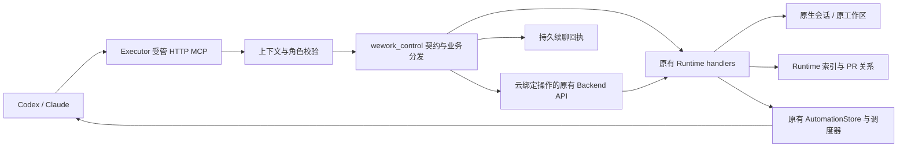
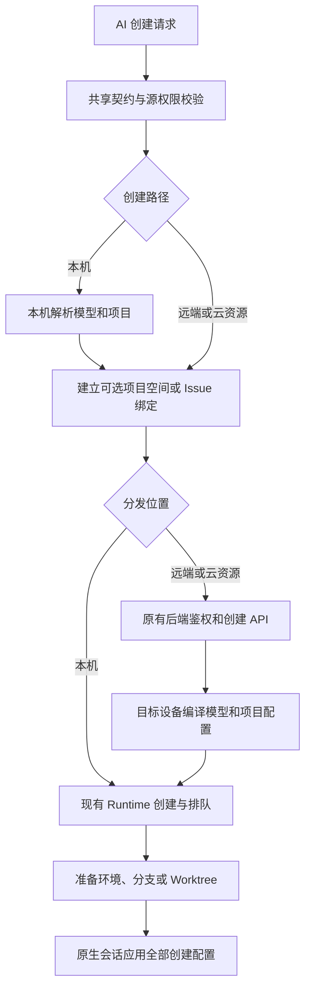
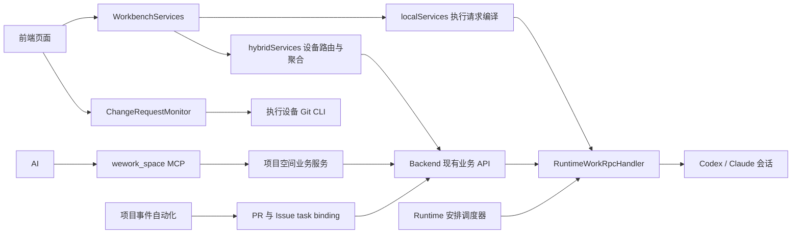
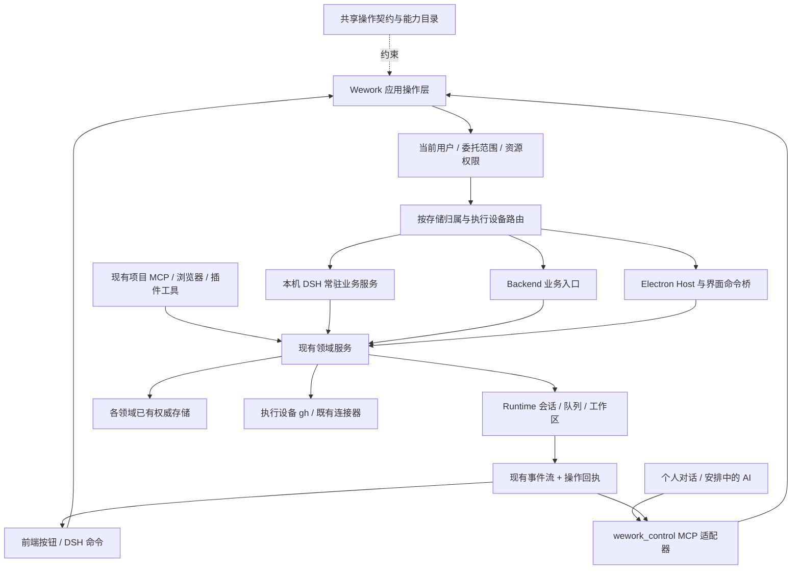
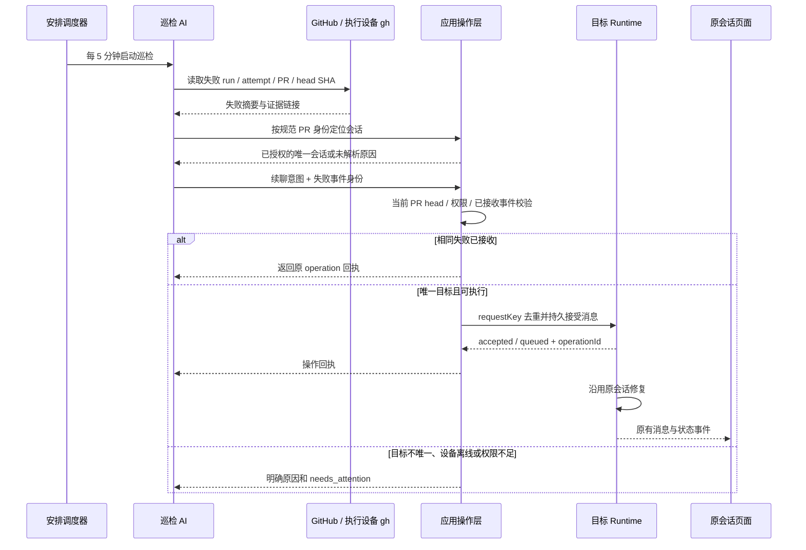

# Wework 全产品 AI 操作能力方案

对应需求：WEWORK2D8526-43。代码基线：`f0482a994d55191f82dd211ccd12e090ae741b8e`。

第 1–9 节保留最初的全产品调查与目标方案，不能作为已实现清单。下面记录本次 `wework_control` 的实际实现与边界。

2026-10-27 已同步 `origin/main` 至 `5e380fe5934872ca896b147ae50ecb376dbc8503`，保留上游新增替身 MCP 与调度路径。替身身份及外部连接工作保留其工具范围和确认机制，不取得个人控制入口。

2026-10-28 再次同步至 `66e6e3e8a9fe94cf405960e12740cf56c1f9e704`，保留最新 CI 分片和 Runtime 分发模块拆分。创建意图及模型配置同步 RPC 使用新的 boxed 分发入口；Claude 同时保留上游产物说明和个人控制说明，并继续限制委托执行。

## 当前实现：受管 wework_control

新增 30 个业务工具以及 `list_capabilities`、`describe_capability`、`invoke_capability` 三个发现/调用工具。工具目录来自同一份输入契约；普通 Codex、Claude 会话及个人安排自动接入，不需要用户另配 MCP 或个人 API Key。

| 已接入领域 | 实际行为                                                                                                                                            |
| ---------- | --------------------------------------------------------------------------------------------------------------------------------------------------- |
| 会话       | 当前设备的列表、分页、搜索、安全元数据及原生历史读取；创建、续聊、重命名、归档、取消与 guidance                                                     |
| 执行状态   | 原有排队/执行状态、目标和 supervisor 的读取与清除、Runtime 容量与模型目录                                                                           |
| PR/MR      | 当前设备独立/本地会话的显式持久绑定；规范化 host、完整仓库与编号；查询返回 unique/missing/ambiguous                                                 |
| 安排       | 复用 cron/interval/one_time、版本检查、启停、立即运行、删除及运行历史；五分钟为 `{"type":"interval","value":5,"unit":"minutes"}`                    |
| 可靠性     | 续聊前持久记录 request_key、消息与排队策略指纹，接收结果再次持久化；相同请求返回原回执，参数冲突拒绝；pending/needs_attention 不自动重发            |
| 权限       | 受管 context handle 与实例 bearer；HTTP 会话、surface 和 context 绑定；委托运行无个人控制工具，不能用个人工具续聊委托执行；云绑定操作复用原后端入口 |

没有另建 DSH 常驻服务。项目空间操作继续由 `wework_space` 提供；业务操作仍由已有 Runtime 处理。安排保存源会话引用与执行意图，运行时编译执行请求，不把当前凭据复制进新安排。云模型通过既有授权目录与网关刷新，原生账户继续使用原生配置；重启后无法恢复的自定义本地模型配置明确返回 `model_configuration_required`。

会话发现和续聊范围是**拥有此 MCP 的设备**；新建支持显式选择现有后端策略允许的远端执行设备，不代表支持多设备聚合或全产品操作。云 Issue 的权威 PR 绑定仍属于项目空间服务，本工具没有把它复制为个人关系；界面分支推测和历史 PR URL 不会自动变成确认绑定。设置写入、插件安装管理、窗口导航、附件上传管理等第 1–9 节目标仍未纳入本次工具。GitHub CI 由现有 `gh` 能力查询，调用方须用 repo/PR/head SHA/run/attempt 构造稳定请求键；本工具不负责判定 GitHub 当前 head。

聚焦回归覆盖 schema、委托边界、HTTP 上下文隔离、PR 持久化/歧义、安排版本、原 native thread 续聊、重复消息及安排的实际启动。新增 `workbench-control` E2E checkpoint，自建两条会话，经真实模型工具链完成查询/读取/绑定/定位/续聊/去重/创建和删除五分钟安排，并由 CI classifier 选入 Core shard 5。该用例只模拟模型，不调用真实 GitHub。遵照本次要求，未运行 E2E 和 ai:verify；不能据此声明完整桌面链路已验证。

已运行并通过：Rust `--lib control` 过滤集 25 项、原有 send contract 59 项、Python `send_runtime_message` 过滤集 6 项，以及受管 MCP、Codex/Claude 配置、安排、API context 和 CI classifier 的聚焦回归。格式与差异检查通过。这些是当前工作区的本地结果，不是远端 CI 或已发布桌面版本的结果。

## 新建会话选项补齐（2026-10-27）

`get_conversation_creation_options` 返回实际创建契约、本机代码项目、原生与界面配置模型、技能及插件；`include_remote` 另外查询当前账号授权的执行环境和云模型。`create_conversation.options` 复用共享 V2 创建契约的字段，排除凭据、执行身份、原始会话句柄与派发来源。

| 创建选择                 | 参数与生效位置                                                                                                                                             |
| ------------------------ | ---------------------------------------------------------------------------------------------------------------------------------------------------------- |
| Runtime、模型与推理      | `runtime`、`modelSelection`、`modelOptions`；支持 Codex / Claude Code、本机模型接口和云模型，推理及摘要用 `reasoning` / `summary`，速度用 `speed`          |
| 权限与计划               | `modelOptions.permissionMode`、`collaborationMode`；Claude 使用 `runtimePermissionMode`；同时接受界面调用中的 `reasoningEffort` / `serviceTier` 参数别名   |
| 设备和代码项目           | `deviceId`、`runtimeProjectKey`，或现有后端的 `projectId` + `deviceWorkspaceId`；工作目录用外层 `workspace_path`                                           |
| 分支与执行方式           | `execution.workspace.source` 为 `local_path` / `git_worktree`，`branch` 指定分支或 Worktree 基准；本地目录可用 `createBranch` 新建分支；在真正执行时切换   |
| 项目空间 / Issue         | 外层 `project_space: {space_id, store, item_id?}`；派发前建立权威绑定，支持只选空间；本地空间使用本机执行器                                                |
| 文件、技能、插件、上下文 | `attachments` 使用执行设备可访问的文件，跨设备使用已上传的 `attachmentIds`；`additionalSkills`、`projectPlugins`、`additionalContext` 进入现有原生启动链路 |
| 引用会话                 | 外层 `reference_conversation_id` 由已授权的 Codex 会话解析原生 side-conversation 引用；保留现有同设备限制，禁止引用委托执行来取得个人权限                  |
| 目标、监督、临时会话     | `initialGoal`、`initialSupervisor`、`ephemeral`；监督遵循原有 Codex 限制，模型配置由设备解析                                                               |

界面通过可信设备 IPC 发布模型配置到 Executor 内存；准备或刷新目录时重发，包括删除后的空目录，并按设备串行处理，防止旧凭据覆盖新配置。MCP 只能指定模型身份，不能传入 `modelConfig` 或 `executionRequest`。远端创建要求显式模型，协商 `intentCompilation` 能力，并保留后端账户代理及 APP 设备控制策略。源会话的附件、Issue 来源、fork 和继承历史不会自动进入新会话。新会话关联本地项目时仍可离线读取。

创建失败且确定未接收时清理绑定；网络或服务端不确定结果保留地址供核对，不自动重发。接收不等于执行成功。Executor 重启后，界面刷新模型目录重新发布自定义配置；尚未发布的模型明确报不可用，不沿用另一模型的凭据。

新增回归覆盖完整选项编译、模型身份和凭据更新、主模型与监督模型代理、实际原生计划与权限参数、真实 Git 分支操作、项目与 Issue 绑定及回滚、委托引用拒绝和跨设备请求。前端相关测试 127 项、后端 Runtime 创建/RPC 测试 152 项、TypeScript 与 ESLint 已通过。Rust 控制及创建过滤集分别运行；完整证据记录在本地审查账本。扩展现有 `workbench-control` CI checkpoint 验证创建配置及界面可见的新会话；未运行 E2E 或 ai:verify。

## 1. 目标与完成标准

Wework 中用户可查看的数据、可执行的业务操作和可组合的工作流程，都应有对应的 AI 能力。普通个人会话与「安排」使用同一组能力；业务操作不依赖当前路由、已打开的会话或挂载的 React 组件。

完整交付包含会话、代码项目、工作区、PR/CI、安排、项目空间、Issue、交付、表格、成员与资源配置、插件、模型、技能、Hooks、通知、应用及桌面设置。界面导航、标签页和窗口操作也纳入能力目录，明确其需要桌面实例的条件。第三方插件的产品操作由插件按同一契约注册。

“与前端一致”包含相同的数据字段、分页、权限、运行状态、业务错误和持久化效果。用户无法读取的密钥不会通过 AI 暴露。本人发起的个人会话按本人权限操作；项目派发的 manager/executor 保留已有委托范围。

## 2. 已有能力与缺口

下表中的“AI 入口”指代码中受管的产品工具和接口；Shell、文件读写及插件专项技能不能据此推导为全产品能力已经覆盖。

| 产品领域                                    | 已有实现                                                                                                                    | 当前 AI 入口与缺口                                                                                                         |
| ------------------------------------------- | --------------------------------------------------------------------------------------------------------------------------- | -------------------------------------------------------------------------------------------------------------------------- |
| 会话列表、详情与搜索                        | `runtime.tasks.list/get/search/transcript`；前端有本地/远端聚合                                                             | 缺少默认可发现的统一会话工具；需补全多设备、归档、筛选、完整性与可用性信息                                                 |
| 会话内容                                    | Runtime transcript 支持原生分页、消息、工具块、附件及文件变更；DSH conversation service 可读指定会话与资源                  | 外部会话 API 返回消息，但目录元数据只是子集；需统一安全读模型，补齐计划、目标、排队、工作区、模型、产物与 PR 等关联        |
| 创建、续聊与执行控制                        | Runtime 已有 create/send、queueIfBusy、guidance、interrupt、cancel、fork、rollback、compact、goal、supervisor、用户输入回答 | 缺少 AI 操作入口。前端仍负责组装执行请求、模型及代理；仅转发一句 message 无法兑现完整续聊                                  |
| 重命名、固定、排序与归档                    | Runtime 与前端已有相应操作                                                                                                  | 尚未统一开放；归档与删除、恢复与续聊需要保持独立语义                                                                       |
| PR/MR 与 CI 状态                            | `changeRequests.ts` 通过执行设备的 Git CLI 查询，`ChangeRequestMonitor` 驱动 UI 状态                                        | 监控目标由已挂载组件注册，缓存位于 localStorage；需形成可后台调用的查询服务，补齐失败详情、run/attempt/head SHA 与反向定位 |
| PR 与会话绑定                               | 云项目已有 `LoopItemTaskBinding.metadata.change_requests`、唯一性校验和 `resolve`；Issue 内容另有 PR badge 索引             | 项目绑定可复用；独立会话没有统一的持久 PR 关系。badge、分支查询结果和已确认会话绑定须区分                                  |
| 个人「安排」                                | `runtime.automations.*`，支持 cron/interval/one_time、独立执行及固定会话续聊；运行记录持久化                                | 缺少创建、修改、启停、立即执行及查询记录的 AI 工具；未覆盖“每次动态查 PR 后定位其他会话”的通用控制入口                     |
| 安排防重                                    | `AutomationStore` 会阻止同一安排的上次运行仍活跃时再次启动                                                                  | 这是安排运行防重；还需针对已经完成巡检后再次读到的同一 CI 失败做业务防重                                                   |
| 项目事件自动化                              | 已有 GitHub/GitLab incoming hooks、轮询/事件归一化、事件去重、PR 绑定解析及 `continue_binding`                              | 可复用现有项目链路；它的作用域是项目绑定，无法单独覆盖所有个人会话和全部前端操作                                           |
| 项目空间、Issue、评论、附件、交付与表格     | `wework_space` 已提供大量本地/云端读写工具，并校验角色及资源权限                                                            | 仍缺前端中成员、资源绑定、项目自动化、执行管理等完整覆盖；当前评论工具未提供回复定位参数，不能当作指定会话续聊接口         |
| 代码工作区、Git、文件、worktree、终端与设备 | `ExecutorClient`、Runtime RPC、device command 与 workspace API 已实现大量操作                                               | 缺少完整产品操作契约；须保留执行设备与工作区归属，并复用现有代码操作和 diff 服务                                           |
| 模型、技能、插件、Hooks、账号和执行环境     | 分散在 Runtime、Electron Host、Backend 与对应设置页                                                                         | 有专项工具/技能及底层接口；缺少统一的能力发现和产品操作覆盖，配置读取需要安全投影                                          |
| 通知、应用、站点与 Smart App                | 已有通知 MCP、通知列表/偏好 API、Sites/Smart App API 和 Host 操作                                                           | 通知发送已覆盖；收件箱、已读、配置与应用管理需要逐动作补齐，复用已有插件业务入口                                           |
| 桌面设置与界面操作                          | HostCapabilityRouter、DSH commands、context/menu/keybinding；另有 `wework desktop` inspect/click/fill/press CLI             | 命令目前大多绑定 Renderer，缺少参数/结果 schema 和业务权限描述。桌面 CLI 依赖窗口与 DOM，后台业务访问仍须补齐              |

### 现有个人 HTTP API 的适用边界

`backend/app/api/endpoints/wework_api.py` 已有 `/api/v1/devices`、`/conversations`、`/conversations/{id}`、模型发现；`openapi_responses.py` 将 Wework 请求交给 native Responses 服务。

代码中的限制包括：独立个人 API Key；列表由在线 Runtime 聚合；目录字段只包含标题、时间、状态、设备、runtime、模型等；续聊要求空闲的 Codex 会话；每次调用要求模型选择；新建会话使用独立聊天工作区。AI 当前收到的 `wework.session.current` 只是会话标识提示，不构成访问授权或完整的工具注入。

该 API 可以作为现有外部集成入口保留。内部 AI 工具使用执行上下文中的受管授权，无需用户额外创建个人 API Key。实现前逐 method/path 核对当前路由表和 Application，保持现有 API 归属；本文不将 Responses 各方法视作同一 owner，也不声称这些接口已完成网关运行验证。

## 3. 现有链路与根本缺口

根本缺口是应用业务操作与数据聚合尚未形成统一、可发现、能脱离页面运行的边界。必须同时复用既有业务处理、抽取前端业务编译、补充必要的数据关系，并将权限与异步执行结果贯穿全程。

## 4. 目标架构

### 4.1 一份操作契约，多个调用入口

建议在 `wework/contracts/operations/` 放置可供 TypeScript/Rust 消费的领域 schema；DSH 命令声明引用同一 operationId，调用应用操作层。复用现有 DSH command/context/menu 注册，不再创建一套平行的前端命令系统。

契约包含：operationId、说明、输入/输出 schema、领域资源类型、读写性质、存储归属、执行目标、可用条件和是否支持后台执行。版本只用于协议校验，不形成旧实现回退路径。

原始 RPC、Host 能力与产品操作分别保持职责。一个“续聊”操作会编译请求、校验权限、选择设备、入队、返回回执；AI 不接收任意 RPC 名称、任意 Backend URL 或未经校验的 executionRequest。

已有 `wework_space`、浏览器、电脑操控及连接器工具继续复用各自业务服务和授权。新能力目录发现这些领域能力，不重新实现其功能。

### 4.2 可后台运行的业务服务

新增 `wework/dsh/workbench-control/` 常驻服务，复用 DSH 的 Executor 客户端与 Electron Host 服务。将 `localServices.ts` 中创建/续聊编译、模型选择解析、代理解析、附件准备及项目上下文处理抽取为无 DOM 的业务模块，页面改为发送高层意图。

本机创建、续聊、安排执行都通过这一编译模块。Runtime 继续独占会话生命周期、队列、原生历史与执行状态。持久化执行 profile 已做密钥清理；每次执行按配置引用重新获取当前配置，避免把历史 materialized executionRequest 当作永久凭据。

云端/远端复用当前 Backend 的执行编译与 RPC 路由；不把本机模型代理、凭据或绝对路径传给其他设备。新增远程应用操作入口落在 Rust Backend，并按注册、active route、聚焦测试一起交付；既有 Python-owned 业务保持其归属。新增 Rust 入口通过明确的领域端口调用既有 owner，不复制 Python 业务。

Executor 与本机常驻服务使用受管、鉴权的 IPC/loopback 桥，并绑定实例与执行上下文。复用 Host/Executor 通道的生命周期机制；不能依靠当前活动页面、全局 window 回调或读取桌面注册文件中的凭据来授予 AI 业务权限。

### 4.3 AI 工具形态

新增固定受管的 `wework_control` MCP，和现有受管 MCP 一样为每次执行绑定上下文，覆盖 Codex、Claude Code 及支持工具注入的执行入口。其他 Harness 要接入其明确的工具适配端口，并在能力发现中报告支持状态。

常用工具由同一操作 schema 生成，例如：

| 工具                                                                              | 语义                                                         |
| --------------------------------------------------------------------------------- | ------------------------------------------------------------ |
| `list_conversations` / `search_conversations`                                     | 分页查询本人可见会话，支持设备、项目、状态、归档和 PR 条件   |
| `get_conversation` / `read_conversation`                                          | 读取完整安全元数据、分页历史、指定工具输出/附件/文件变更     |
| `find_conversations_by_change_request`                                            | 用规范 PR 身份查询绑定，返回唯一、缺失或多义结果             |
| `continue_conversation`                                                           | 在原会话发消息，支持入队与可查询回执                         |
| `get_operation`                                                                   | 查询接受、排队、执行和最终结果                               |
| `list_automations` / `create_automation` / `update_automation` / `run_automation` | 复用现有「安排」操作，启停、删除及运行记录同样开放           |
| `list_capabilities` / `describe_capability` / `invoke_capability`                 | 按需发现其余全部领域操作；调用前按目录 schema 和当前权限验证 |

上述名称是拟议契约；不能将尚未注册、没有实际 handler 的能力宣称可用。工具发现按用户、执行角色、设备和插件安装状态过滤，业务服务在执行时再次校验。

### 4.4 会话读模型和身份

复用 `RuntimeTaskSummary`、`RuntimeTranscriptResponse`、现有 conversation ID 编码及 origin/task binding。设备 ID、任务 ID、native thread ID、response ID、项目 ID 和 Issue ID 继续保持独立。

统一的安全会话模型包含：

- 原有 `conv_` 标识和 `deviceId + taskId` 地址；有同步副本时附 transcriptId/来源关联。
- 标题、runtime、模型选择、状态、运行/排队/等待输入、是否可续聊、归档状态及更新时间。
- 代码项目、项目空间位置、Issue、活动线程、执行记录、工作区、worktree、仓库和分支。
- 已确认 PR 关系、CI 快照及采集时间；计划、目标、supervisor、产物和附件引用。
- 允许的操作与不可用原因、数据来源、freshness、设备错误及列表完整性信息。

内容分页与按需读取，沿用 Runtime 原生历史，长工具输出提供分块/资源读取。只返回前端可见的安全配置字段，不能序列化 raw runtimeHandle、executionRequest 或认证配置。

本机数据无需云连接；远端数据通过现有授权路由读取。离线时返回已有可读投影并标注不可用范围，不能把设备离线解释为空列表，也不能承诺取回未同步的完整历史。缓存只是投影，不能作为执行授权依据。

### 4.5 PR 关系与反向查询

PR 身份采用 provider、规范实例地址、完整仓库路径和 PR number；head branch、head SHA 与 run/attempt 作为版本及 CI 证据。复用 `repository_identity.rs`、现有 PR URL 解析与 `ProjectChangeRequestBindingService`。

云项目的已确认关系继续以现有 task binding 为权威。独立/本地会话在所属 Runtime 索引保存等价关系；反向索引由这些关系生成。派生聚合索引不得变成另一份可独立修改的权威关系。

关系来源包括用户显式绑定、结构化 PR 交付，以及现有 Git 查询确认后的绑定操作。历史消息/工具输出中的 URL 和分支只产生候选证据，不能看到任意引用就自动绑定。存量会话提供一次明确的关系重建操作；无法唯一确认的记录保持未解析并可人工指定。

默认策略：一个会话可关联多个 PR；同一个人同一 PR 的自动处理目标必须唯一。多会话/多副本命中时返回候选和冲突原因，不按最近更新时间猜测。共享项目只查询当前用户能读的 Issue 绑定，不能借绑定读取会话所属设备的整个目录。

### 4.6 可靠的跨会话续聊

`continue_conversation` 接收会话引用、消息、附件引用、可选模型变更、busy policy 和 requestKey。默认保留目标会话的模型、项目上下文、工作区、分支、插件、团队与 native session；调用者提供的是意图，目标元数据从权威服务重新解析。

默认忙碌策略为排队，复用现有 queueIfBusy、task send gate 与持久化队列。只有明确调用 interrupt 操作才中断当前执行。等待用户输入、归档、删除、缺失 native session 与工作区恢复失败各自返回可理解的状态，不创建另一段会话掩盖失败。

操作回执应包含 operationId、conversationId、messageId/turnId（可用时）、accepted/queued/running/completed/failed、位置及错误。Runtime 事件是最终执行事实；接受消息不能记作修复完成。

requestKey 在目标 Runtime 接受意图与写入队列的同一持久化边界去重。相同键和参数返回原回执；相同键不同参数报冲突。超时后先查询回执，不能盲目重发。接收前/后重启均须验证恢复，不能仅有发送端内存 Set 或预先写“已处理”标记。

## 5. 每五分钟检查 CI 的实现

复用「安排」现有 interval，创建独立巡检执行。巡检 AI 查询用户指定仓库/本人 PR 范围，读取失败 CI 的 run、attempt、head SHA、链接及失败摘要，再调用通用 PR 定位与续聊工具。GitHub 操作继续使用既有执行设备上的 gh 与 Wework 授权流程；授权失效返回结构化状态，不在后台交互登录或读取认证文件。

失败事件键至少包括 provider/host/repo/PR/head SHA/workflow run ID/run attempt；多个当前失败可以合并为一条修复消息并记录各事件身份。相同失败跨定时运行、跨手动调用、重启后保持去重；新的提交或 CI 重跑的新 attempt 可再次处理。

同一 PR 的修复尚在运行时复用已有操作状态，避免每次轮询继续堆积相同消息。续聊前校验失败 SHA 仍属于当前 PR head；旧提交失败记录为过期。未知、取消、等待和失败状态保持区分。

找不到或匹配多个会话时保留待处理记录；唯一绑定形成后可以重新处理。沿用项目 incoming event 的归一化/去重/解析结构，个人巡检补齐作用域适配，不能用项目全权身份访问个人设备。

巡检运行的“已交办”和修复会话的“已完成”分开记录，链接 operationId 与目标会话。用户可查看对应消息、运行状态和失败原因；需要提醒时复用现有 Wework 通知。

## 6. 全产品覆盖与权限

建立可执行的覆盖清单：前端路由/领域、操作控件或命令、operationId、读写字段、业务 owner、个人/项目范围、后台支持、测试入口。覆盖目录必须包含前表中的全部领域；动态插件卸载后及时移除其能力。

DSH menu/command 注册可直接做契约校验。普通 React 按钮需要逐模块迁入公共操作并在测试中登记；仅扫描 DOM 或统计命令数不能证明全量覆盖。

插件 SDK 为业务交互提供 operation 绑定，并在安装/更新校验中验证声明和 handler。第三方插件或 Smart App 内部任意页面不会因为安装就自动具有语义操作；其业务能力必须实现同一契约，未适配项在覆盖清单中保持缺口。只有内置功能及交付范围内插件的清单全部闭合，才声明“全产品覆盖”。

保留 CP01–CP20。重点回归 CP07、CP10、CP11–CP16、CP20：列表与详情同权、读取共享项目不能获取私有凭据、派发角色不能借新工具升级为个人身份、接受和出队均检查当前权限、撤销后禁止新执行且确认运行取消。

设备所有者、当前用户、资源定义所有者、项目成员及执行角色分别传递。现有人工确认/登录通过统一的待用户处理状态表达；普通已授权操作直接完成，不增加全局确认开关。

## 7. 实施顺序与改动位置

各阶段是同一完整交付的依赖顺序；“所有前端能力”作为最终验收范围。

| 阶段                 | 主要改动                                                                                                                  | 退出条件                                                                    |
| -------------------- | ------------------------------------------------------------------------------------------------------------------------- | --------------------------------------------------------------------------- |
| A. 契约与后台操作层  | `wework/contracts/operations/`；DSH command 契约扩展；新增常驻 control 服务；拆分 `localServices.ts` 的业务编译与设备路由 | UI、AI、安排可调用同一业务 handler，业务操作不依赖页面挂载                  |
| B. 会话与执行工具    | Executor 的 control MCP 与 per-execution 注册；复用 runtime 查询/历史/create/send/queue；前端薄适配                       | 列出所有可访问会话，读完整可用数据，准确续聊并追踪结果；Codex/Claude 均覆盖 |
| C. PR 关系与可靠交办 | Runtime PR 关系持久化；复用云 task binding；后台 Git 查询；目标端回执与去重                                               | 反向定位准确；重启、重复请求、超时及多义关系行为确定                        |
| D. 安排与 CI 场景    | 暴露安排所有操作；按当前配置编译每次执行；扩展事件身份和修复操作记录                                                      | 完成“每 5 分钟检查 → 找 PR → 原会话修复”的全部状态分支                      |
| E. 全产品接入        | 按覆盖清单补齐项目空间、资源配置、应用、插件、设置、通知、工作区与界面操作                                                | 每个用户可执行的产品操作均有目录、handler、权限与验证依据                   |
| F. 清理与交付检查    | 移除重复的前端编译、PR 业务监控和旁路处理；执行聚焦测试与完整审查                                                         | 主流程唯一；变更后的 Mermaid 与代码一致；没有登记但未实现的能力             |

建议新增/修改模块：

- `executor/src/workbench_control/`：受管 MCP、上下文授权、能力投影与本机/远端路由适配。
- `executor/src/runtime_work/`：安全会话读模型、PR 关系与操作回执、接受/队列边界幂等。
- `executor/src/agents/codex.rs`、`agents/runtime_capabilities.rs` 及相关原生配置：工具注入与每轮授权刷新。
- `wework/dsh/workbench-control/`、`app-wework/`：常驻领域操作、现有命令绑定和服务生命周期。
- `wework/src/api/local/localServices.ts`、`api/hybrid/hybridServices.ts`、`features/workbench/workbenchServices.ts`：抽取业务、收敛为适配接口。
- `wework/src/features/workbench/changeRequestMonitor.ts`：保留 UI 订阅投影，业务查询和持久关系移入领域服务。
- `wework/electron/src/host/`：安全配置读取、受限 Host 桥及 UI 状态命令；不暴露 secureStorage 等原始能力。
- `backend-rs/`：有远程聚合/操作需求的新 API、Application 注册、active routes 与聚焦测试。具体路径在逐操作契约中确定。
- `backend/app/services/project_change_request_bindings.py`、`project_automation_execution.py` 等现有 Python-owned 服务：复用其模型和领域规则，仅在所拥有的现有链路中修正必要行为。

会话全文继续保存在既有原生存储。新增本机关系和回执扩展 Runtime 已有持久化体系；云侧优先扩展现有 binding/event 元数据。若可靠的唯一性、事件接受或查询需要数据库结构变更，使用正常迁移并验证升级/回滚，不在启动代码中临时改表。

每批代码修改后对照目标架构和 CI 时序图核查入口、权限、路由、持久化、执行与事件是否一致。完成全部功能后按 `/Volumes/OuterHD/OuterIdeaProjects/review/WEGENT.md` 做正式 review；本次代码调查阶段不触发功能完成审查。

## 8. 验证与交付证据

| 验证层       | 必须覆盖                                                                                                                   |
| ------------ | -------------------------------------------------------------------------------------------------------------------------- |
| 契约测试     | 前端命令与 AI operationId/schema/结果一致；发现被过滤的操作执行时仍拒绝；插件卸载与版本错误                                |
| 会话读测试   | 多设备、同名、归档、分页、长工具输出、附件、diff、目标与计划、等待输入、在线/离线/部分失败；敏感字段不存在                 |
| 执行测试     | Codex/Claude 原 session 和工作区保留；模型不变/明确切换；队列/interrupt/用户输入；模型失效、工作区恢复失败、取消与事件回传 |
| 关系测试     | 不同 host/repo 同 PR number；fork/same branch；多 PR、多会话、同步副本、失效绑定、历史 URL 候选、重启后查询                |
| 自动化测试   | 五分钟 interval；无失败/旧 SHA/同一失败重复/new attempt；并发巡检、超时后查询、接受前后崩溃、目标持续忙碌、离线与授权失效  |
| 权限测试     | 本人个人会话、共享 Issue 单会话读取、Viewer、跨项目拒绝、委托角色限制、执行前/出队前撤销、设备禁用远控                     |
| 状态与持久化 | accepted 不等于 completed；消息写入、操作回执、运行记录和 UI 事件一致；重启后不丢失、不重复                                |
| 桌面集成覆盖 | 从普通对话使用工具、创建安排、动态定位另一个未打开会话、原会话展示消息并继续；个人/本地项目/云项目与远端执行矩阵           |

复用测试入口：`executor/tests/app_runtime_work_send_contract.rs`、`local_task_mcp_contract.rs`、`space_mcp_contract.rs`；Runtime handler/store/automation tests；`backend/tests/api/test_wework_api.py`、`backend/tests/services/test_project_incoming_hooks.py`、项目自动化和权限契约测试；Wework localServices/hybridServices/ChangeRequestMonitor 与 DSH 命令测试。

新增必要 E2E 场景进入 `wework/e2e/desktop/` 的现有发现和 checkpoint runner，并确保 `.github/workflows/wework-e2e.yml` 及场景分类实际选中。每个 checkpoint 自带最小前置条件。E2E 只模拟模型，GitHub 集成需要真实测试仓库/CI；未配置时明确该验证未执行，不能静默跳过或用假的 GitHub 结果声称通过。

本节为全产品目标的验证矩阵；当前实现与已执行验证以本文开头的记录为准。E2E 和 ai:verify 仅在用户明确要求时运行，需要的回归覆盖仍随实现新增。

## 9. 关键代码依据

- [前端统一服务边界与安排 API](../src/features/workbench/workbenchServices.ts)。
- [Runtime 会话操作与安排分发](../../executor/src/runtime_work/handler.rs)。
- [续聊接收、send gate、busy queue 与 executionRequest 要求](../../executor/src/runtime_work/handler/tasks.rs)。
- [前端执行编译与模型准备](../src/api/local/localServices.ts)、[本地/远端聚合](../src/api/hybrid/hybridServices.ts)。
- [个人会话 HTTP API](../../backend/app/api/endpoints/wework_api.py)、[native 读模型](../../backend/app/services/wework_api/native.py)、[Responses 续聊条件](../../backend/app/services/wework_api/service.py)。
- [当前会话标识注入](../../executor/src/runtime_work/api_context.rs)。
- [安排执行器](../../executor/src/runtime_work/handler/automation_rpc.rs)、[安排持久化与运行防重](../../executor/src/runtime_work/automations.rs)。
- [PR 查询](../src/api/changeRequests.ts)、[界面监控与缓存](../src/features/workbench/changeRequestMonitor.ts)。
- [项目 PR 绑定](../../backend/app/services/project_change_request_bindings.py)、[项目自动化续聊](../../backend/app/services/project_automation_execution.py)、[incoming event 回归覆盖](../../backend/tests/services/test_project_incoming_hooks.py)。
- [受管项目 MCP](../../executor/src/task_runtime/mcp.rs)、[评论工具参数](../../executor/src/task_runtime/mcp/comments.rs)。
- [DSH 命令契约](../dsh/app-wework/client.d.ts)、[命令实现](../dsh/app-wework/client.js)、[Electron Host 能力路由](../electron/src/host/capability-router.ts)。
- [桌面 CLI](../electron/src/cli/wework-cli.mjs)、[无 Renderer 的 Executor 客户端](../electron/src/runtime/managed-executor-runtime.ts)。
- [Backend 路由归属](../../backend-rs/config/routes.toml)、[协作权限契约](../../docs/en/wegent/developer-guide/collaboration-permissions.md)。
